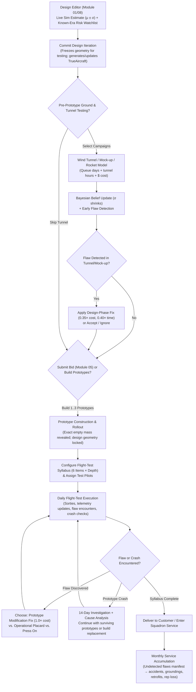

# 06 — Uncertainty, Wind Tunnel, Prototype, Flight Test & Hidden Flaws

> Status: v1.0 | Owner: Module 06 (`sim/mic/testing`) | Conforms to `00_conventions.md` v1.0 & `03_tech_effect_keys.md` v1.0

---

## 1. Purpose & Player Fantasy

In real 1945–1960 aircraft development, **nobody knew what an airplane would actually do until it was built and flown**—and sometimes not until squadron pilots died in it. Convair's calculations promised the YF-102 would reach Mach 1.25; in October 1953 it hit a transonic drag wall at Mach 0.98 until Richard Whitcomb's NACA slotted-throat wind tunnel and the Area Rule saved the program. North American's F-100A exceeded speed predictions on its first flight in May 1953, only to kill chief test pilot George Welch in October 1954 via roll-inertia coupling—a phenomenon NACA theorist William Phillips had predicted in 1948 (`NACA TN 1627`) that industry had largely ignored. Westinghouse's J40 turbojet crippled an entire generation of US Navy fighters (F3H-1, XF4D-1, XF10F-1) when promised thrust and reliability failed to materialize.

Module 06 turns aerodynamics and propulsion from a deterministic spreadsheet into **an engineering risk-management game**:

1. **Every number shown to the player is an `Estimate` (`value ± sigma`)**, never the ground truth (`TrueAircraft`).
2. **Design estimates have a realistic optimism bias and variance** driven by design novelty, immature technologies, the transonic regime, and the company's engineering staff quality.
3. **Information costs money and calendar time.** Wind-tunnel campaigns, mock-up inspections, static structural tests, and prototype flight tests reduce uncertainty via **conjugate Bayesian updating** and expose **Hidden Flaws** before they become fleet-grounding disasters.
4. **Testing has diminishing returns and physical blind spots.** Before slotted-throat transonic tunnels (`testing.transonic_tunnel`, ~1950), conventional wind tunnels **choke** between Mach 0.85 and 1.20—forcing the player to gamble on expensive NACA Wallops rocket-boosted free-flight drop models (`testing.rocket_model_testing`), limited transonic bump tests, or full-scale flight testing.
5. **When to freeze, bid, and commit to production is a high-stakes trade-off:**
   - **Bid early (Sim only):** Fast and cheap, and optimistic estimates make it easier to promise high numbers—but if `TrueAircraft` falls short of contract guarantees at delivery, the company suffers severe contract penalties and reputation loss.
   - **Test thoroughly (Wind Tunnel + Full 6-Item Flight Syllabus):** Exposes flaws when fixes cost $50k–$250k on the drawing board or prototype rather than $5M+ in fleet retrofits and groundings—but tunnel queues and flight-test months eat into tight `proposal_due`, `first_flight_due`, and `ioc_due` deadlines.
   - **Fix vs. Placard vs. Accept:** When a flaw is discovered, the player chooses between an engineering redesign (money, days, weight/drag trade-off), a flight-manual operating restriction ("placard"—free and fast, but permanently caps performance), or pressing on into service with unresolved risk.

---

## 2. Scope

### 2.1 In Scope (MVP: US 1945–1960)
- **Dual-representation architecture:** `TrueAircraft` (hidden ground truth of underlying physical driver multipliers, derived performance report, and active hidden flaws) vs. `EstimateReport` (player-facing `Estimate` objects for all 24 `PerformanceReport` keys plus a risk watchlist).
- **Deterministic counter-based hashing & 5D value noise:** Guarantees that (a) Python and C# produce identical truth values, (b) tweaking wing sweep by $0.2^\circ$ or area by $0.5\text{ m}^2$ smoothly shifts truth rather than rerolling luck (`save-scum` proof), and (c) flaw triggers are monotonic with respect to risk parameters.
- **10 underlying physical error drivers:** Zero-lift drag ($C_{D0}$), wave drag ($C_{Dw}$), induced drag ($K_{ind}$), maximum lift ($C_{L,\max}$), structural empty mass ($m_{\text{empty}}$), installed thrust ($T_{\text{inst}}$), specific fuel consumption ($\text{TSFC}$), flyaway unit cost ($C_{\text{unit}}$), R&D cost ($C_{\text{dev}}$), and maintenance man-hours ($\text{MMH/FH}$).
- **Experience & novelty ledger:** Company-specific and industry-wide familiarity across 13 historical novelty features (swept wings, high sweep, delta planform, thin wings, transonic speed, supersonic level flight, Mach 2+, afterburner, area ruling, T-tail, variable intakes, radar FCS, titanium structure).
- **Information sources:**
  1. Built-in conceptual simulator (`sim`)
  2. Wind-tunnel & ground test campaigns (`low_speed_tunnel`, `transonic_bump`, `rocket_model`, `transonic_slotted`, `supersonic_tunnel`, `spin_tunnel`, `flutter_model`, `engine_altitude_cell`, `mockup_review`, `static_structural`) across Company-Owned, NACA (Langley/Ames/Lewis/Wallops), and USAF AEDC facilities
  3. Prototype construction & rollout weighing (1–3 prototypes)
  4. **6 Flight-Test Syllabus Items** (`low_speed`, `speed_envelope`, `altitude_envelope`, `maneuver`, `high_aoa_spin`, `weapons_stores`) at selectable depth (`light`, `standard`, `thorough`)
  5. Operational squadron service entry & monthly fleet hazard accumulation
- **34 historical hidden flaws** covering aerodynamics, aeroelasticity, stability/control, propulsion/inlet integration, structures, systems, and carrier/ergonomics, mapped onto the 11 canonical `testing.flaw_incidence.<family>` keys in `03_tech_effect_keys.md` §2.6.
- **Test-pilot roster & flight-test incident simulation:** Hiring pool, skill/experience progression, personality traits (`engineer_pilot`, `cautious`, `daring`, `carrier_qualified`), near-miss vs. crash resolution, ejection/bailout survival (`systems.ejection_seat`), and prototype loss/investigation delays.

### 2.2 Out of Scope for MVP (Deferred to Later Phases)
- Real-time 3D flight visuals or player stick-and-rudder flight control (Phase 6 JSBSim integration per GDD §12.2).
- Competitive fly-off air-combat maneuvering (ACM) dogfight mini-game (MVP fly-offs evaluate updated `Estimate`/`TrueAircraft` data from flight testing).
- False-positive wind-tunnel artifacts (in MVP, tunnel errors are captured continuously via the systematic tunnel noise floor $\sigma_{\text{floor}}$ rather than discrete phantom flaw cards).

---

## 3. Player-Facing Flow



### 3.1 Step-by-Step UX & Information Revealed
1. **In the Design Editor (Pre-Commit):**
   - All 24 `PerformanceReport` metrics display as `Estimate` bars: point estimate `value`, $1\sigma$ uncertainty band (`±sigma`), and source badge (`sim`).
   - A tooltip on the `sim` badge reminds the player: *"Preliminary slide-rule and simulator estimates historically carry an optimistic bias on novel configurations until verified in the wind tunnel or flight test."*
   - **Risk Watchlist Panel:** Lists potential design flaws whose `known_from_year <= current_year` and whose computed trigger probability $P_{\text{trig}} \ge 0.12$. Displayed as qualitative bands (`Low 12–24%`, `Moderate 25–44%`, `High 45–69%`, `Severe ≥70%`). Phenomena not yet discovered by航空 science (e.g., `inertia_coupling` before 1954, `area_rule_drag_pinch` before 1952) are **hidden from the pre-test watchlist** (`"Unknown high-speed regime risks"` warning shown instead).
2. **Wind-Tunnel & Ground Campaign Selection:**
   - Player selects from 10 campaign types, chooses provider (`own` facility if built, `naca` for low-cost/long-queue government tunnels, or `aedc` from 1956 for fast/paid USAF testing), and selects depth (`brief`, `standard`, `comprehensive`).
   - **Transonic Choking Rule:** If the player runs a conventional tunnel on a design with $\hat{M}_{\max} \ge 0.85$ before `testing.transonic_tunnel` is unlocked, the report flags `TRANSONIC CHOKING (M 0.85–1.20)`: $C_{Dw}$ is NOT updated, and transonic flaws (`mach_tuck`, `area_rule_drag_pinch`, `transonic_buffet`, `aileron_reversal`) cannot be detected unless the player uses `transonic_bump` or `rocket_model`.
3. **Prototype Construction & Rollout:**
   - Player orders $N_{\text{proto}} \in \{1, 2, 3\}$ prototypes. At rollout completion, the aircraft is weighed on scales and development invoices are tallied, immediately collapsing `empty_mass_kg` and `dev_cost_usd_estimate` uncertainty to near zero.
4. **Flight-Test Syllabus & Daily Sortie Log:**
   - Player selects which of the **6 Flight-Test Syllabus Items** to run (`low_speed`, `speed_envelope`, `altitude_envelope`, `maneuver`, `high_aoa_spin`, `weapons_stores`), sets depth (`light` $0.5\times$ sorties, `standard` $1.0\times$, `thorough` $1.6\times$), and assigns test pilots from the company roster.
   - As flights execute, narrative log entries are generated from `sim/data/testing/report_templates.json`:
     > *"Flight #14 (1953-11-18, Edwards AFB) — Pilot: Maj. R. Thorne. Item: Speed Envelope Expansion. At Mach 0.93 in a 15° dive from 35,000 ft, severe nose-down trim change (Mach tuck) exceeded elevator authority. Recovery effected by deploying speed brakes at 18,000 ft. Flaw identified: **Transonic Mach Tuck (Severity 3)**."*
5. **Service Entry & Operational Feedback:**
   - Once delivered, squadron flight hours accumulate monthly. Any unfixed hidden flaws remaining in `TrueAircraft` roll against a Poisson fleet hazard process. When a flaw manifests in squadron service, it triggers squadron accidents, mandatory fleet groundings (for Severity $\ge 4$), mandatory retrofit bills ($2.2\times$ base fix cost + per-aircraft kit cost), and customer reputation damage.

---

## 4. Data Schemas

### 4.1 `Estimate` and `EstimateReport`
Conforms to `00_conventions.md` §4.1 and §4.4:
```json
{
  "value": 1.08,
  "sigma": 0.065,
  "source": "tunnel",
  "unit": "mach"
}
```
- `source`: `"sim" | "tunnel" | "flight" | "service"`. (Ground tests such as mock-up, static structural, and altitude engine cell report under `"tunnel"` per §4.1 contract; see §11 for optional `"ground"` enum extension.)
- `EstimateReport`: dictionary mapping all 23 scalar keys of `PerformanceReport` to `Estimate` objects, plus `ps_grid` (each cell holds `{value, sigma}`), `carrier_suitability` (`{suitable: bool, reasons: list[str], confidence: float}`), and `watchlist` (`list[WatchlistEntry]`).

### 4.2 `DriverBelief` & `TrueDriverState`
Module 06 models uncertainty on **10 log-space physical drivers** $d \in \mathcal{D}$. Let $\theta_d = \ln(f_d)$ be the true log-multiplier on driver $d$ (where $f_d = 1.0 \iff \theta_d = 0$ is the nominal simulator calculation from Module 01/02):

| Driver ID (`d`) | Physical Quantity | Unfavorable Sign ($s_d$) | Baseline $\sigma_{0,d}$ | Novelty Bias Rate $b_{0,d}$ | Primary Discipline |
|---|---|---:|---:|---:|---|
| `cd0` | Zero-lift parasite drag coefficient $C_{D0}$ | $+1$ | $0.055$ | $+0.025$ | `aero` |
| `cdw` | Transonic/supersonic wave drag $C_{Dw}$ | $+1$ | $0.095$ | $+0.055$ | `aero` |
| `kind` | Lift-induced drag factor $K = 1/(\pi AR e)$ | $+1$ | $0.050$ | $+0.020$ | `aero` |
| `clmax` | Maximum usable lift coefficient $C_{L,\max}$ | $-1$ | $0.055$ | $+0.022$ | `aero` |
| `mass` | Structural empty mass $m_{\text{empty}}$ | $+1$ | $0.040$ | $+0.030$ | `structures` |
| `thrust` | Installed net thrust $T_{\text{inst}}$ (incl. inlet $\pi_d$) | $-1$ | $0.040$ | $+0.020$ | `propulsion` |
| `tsfc` | Installed thrust specific fuel consumption | $+1$ | $0.035$ | $+0.018$ | `propulsion` |
| `cost_unit` | Flyaway unit manufacturing cost | $+1$ | $0.090$ | $+0.045$ | `structures` |
| `cost_dev` | Non-recurring engineering & prototype R&D cost | $+1$ | $0.120$ | $+0.065$ | `systems` |
| `maint` | Maintenance man-hours per flight hour ($\text{MMH/FH}$) | $+1$ | $0.110$ | $+0.050$ | `systems` |

```json
{
  "driver_id": "cdw",
  "mu_belief": 0.142,
  "var_belief": 0.0049,
  "best_source": "tunnel",
  "tunnel_floor_var_remaining": 0.0025
}
```

### 4.3 `HiddenFlaw` Catalog Entry (`sim/data/testing/flaws.json`)
Extends `00_conventions.md` §4.7 with complete trigger, hazard, truth-effect, placard, and fix schemas:
```json
{
  "id": "swept_wing_pitch_up",
  "name": "Swept-Wing Sabre Dance / Pitch-Up",
  "family": "pitch_up",
  "category": "aerodynamics",
  "base_severity": 4,
  "known_from_year": 1949,
  "unknown_symptom_label": "Unexplained violent high-alpha nose-up departure",
  "historical_examples": ["F-86A/E Sabre", "F-100A Super Sabre", "F-101A Voodoo"],
  "max_prob": 0.85,
  "novelty_features": ["swept_wing", "high_sweep", "t_tail"],
  "trigger": {
    "base": 0.04,
    "gates": [
      {"feature": "sweep_deg", "min": 22.0, "full": 32.0}
    ],
    "ramps": [
      {"feature": "shortal_maggin_excess", "x0": -0.5, "x1": 1.5, "weight": 0.42}
    ],
    "flags": [
      {"feature": "is_t_tail", "add": 0.22}
    ],
    "multipliers": [
      {"feature": "has_le_slats", "mul": 0.45},
      {"feature": "has_wing_fences", "mul": 0.55},
      {"feature": "has_sawtooth_le", "mul": 0.50}
    ]
  },
  "detect_prob_by_source": {
    "sim": 0.08,
    "low_speed_tunnel": 0.35,
    "transonic_slotted": 0.50,
    "spin_tunnel": 0.40,
    "flight:low_speed": 0.45,
    "flight:maneuver": 0.82,
    "flight:high_aoa_spin": 0.88
  },
  "flight_incident": {
    "encounter_weight": 0.35,
    "crash_prob_given_encounter": 0.18
  },
  "truth_effects": {
    "driver_log_deltas": {},
    "metric_multipliers": {
      "instantaneous_turn_dps_m08_4572m": 0.86,
      "sustained_turn_dps_m08_4572m": 0.92
    }
  },
  "placard": {
    "name": "AoA / G-Limiter Placard",
    "metric_multipliers": {
      "instantaneous_turn_dps_m08_4572m": 0.80,
      "sustained_turn_dps_m08_4572m": 0.88,
      "max_load_factor_g": 0.85
    },
    "residual_hazard_factor": 0.25
  },
  "service_hazard": {
    "manifest_rate_per_1000fh": 0.55,
    "accident_rate_per_1000fh": 0.18,
    "grounding_days": 45,
    "rep_penalty": 8.0
  },
  "fixes": [
    {
      "id": "wing_fences",
      "name": "Install Boundary-Layer Wing Fences",
      "available_year": 1948,
      "required_tech": null,
      "base_cost_1950_usd": 45000.0,
      "retrofit_kit_1950_usd": 1800.0,
      "fix_days": 21,
      "residual_factor": 0.20,
      "driver_log_deltas": {"cd0": 0.015, "mass": 0.004},
      "metric_multipliers": {}
    },
    {
      "id": "sawtooth_le_dogtooth",
      "name": "Sawtooth / Dogtooth Leading-Edge Extension",
      "available_year": 1952,
      "required_tech": null,
      "base_cost_1950_usd": 95000.0,
      "retrofit_kit_1950_usd": 4200.0,
      "fix_days": 38,
      "residual_factor": 0.10,
      "driver_log_deltas": {"cd0": 0.008, "mass": 0.006},
      "metric_multipliers": {}
    },
    {
      "id": "auto_le_slats",
      "name": "Retrofit Automatic Leading-Edge Slats",
      "available_year": 1947,
      "required_tech": "aero.le_slats",
      "base_cost_1950_usd": 140000.0,
      "retrofit_kit_1950_usd": 6500.0,
      "fix_days": 50,
      "residual_factor": 0.08,
      "driver_log_deltas": {"cd0": 0.012, "clmax": 0.08, "mass": 0.018},
      "metric_multipliers": {}
    }
  ]
}
```

### 4.4 `ActiveFlawState` (Per Design Lineage)
```json
{
  "flaw_id": "swept_wing_pitch_up",
  "severity": 4,
  "detected": true,
  "detected_day": 3240,
  "detected_source": "flight:maneuver",
  "status": "fixed",
  "applied_fix_id": "sawtooth_le_dogtooth",
  "residual_factor": 0.10,
  "manifested_in_service": false
}
```

### 4.5 `TestPilot` (`sim/mic/testing/pilots.py`)
```json
{
  "id": "pilot_004",
  "name": "Maj. Richard 'Dick' Thorne",
  "age": 31,
  "hired_year": 1951,
  "skill": 82.0,
  "experience": 68.0,
  "traits": ["engineer_pilot", "cautious"],
  "salary_annual_usd": 18500.0,
  "status": "active",
  "injured_until_day": 0,
  "assigned_prototype_idx": 0,
  "flights_flown": 42
}
```

---

## 5. Algorithms

### 5.1 Deterministic Counter-Based Hashing & 5D Value Noise (`hashing.py`)

To prevent the "micro-tweak reroll exploit" (where a player alters wingspan by $0.01\text{ m}$ to reroll bad wind-tunnel or flaw draws) while ensuring exact cross-language reproducibility between Python (`float64`/`uint64`) and C# (`double`/`ulong`), `TrueAircraft` draws **never** consume sequential state from the session RNG stream. Instead, they use a stateless counter-based hash built from **FNV-1a 64** and **SplitMix64**.

#### 5.1.1 Primitives
Given an ASCII string $S$, the 64-bit FNV-1a digest is:
$$h_0 = \text{0xcbf29ce484222325}, \quad h_{k} = \left((h_{k-1} \oplus \text{byte}_k) \times \text{0x100000001b3}\right) \bmod 2^{64}$$

The SplitMix64 mixing function $\text{mix64}(x)$ for a 64-bit unsigned integer $x$ is:
$$\begin{aligned}
z_1 &= ((x + \text{0x9e3779b97f4a7c15}) \oplus ((x + \text{0x9e3779b97f4a7c15}) \gg 30)) \times \text{0xbf58476d1ce4e5b9} \bmod 2^{64} \\
z_2 &= (z_1 \oplus (z_1 \gg 27)) \times \text{0x94d049bb133111eb} \bmod 2^{64} \\
\text{mix64}(x) &= z_2 \oplus (z_2 \gg 31)
\end{aligned}$$

A tuple of keys $(k_1, k_2, \dots, k_m)$ hashes to $H(k_1, \dots, k_m)$ by folding $h \leftarrow \text{mix64}(h \oplus \text{fnv1a}(k_i))$ starting from `campaign_seed`.
- **Standard uniform $u \in (0, 1)$:**
  $$u = \frac{(H \gg 11) + 0.5}{2^{53}}$$
  (Uses the top 53 bits and $+0.5$ offset so $u \in [2^{-54}, 1 - 2^{-54}]$, strictly avoiding $0$ and $1$.)
- **Standard normal $z \sim \mathcal{N}(0, 1)$:** Box-Muller transform on two independent uniforms $u_1 = U(\text{key}, 0)$, $u_2 = U(\text{key}, 1)$:
  $$z = \sqrt{-2 \ln(u_1)} \cos(2\pi u_2)$$

#### 5.1.2 Coarse Design Signature & Continuous 5D Value Noise
Every `AircraftDesign` is mapped to:
1. **Coarse Categorical Signature ($\text{sig}_{\text{cat}}$):**
   $$\text{sig}_{\text{cat}} = \text{ "{company\_id}:{planform\_class}:{is\_t\_tail}:{intake\_type}:{carrier\_capable}:{engine\_id}" }$$
   where `planform_class` is `"delta"` if `is_delta`, `"swept"` if $\Lambda_{c/4} \ge 20^\circ$, else `"straight"`.
2. **Normalized 5D Continuous Coordinate Vector $\mathbf{x} \in \mathbb{R}^5$:**
   $$x_1 = \frac{\Lambda_{c/4\text{,deg}}}{15^\circ}, \quad x_2 = \frac{t/c}{0.03}, \quad x_3 = \frac{AR}{1.5}, \quad x_4 = \frac{\ln(m_{\text{empty,nom}} / 2000\text{ kg})}{0.35}, \quad x_5 = \frac{M_{\max,\text{nom}}}{0.25}$$

For each driver $d$, the standard-normal draw $Z_d(\text{design})$ blends a categorical signature component $Z_{\text{cat},d}$ and a $2^5 = 32$-corner multilinear value-noise field $Z_{\text{vn},d}(\mathbf{x})$:
$$Z_{\text{vn},d}(\mathbf{x}) = \frac{\sum_{\mathbf{c} \in \{0,1\}^5} \left(\prod_{j=1}^5 w_j(c_j, \alpha_j)\right) Z_{\text{lattice}}(d, \lfloor \mathbf{x} \rfloor + \mathbf{c})}{\sqrt{\prod_{j=1}^5 \left((1 - \alpha_j)^2 + \alpha_j^2\right)}}$$
where $\alpha_j = x_j - \lfloor x_j \rfloor \in [0, 1)$ and $w_j(0, \alpha_j) = 1 - \alpha_j$, $w_j(1, \alpha_j) = \alpha_j$. The denominator normalizes the interpolated variance so $\text{Var}[Z_{\text{vn},d}(\mathbf{x})] \equiv 1.0$ everywhere, including midpoints between lattice vertices!

Finally, blending categorical and continuous components with weight $\rho_{\text{cat}} = 0.50$:
$$Z_d(\text{design}) = \sqrt{\rho_{\text{cat}}}\, Z_{\text{cat},d}(\text{sig}_{\text{cat}}, d) + \sqrt{1 - \rho_{\text{cat}}}\, Z_{\text{vn},d}(\mathbf{x})$$
Because $Z_{\text{cat},d}$ is invariant within a configuration class and $Z_{\text{vn},d}(\mathbf{x})$ is Lipschitz continuous with unit variance, a $1\%$ change in geometry alters $Z_d$ by $< 0.03\sigma$.

---

### 5.2 Unified Feature & Diagnostic Vector (`features.py`)

Module 06 consumes a flat dictionary `FeatureVector` assembled from `AircraftDesign`, `PerformanceReport` (nominal), `aero_diagnostics` (Module 01), `engine_diagnostics` (Module 02), and `TechContext` (Module 03). When running standalone or before Module 01/02 diagnostics are attached, `features.py` computes exact physics fallbacks:

1. **Shortal–Maggin Swept-Wing Pitch-Up Excess (`shortal_maggin_excess`):**
   Per Shortal & Maggin (*NACA TN 1093*, 1946) and Raymer §4.2, the critical aspect ratio above which swept wings experience tip stall and nose-up pitch instability is:
   $$AR_{\text{crit}}(\Lambda_{c/4}, \lambda) = 5.8 \exp\!\left(-0.0365\,\Lambda_{c/4,\text{deg}}\right) \cdot \left(1.0 + 0.35(\lambda - 0.5)\right)$$
   $$\text{shortal\_maggin\_excess} = AR - AR_{\text{crit}}(\Lambda_{c/4}, \lambda)$$
   (Positive values indicate the wing lies in the unstable pitch-up region above the Shortal–Maggin boundary.)
2. **Korn Drag-Divergence Mach & Transonic Margin (`m_dd`, `mach_dd_excess`):**
   $$M_{dd} = \frac{\kappa_A}{\cos\Lambda_{c/4}} - \frac{t/c}{\cos^2\Lambda_{c/4}} - \frac{C_{L,\text{design}}}{10\cos^3\Lambda_{c/4}}, \quad \kappa_A = 0.87$$
   $$\text{mach\_dd\_excess} = M_{\max,\text{nom}} - M_{dd}$$
3. **Wave-Drag Area-Rule Ratio (`wave_drag_ratio`):**
   Ratio of actual aircraft transonic wave drag to an ideal Sears–Haack body of equal volume and length ($D_{\text{wave}} / D_{\text{SH}}$):
   $$\text{wave\_drag\_ratio} = \max\!\left(1.05,\; 2.35 \left(1.0 - 0.55 \cdot \mathbb{I}_{\text{area\_ruled}} \cdot \max(0.5, \eta_{\text{area\_rule}})\right) \left(\frac{t/c}{0.06}\right)^{0.35} \left(\frac{d_{\text{fus}}/L_{\text{fus}}}{0.10}\right)^{0.25}\right)$$
4. **Aerodynamic Center Transonic Shift (`ac_shift_mac`):**
   $$\Delta x_{ac}/\bar{c} = 0.14 \cdot \text{clamp}\!\left(\frac{M_{\max,\text{nom}} - 0.80}{0.35}, 0, 1\right) \cdot \left(1.0 + 0.3 \cdot \mathbb{I}_{\text{delta}}\right)$$
5. **Phillips Roll-Inertia Coupling Index (`inertia_coupling_index`):**
   Per Phillips (*NACA TN 1627*, 1948), slender fuselages with short, thin wings have $(I_{yy} - I_{xx})/I_{zz} \to 1$, causing yaw/pitch divergence during rapid rolls:
   $$I_{\text{couple}} = \left(\frac{L_{\text{fus}}}{b}\right)^2 \cdot \frac{\max(0.7, M_{\max,\text{nom}})}{10 \cdot \max(0.03, V_v)}$$
6. **Aeroelastic Torsional Stiffness Deficit (`torsion_flex_index`):**
   $$\text{torsion\_flex\_index} = \frac{q_{\text{dive}}}{10^5\text{ Pa}} \cdot \frac{AR^{1.5}}{(10 \cdot t/c)^2 \cos^2\Lambda_{c/4}}$$
   where $q_{\text{dive}} = \frac{1}{2}\rho_{\text{SL}} (1.15 \cdot M_{\max,\text{SL}} \cdot a_{\text{SL}})^2$.
7. **Engine Diagnostics (`engine_maturity`, `compressor_stall_margin`, `flameout_alt_margin_m`, `ab_maturity`):**
   - `engine_maturity` $\in [0, 1]$: $0.15$ for brand-new R&D engine ($<200$ test-cell hours), rising to $1.0$ at $2500+$ fleet hours.
   - `compressor_stall_margin` $\in [0.04, 0.30]$: fractional surge margin $\Delta \pi_{\text{surge}} / \pi_c$.
   - `flameout_alt_margin_m`: combustor relight ceiling minus nominal `service_ceiling_m` (negative means aircraft ceiling exceeds combustor relight envelope).

---

### 5.3 Novelty, Regime, Maturity, and Staff Quality (`novelty.py`, `truth.py`)

#### 5.3.1 Feature Unfamiliarity & Per-Driver Novelty $N_d$
Each of the 13 novelty features $f \in \mathcal{F}_{\text{nov}}$ (`sim/data/testing/novelty_features.json`) has an activation weight $a_f(\text{design}) \in [0, 1]$, a relevance map $w_{f,d} \ge 0$ to drivers $d$, and a list of historical US first-flight dates $\{t_{f,1}, t_{f,2}, \dots\}$.

At simulation date `date_day`:
- **Industry experience count $n_{\text{ind}}(f)$:** number of historical dates $t_{f,k} \le \text{date\_day}$.
- **Company experience score $n_{\text{comp}}(f)$:** accumulated by the company from completed wind-tunnel campaigns ($+0.25$), completed flight-test envelope items ($+0.50$), completed full test programmes ($+0.75$), and aircraft entering service ($+1.00$) that use feature $f$.

Unfamiliarity $U(f) \in [0.15, 1.0]$ decays exponentially with company and industry experience:
$$U(f) = 0.15 + 0.85 \left(0.65 \exp\!\left(-\frac{n_{\text{comp}}(f)}{1.8}\right) + 0.35 \exp\!\left(-\frac{n_{\text{ind}}(f)}{3.0}\right)\right)$$

The novelty score for driver $d$ is:
$$N_d = \sum_{f \in \mathcal{F}_{\text{nov}}} a_f(\text{design}) \cdot w_{f,d} \cdot U(f)$$

#### 5.3.2 Regime Difficulty Multiplier $R_d(M)$
The transonic drag-rise regime ($M \in [0.85, 1.15]$) is the peak of aerodynamic analytical difficulty in the 1945–1960 era. Let $M = M_{\max,\text{nom}}$. The base regime curve $r_{\text{mach}}(M)$ is piecewise linear through:
$$(0.70, 1.00) \to (0.85, 1.25) \to (0.98, 1.85) \to (1.15, 1.70) \to (1.60, 1.50) \to (2.20, 1.75)$$
Each driver $d$ has a regime sensitivity $\gamma_d \in [0, 1]$ (`cdw`: $1.0$, `cd0`: $0.55$, `kind`: $0.45$, `clmax`: $0.35$, `thrust`: $0.60$, `tsfc`: $0.35$, `mass`: $0.20$, `cost_unit`: $0.25$, `cost_dev`: $0.40$, `maint`: $0.30$):
$$R_d(M) = 1.0 + \gamma_d \left(r_{\text{mach}}(M) - 1.0\right)$$

#### 5.3.3 Tech Maturity Multiplier $M_{\text{tech}}$
From `TechContext.tech_maturity` (`03_tech_effect_keys.md` §1.2), let $m_{\min} = \min_{t \in \text{techs\_used}} \text{maturity}(t)$ (default $1.0$ if `techs_used` is empty) and $\bar{m}$ be the mean maturity across `techs_used`:
$$m_{\text{eff}} = 0.65\,m_{\min} + 0.35\,\bar{m}, \quad M_{\text{tech}} = 1.0 + k_{\text{mat}}(1.0 - m_{\text{eff}})$$
where $k_{\text{mat}} = 0.85$ (tunable).

#### 5.3.4 Engineering Quality Multiplier $Q_d$
Given the company's engineering discipline rating $q_{\text{disc}} \in [0, 100]$ (default $50.0$) for the driver's primary discipline (`aero`, `structures`, `propulsion`, `systems`):
$$Q_d = \text{clamp}\!\left(1.30 - 0.006\,q_{\text{disc}},\; 0.70,\; 1.35\right)$$

#### 5.3.5 Prior Distribution & True Driver Realization
For each driver $d \in \mathcal{D}$, the true error distribution has systematic optimism bias $\mu_{0,d}$ (shifted in the unfavorable direction $s_d \in \{-1, +1\}$) and prior standard deviation $\sigma_{\text{prior},d}$:
$$\mu_{0,d} = s_d \cdot b_{0,d} \cdot N_d \cdot M_{\text{tech}} \cdot Q_d \cdot \text{ctx.get}(\text{"testing.sim\_sigma\_factor"})$$
$$\sigma_{\text{prior},d} = \sigma_{0,d} \cdot \left(1.0 + \alpha_{\text{nov}} N_d\right) \cdot R_d(M) \cdot M_{\text{tech}} \cdot Q_d \cdot \text{ctx.get}(\text{"testing.sim\_sigma\_factor"})$$
where $\alpha_{\text{nov}} = 0.42$ (tunable).

The **base truth** log-multiplier for driver $d$ is:
$$\theta_{d,\text{base}}^{\text{true}} = \text{clamp}\!\left(\mu_{0,d} + \sigma_{\text{prior},d} \cdot Z_d(\text{design}),\; -0.55,\; +0.65\right)$$

And adding any active hidden-flaw driver shifts $\Delta\theta_{d,\text{flaw}}$ (weighted by the flaw's current `residual_factor` $\rho_f$, initially $1.0$):
$$\theta_{d}^{\text{true}} = \theta_{d,\text{base}}^{\text{true}} + \sum_{f \in \text{ActiveFlaws}} \rho_f \cdot \Delta\theta_{d,f}$$

#### 5.3.6 Initial Player Belief (`sim` Source)
When a design is first evaluated in the built-in simulator:
- The player's point estimate starts at the nominal simulator output ($\hat{\mu}_{d,0} = 0.0$), because the company does not know its own optimism bias $\mu_{0,d}$ prior to testing.
- The player's initial RMS uncertainty variance incorporates both random spread and expected uncalibrated bias:
  $$V_{d,0} = \sigma_{\text{prior},d}^2 + \mu_{0,d}^2$$

---

### 5.4 Mapping Drivers & Flaws to `PerformanceReport` Metrics

To evaluate `TrueAircraft` and `EstimateReport` rapidly and deterministically (and when running standalone before Module 01 re-solves polars), each scalar metric $m$ in `PerformanceReport` has a log-elasticity row $E_{m,d} = \frac{\partial \ln m}{\partial \theta_d}$ (`sim/data/testing/drivers.json`), with separate supersonic rows for `max_mach_sl`, `max_mach_alt`, and `ps_mps_m09_4572m_1g` when $M_{\max,\text{nom}} \ge 1.0$.

- **True Metric Value:**
  $$m^{\text{true}} = m^{\text{nom}} \cdot \exp\!\left(\sum_{d \in \mathcal{D}} E_{m,d}\,\theta_d^{\text{true}}\right) \cdot \prod_{f \in \text{ActiveFlaws}} \left(M_{m,f}^{\text{flaw}}\right)^{\rho_f} \cdot \prod_{f \in \text{FixedFlaws}} M_{m,f}^{\text{fix}} \cdot \prod_{f \in \text{PlacardedFlaws}} M_{m,f}^{\text{placard}}$$
- **Player Estimated Metric Value & Uncertainty (`Estimate`):**
  Let $\mathcal{K}$ be the set of flaws currently **detected** by the player. The player's estimated value applies only known/detected flaw multipliers, fixes, and placards:
  $$\hat{m} = m^{\text{nom}} \cdot \exp\!\left(\sum_{d \in \mathcal{D}} E_{m,d}\,\hat{\mu}_d\right) \cdot \prod_{f \in \mathcal{K}} \left(M_{m,f}^{\text{flaw}}\right)^{\rho_f} \cdot \prod_{f \in \text{FixedFlaws}} M_{m,f}^{\text{fix}} \cdot \prod_{f \in \text{PlacardedFlaws}} M_{m,f}^{\text{placard}}$$
  By first-order delta propagation, the relative variance in log-space is $\sigma_{\ln m}^2 = \sum_{d \in \mathcal{D}} E_{m,d}^2\,V_d$, yielding the metric standard deviation:
  $$\hat{\sigma}_m = |\hat{m}| \cdot \sqrt{\sum_{d \in \mathcal{D}} E_{m,d}^2\,V_d}$$

---

### 5.5 Bayesian Variance Reduction Across Information Sources (`sources.py`, `belief.py`)

When an information source $s$ observes a subset of drivers $\mathcal{D}_s \subseteq \mathcal{D}$ with effective measurement variance $\sigma_{\text{meas},s,d}^2$, it draws a noisy measurement around the true driver state:
$$y_{s,d} = \theta_d^{\text{true}} + \sigma_{\text{meas},s,d} \cdot Z_{\text{meas}}(\text{lineage\_id}, s, \text{campaign\_seq}, d)$$
and updates the player's Gaussian belief $(\hat{\mu}_d, V_d)$ via **conjugate Bayesian normal updating**:
$$V_d^{\text{new}} = \frac{1}{\frac{1}{V_d^{\text{old}}} + \frac{1}{\sigma_{\text{meas},s,d}^2}}, \qquad \hat{\mu}_d^{\text{new}} = V_d^{\text{new}} \left(\frac{\hat{\mu}_d^{\text{old}}}{V_d^{\text{old}}} + \frac{y_{s,d}}{\sigma_{\text{meas},s,d}^2}\right)$$

#### 5.5.1 Wind-Tunnel & Ground Campaign Measurement Noise & Tunnel Floor
Scale-model wind tunnels have two physical limitations:
1. **Diminishing returns with tunnel hours ($H$):** Running more hours reduces random measurement scatter, governed by reference hours $H_{\text{ref}}$ and depth multiplier $m_{\text{depth}} \in \{0.5\text{ (brief)}, 1.0\text{ (standard)}, 2.0\text{ (comprehensive)}\}$.
2. **Reynolds-number / wall-interference systematic floor ($\sigma_{\text{floor},s,d}$):** Even infinite wind-tunnel hours cannot reduce uncertainty below the scale-model extrapolation floor $\sigma_{\text{floor},s,d}$.

Specifically, for a tunnel campaign of $H = m_{\text{depth}} H_{\text{ref}}$ hours:
$$\sigma_{\text{meas},s,d} = \text{ctx.get}(\text{"testing.tunnel\_sigma\_factor"}) \cdot q_{\text{provider}} \cdot \sqrt{\sigma_{\text{floor},s,d}^2 + \frac{\sigma_{\text{ref},s,d}^2}{m_{\text{depth}}}}$$
where provider quality $q_{\text{provider}}$ is $1.00$ for NACA, $0.88$ for USAF AEDC (1956+), and $1.05$ for company-owned tunnels. To prevent repeated identical tunnel runs from bypassing the Reynolds-number floor, `V_d` updated solely by `"tunnel"` sources is clamped so $V_d \ge \sigma_{\text{floor},s,d}^2$ until `"flight"` or `"service"` data arrives.

#### 5.5.2 Summary of the 10 Pre-Flight Campaign Types (`sim/data/testing/sources.json`)

| Campaign ID | Name | Tech Gate / Era | Drivers Measured ($\sigma_{\text{ref}} / \sigma_{\text{floor}}$) | Model Cost (1950 $) | Fab Days | Ref Hours $H_{\text{ref}}$ |
|---|---|---|---|---:|---:|---:|
| `low_speed_tunnel` | Subsonic Wind Tunnel ($M \le 0.4$) | Available 1945 | `clmax` ($0.024/0.014$), `kind` ($0.026/0.015$), `cd0` ($0.032/0.018$) | $35,000 | 30 | 80 |
| `transonic_bump` | NACA Transonic Wing-Flow / Bump | Available 1946 | `cdw` ($0.065/0.042$), `cd0` ($0.045/0.028$) | $45,000 | 35 | 60 |
| `rocket_model` | Free-Flight Rocket Drop Model (Wallops) | `testing.rocket_model_testing` | `cdw` ($0.038/0.022$), `cd0` ($0.035/0.020$) | $75,000 | 45 | 40 |
| `transonic_slotted` | Slotted-Throat Transonic Tunnel ($M 0.7\text{–}1.3$) | `testing.transonic_tunnel` | `cdw` ($0.025/0.012$), `cd0` ($0.024/0.012$), `kind` ($0.024/0.013$), `clmax` ($0.028/0.015$) | $65,000 | 45 | 100 |
| `supersonic_tunnel` | Continuous Supersonic Tunnel ($M 1.2\text{–}2.5$) | `testing.supersonic_tunnel` | `cdw` ($0.028/0.014$), `cd0` ($0.028/0.015$), `thrust` ($0.032/0.018$) | $80,000 | 50 | 100 |
| `spin_tunnel` | 20-ft Vertical Free-Spin Tunnel | Available 1945 | `clmax` ($0.040/0.025$) + high-AoA/spin flaws | $20,000 | 25 | 40 |
| `flutter_model` | Dynamic Aeroelastic Flutter Model | Available 1947 | `mass` ($0.035/0.020$) + flutter/reversal flaws | $55,000 | 40 | 60 |
| `engine_altitude_cell` | Propulsion Altitude Test Cell | Available 1945 | `thrust` ($0.018/0.009$), `tsfc` ($0.016/0.008$), `maint` ($0.055/0.030$) | $30,000 | 20 | 80 |
| `mockup_review` | Full-Scale Engineering Mock-up Board | Available 1945 | `mass` ($0.028/0.016$), `maint` ($0.050/0.028$), `cost_unit` ($0.055/0.030$) | $40,000 | 30 | 24 |
| `static_structural` | Static Ultimate-Load Structural Test Article | Available 1945 | `mass` ($0.015/0.008$), `cost_unit` ($0.045/0.025$) + structural flaws | $110,000 | 60 | 40 |

#### 5.5.3 Access Providers, Queues, and Costs
- **Company-Owned Facility (`own`):** Requires `CompanyState.facilities.wind_tunnel_level` $\ge 1$ (for `low_speed_tunnel`), $\ge 2$ + `testing.transonic_tunnel` (for `transonic_slotted`), or $\ge 3$ + `testing.supersonic_tunnel` (for `supersonic_tunnel`). Queue wait = $0\text{ days}$; operating rate = $16\text{ h/day}$; hourly operating cost = $\$350\text{–}\$1,200/\text{h}$ (1950 $).
- **NACA Government Tunnel (`naca`):** Nominal hourly fee = $\$180/\text{h}$ (subsidized for US industry), operating rate = $8\text{ h/day}$, but subject to national queue wait:
  $$T_{\text{queue,NACA}} = \text{round}\!\left((75 + 30 \cdot U_{\text{queue}}) \cdot (0.50\text{ if active\_military\_contract else }1.00)\right)\text{ days}$$
- **USAF AEDC Tullahoma (`aedc`, available $\ge 1956-01-01$):** Hourly fee = $\$1,400/\text{h}$, operating rate = $12\text{ h/day}$, queue wait = $\text{round}((30 + 15 \cdot U_{\text{queue}}) \cdot (0.50\text{ if active\_military\_contract else }1.00))\text{ days}$.

#### 5.5.4 Prototype Construction & Rollout Weighing (`prototype.py`)
Building $N_{\text{proto}} \in \{1, 2, 3\}$ prototypes costs:
$$C_{\text{proto}}(N_{\text{proto}}) = m_{\text{flyaway}}^{\text{true}} \cdot \left(3.2 + 1.8(N_{\text{proto}} - 1)\right)$$
and requires build duration:
$$T_{\text{proto}} = \text{round}\!\left(\left(240 + 55\ln\!\left(\frac{m_{\text{empty,nom}}}{3000\text{ kg}}\right) + 38\,\bar{N}\right) \cdot Q_{\text{structures}} \cdot \exp(0.35\,\theta_{\text{cost\_dev}}^{\text{true}})\right)\text{ days}$$
At rollout completion, weighing the aircraft and auditing prototype shop invoices immediately performs a high-precision Bayesian observation on `mass` ($\sigma_{\text{meas}} = 0.005$), `cost_dev` ($\sigma_{\text{meas}} = 0.015$), and `cost_unit` ($\sigma_{\text{meas}} = 0.030$).

#### 5.5.5 The 6 Flight-Test Syllabus Items (`flight_test.py`)
Conforming to GDD §12.1, the prototype flight-test syllabus comprises **6 selectable items**. Each item $k$ has standard sortie count $F_{k,\text{std}}$, base turnaround days per sortie $d_k$ (scaled by `testing.flight_test_time_factor`), base cost per sortie $c_k$ (1950 $, scaled by $(m_{\text{empty,nom}}/5000)^{0.6}$ and inflation), base crash hazard per sortie $h_{0,k}$, and driver measurement precisions $\sigma_{\text{ref},k,d}$ (scaled by `testing.flight_sigma_factor` / $\sqrt{\text{completion\_ratio}} \cdot q_{\text{pilot\_data}}$):

| Syllabus Item ID | Name (GDD §12.1) | Std Sorties $F_{k,\text{std}}$ | Days / Sortie $d_k$ | 1950 $ / Sortie | Base Crash Hazard $h_{0,k}$ | Drivers Measured ($\sigma_{\text{ref},k,d}$) |
|---|---|---:|---:|---:|---:|---|
| `low_speed` | Low-Speed, Take-off & Landing (incl. Carrier Approach if naval) | 22 | 2.2 | $8,500 | $0.0008$ | `clmax` ($0.010$), `kind` ($0.014$), `cd0` ($0.018$) |
| `speed_envelope` | High-Speed & Mach Dive Envelope Expansion | 30 | 2.8 | $12,000 | $0.0022$ | `cdw` ($0.008$), `cd0` ($0.009$), `thrust` ($0.014$) |
| `altitude_envelope` | High-Altitude, Climb & Service Ceiling | 20 | 2.5 | $10,000 | $0.0012$ | `thrust` ($0.009$), `tsfc` ($0.009$), `cd0` ($0.016$) |
| `maneuver` | High-G Turn, Load Factor & Energy Agility | 26 | 2.6 | $11,000 | $0.0018$ | `kind` ($0.009$), `clmax` ($0.011$), `mass` ($0.008$) |
| `high_aoa_spin` | High-Alpha Stall & Intentional Spin Recovery | 18 | 3.0 | $11,500 | $0.0032$ | `clmax` ($0.008$), `kind` ($0.015$) |
| `weapons_stores` | Armament Firing, Stores Separation & Avionics/FCS Shakedown | 24 | 2.5 | $13,000 | $0.0010$ | `maint` ($0.022$), `cost_unit` ($0.020$), `cd0` ($0.016$), `tsfc` ($0.014$) |

Depth multiplier on sorties: `light` $= 0.5\times$, `standard` $= 1.0\times$, `thorough` $= 1.6\times$. Multiple surviving prototypes ($N_{\text{proto}} \ge 2$) fly sorties in parallel when assigned active test pilots, dividing calendar duration by up to $N_{\text{active\_pilots}} \le N_{\text{proto}}$.

---

### 5.6 Hidden Flaw Generation, Detection, and Fixes (`flaws.py`)

#### 5.6.1 Flaw Trigger Probability Formula
For each flaw $f$ in `sim/data/testing/flaws.json`:
1. **Additive Core Score $S_{\text{add},f}$:**
   $$S_{\text{add},f} = p_{\text{base},f} + \sum_{r \in \text{ramps}_f} w_r \cdot \text{clamp}\!\left(\frac{x_{\text{feat}(r)} - x_{0,r}}{x_{1,r} - x_{0,r}},\; 0,\; 1\right) + \sum_{g \in \text{flags}_f} \Delta p_g \cdot \mathbb{I}_{\text{feat}(g)}$$
2. **Gate Multiplier $G_f$:**
   $$G_f = \prod_{k \in \text{gates}_f} \text{clamp}\!\left(\frac{x_{\text{feat}(k)} - x_{\min,k}}{x_{\text{full},k} - x_{\min,k}},\; 0,\; 1\right)$$
3. **Design & Tech Feature Multipliers $M_{\text{feat},f}$:**
   $$M_{\text{feat},f} = \prod_{m \in \text{multipliers}_f} \left(m_{\text{val}} \text{ if } \mathbb{I}_{\text{feat}(m)} \text{ else } 1.0\right)$$
4. **Novelty & Tech Incidence Multipliers:**
   Let $\bar{U}_f$ be the mean unfamiliarity $U(\nu)$ across the flaw's relevant `novelty_features`, and let $I_{\text{tech},f} = \text{ctx.get}(\text{"testing.flaw\_incidence."} + f.\text{family})$ (and additionally $\times \text{ctx.get}(\text{"mfg.quality\_defect\_factor"})$ if $f.\text{family} == \text{"manufacturing"}$, or $\div \text{ctx.get}(\text{"avionics.reliability\_factor"})$ if $f.\text{id} == \text{"radar\_fcs\_immaturity"}$):
   $$M_{\text{nov},f} = 0.75 + 0.65\,\bar{U}_f$$
5. **Final Trigger Probability $P_{\text{trig},f}$:**
   $$P_{\text{trig},f} = \text{clamp}\!\left(S_{\text{add},f} \cdot G_f \cdot M_{\text{feat},f} \cdot M_{\text{nov},f} \cdot I_{\text{tech},f},\; 0.0,\; p_{\max,f}\right)$$

#### 5.6.2 Monotonic Flaw Realization & Severity
Using the deterministic uniform draw $U_{\text{flaw}}(\text{sig}_{\text{cat}}, f.\text{id}) \in (0, 1)$:
- **Presence:** Flaw $f$ is present in `TrueAircraft` iff $U_{\text{flaw}} < P_{\text{trig},f}$.
  *(Monotonicity guarantee: reducing any risk parameter strictly reduces $P_{\text{trig},f}$, which can cure a flaw on a design iteration without ever introducing a new flaw!)*
- **Severity:**
  $$\text{severity}_f = \min\!\left(5,\; \text{base\_severity}_f + \mathbb{I}\!\left(U_{\text{flaw}} < 0.25\,P_{\text{trig},f}\right)\right)$$

#### 5.6.3 Complete 34-Flaw Historical Catalog (1945–1960)

Every flaw maps to one of the 11 canonical `testing.flaw_incidence.<family>` keys in `03_tech_effect_keys.md` §2.6:

| # | Flaw ID | Family (`03` §2.6) | Base Sev | Known Year | Primary Trigger Conditions | Best Detection Sources | Historical Reference & Primary Fix |
|---:|---|---|---:|---:|---|---|---|
| 1 | `swept_wing_pitch_up` | `pitch_up` | 4 | 1949 | $\Lambda_{c/4} \ge 22^\circ$, $AR > AR_{\text{crit}}$ (Shortal–Maggin), T-tail | `flight:maneuver` (0.82), `transonic_slotted` (0.50) | F-86, F-100A, F-101A; Wing fences, sawtooth LE, auto slats |
| 2 | `deep_stall_t_tail` | `pitch_up` | 5 | 1954 | `is_t_tail`, $\Lambda_{c/4} \ge 25^\circ$, low $AR$ wake immersion | `flight:high_aoa_spin` (0.85), `spin_tunnel` (0.55) | F-101 Voodoo, F-104; Stick pusher / AoA limiter, tail relocation |
| 3 | `inertia_roll_coupling` | `inertia_coupling` | 5 | 1954 | $M_{\max} \ge 0.95$, high $(L_{\text{fus}}/b)^2 / V_v$, no SAS | `flight:maneuver` (0.78), `flight:speed_envelope` (0.72) | F-100A (Welch crash 1954), X-3, F-104; Enlarged vertical fin, yaw damper |
| 4 | `supersonic_directional_instability` | `inertia_coupling` | 4 | 1953 | $M_{\max} \ge 1.25$, low $V_v$ ($C_{n\beta} \downarrow$ at high $M$) | `flight:speed_envelope` (0.82), `supersonic_tunnel` (0.58) | F-100C, F-102A, F8U; Ventral fins, enlarged dorsal fin |
| 5 | `transonic_mach_tuck` | `transonic_control_loss` | 3 | 1945 | $M_{\max} \ge 0.82$, $\Delta x_{ac}/\bar{c}$ high, no `all_moving_tail` | `flight:speed_envelope` (0.88), `transonic_slotted` (0.68) | P-80, F-86A; All-flying stabilator (F-86E), Mach trim compensator |
| 6 | `transonic_control_heaviness` | `transonic_control_loss` | 3 | 1946 | $M_{\max} \ge 0.84$, no `systems.powered_controls` | `flight:speed_envelope` (0.86), `flight:maneuver` (0.75) | Early P-80/F-84; Hydraulic irreversible boost (`systems.powered_controls`) |
| 7 | `transonic_buffet_boundary` | `transonic_control_loss` | 3 | 1947 | $t/c \ge 0.08$, $M_{\max} > M_{dd}$ | `flight:maneuver` (0.84), `transonic_slotted` (0.62) | F-86, F9F, F3D; Vortex generators, thinner wing section |
| 8 | `control_surface_buzz` | `transonic_control_loss` | 2 | 1946 | $M_{\max} \ge 0.82$, $t/c \ge 0.08$, manual/boosted tabs | `flight:speed_envelope` (0.80), `transonic_bump` (0.45) | P-80A aileron buzz; Hydraulic hinge dampers, thicker trailing edge |
| 9 | `aileron_reversal` | `aileron_reversal` | 4 | 1947 | High $q_{\text{dive}}$, high `torsion_flex_index`, thin swept wing | `flight:speed_envelope` (0.84), `flutter_model` (0.62) | F-86 dive roll, B-47; Wing torsion box stiffening, roll spoilers |
| 10 | `wing_bending_torsion_flutter` | `flutter` | 5 | 1945 | High $q_{\text{dive}}$, high $AR/(t/c)$, wingtip/underwing stores | `flight:speed_envelope` (0.82), `flutter_model` (0.70) | F-84, F-104; Wing skin gauge thickening, mass balance |
| 11 | `empennage_t_tail_flutter` | `flutter` | 4 | 1947 | High $q_{\text{dive}}$, `is_t_tail` or thin stabilizer | `flight:speed_envelope` (0.80), `flutter_model` (0.68) | F-104A, F-89; Tail mass balance, stabilizer spar stiffening |
| 12 | `panel_transonic_flutter` | `flutter` | 3 | 1953 | $M_{\max} \ge 1.25$, thin aluminum fuselage/wing skin panels | `flight:speed_envelope` (0.76), `supersonic_tunnel` (0.40) | F-100, F-105; Skin stiffening stringers, honeycomb panels |
| 13 | `unrecoverable_flat_spin` | `spin` | 5 | 1945 | High fuselage mass ratio, low $V_v$, shielded rudder | `flight:high_aoa_spin` (0.86), `spin_tunnel` (0.72) | XF-92A, F7U Cutlass, F-100; Ventral strakes, rudder unshielding |
| 14 | `swept_wing_dutch_roll` | `spin` | 2 | 1948 | $\Lambda_{c/4} \ge 25^\circ$, high ceiling, low $V_v$, no SAS | `flight:altitude_envelope` (0.78), `flight:weapons_stores` (0.70) | F-86, B-47; Yaw damper (`systems.stability_augmentation`) |
| 15 | `high_aoa_adverse_yaw` | `spin` | 3 | 1948 | $\Lambda_{c/4} \ge 28^\circ$, ailerons at high $\alpha$, no ARI | `flight:high_aoa_spin` (0.80), `flight:maneuver` (0.72) | F-100, F-102; Aileron-rudder interconnect (ARI), roll spoilers |
| 16 | `tip_stall_wing_drop` | `spin` | 3 | 1946 | $\Lambda_{c/4} \ge 20^\circ$, $\lambda < 0.45$, no slats/washout | `flight:low_speed` (0.85), `low_speed_tunnel` (0.60) | FJ-2/3 Fury, F-86 hard-wing; Leading-edge slats, washout twist |
| 17 | `delta_high_sink_approach` | `spin` | 3 | 1951 | Low $AR \le 3.0$ or delta, high wing loading, backside of power curve | `flight:low_speed` (0.88), `low_speed_tunnel` (0.52) | F4D Skyray, F-102, F7U; Enlarged wing area, approach drag chute / BLC |
| 18 | `area_rule_drag_pinch` | `inlet` | 4 | 1952 | $M_{\max,\text{nom}} \ge 1.02$, not `area_ruled`, high `wave_drag_ratio` | `transonic_slotted` (0.85), `rocket_model` (0.72), `flight:speed_envelope` (0.95) | YF-102 (stuck at M0.98), F11F; Wasp-waist area-rule fuselage redesign |
| 19 | `supersonic_intake_buzz` | `inlet` | 3 | 1953 | $M_{\max} \ge 1.35$, fixed geometry intake, shock instability | `supersonic_tunnel` (0.74), `flight:speed_envelope` (0.86) | F-100, F-104, F-105; Intake bypass doors, variable shock cone/ramps |
| 20 | `inlet_distortion_recoverable` | `inlet` | 3 | 1950 | Cheek/wing-root/chin intake, high $\alpha$ flow separation | `transonic_slotted` (0.55), `flight:maneuver` (0.80) | F-101, F11F, F4H; Boundary-layer splitter plate, vortex generators |
| 21 | `compressor_surge_stall` | `engine_stall` | 4 | 1947 | Low `compressor_stall_margin`, high OPR single-spool axial | `engine_altitude_cell` (0.72), `flight:altitude_envelope` (0.82) | J35, J65, J71 (F3H); Compressor bleed valves, variable inlet guide vanes |
| 22 | `gun_gas_ingestion_surge` | `engine_stall` | 4 | 1952 | `guns_near_intake`, large cannon caliber ($\ge 20\text{ mm}$), nose/chin intake | `flight:weapons_stores` (0.90), `engine_altitude_cell` (0.25) | F-86F GunVal (T-160 20mm), F-101, F11F; Muzzle blast deflectors, auto-igniter |
| 23 | `high_altitude_flameout` | `engine_stall` | 3 | 1948 | `flameout_alt_margin_m` $< 0$, low `engine_maturity` | `engine_altitude_cell` (0.82), `flight:altitude_envelope` (0.86) | J47, J65, J57 at 50k ft; High-energy capacitor relight, combustor cans |
| 24 | `afterburner_lightoff_instability` | `engine_stall` | 3 | 1949 | `has_afterburner`, low `ab_maturity` (screech / blowout) | `engine_altitude_cell` (0.78), `flight:altitude_envelope` (0.80) | F-94, F7U, F-100A; "Hot-streak" fuel igniter, screech liner |
| 25 | `prototype_engine_teething` | `engine_stall` | 4 | 1945 | `engine_maturity` $< 0.45$ (concurrent immature engine R&D) | `engine_altitude_cell` (0.75), `flight:altitude_envelope` (0.78) | Westinghouse J40 (F3H-1), Wright J65; Component durability CIP |
| 26 | `wing_root_fatigue_cracking` | `structural_fatigue` | 4 | 1948 | High `design_load_factor_g`, low $t/c$, high wing loading | `static_structural` (0.82), `flight:maneuver` (0.70) | F-84B/C wing failure, F-86; Forged steel/7075 spar caps, doublers |
| 27 | `landing_gear_shimmy_collapse` | `structural_fatigue` | 3 | 1945 | Thin wing gear stowage ($t/c \le 0.07$), high MTOW, carrier landing | `static_structural` (0.65), `flight:low_speed` (0.80) | F7U Cutlass nose gear, F-104; Heavy-duty oleo strut & shimmy damper |
| 28 | `aft_fuselage_ab_overheating` | `structural_fatigue` | 3 | 1951 | `has_afterburner`, low `ti_fraction`, buried engine | `engine_altitude_cell` (0.50), `flight:speed_envelope` (0.76) | F-100, F-101; Titanium aft heat shield (`struct.material.titanium_available`), cooling louvers |
| 29 | `stores_separation_strike` | `structural_fatigue` | 2 | 1948 | `hardpoints` $\ge 4$, $M_{\max} \ge 0.90$, underwing pylon flowfield | `transonic_slotted` (0.55), `flight:weapons_stores` (0.88) | F-84, F-100, F-105; Explosive cartridge ejector racks, canted pylons |
| 30 | `hydraulic_single_point_failure` | `systems` | 4 | 1948 | `systems.powered_controls`, single hydraulic loop (`hyd_redundancy == 1`) | `mockup_review` (0.55), `flight:maneuver` (0.72) | F-86, F-100; Dual-tandem independent hydraulic system + ram-air turbine |
| 31 | `fuel_cg_shift_venting` | `systems` | 2 | 1947 | High internal fuel fraction, thin wing tanks, negative-g venting | `flight:maneuver` (0.70), `flight:altitude_envelope` (0.68) | F-84, F-100, F-102; Automatic fuel proportioner & negative-g trap |
| 32 | `radar_fcs_immaturity` | `systems` | 3 | 1949 | `has_radar`, `avionics_level` $\ge 3$, vacuum-tube vibration failure | `flight:weapons_stores` (0.84), `mockup_review` (0.30) | F-86D (E-4 FCS), F-102 (MG-10); Shock-mounted racks, environmental cooling |
| 33 | `ejection_envelope_deficiency` | `systems` | 3 | 1946 | No `systems.ejection_seat` or `is_t_tail` downward/low-altitude limit | `mockup_review` (0.78), `flight:low_speed` (0.45) | P-80, F-104A C-2 downward seat; Rocket-assisted upward ejection seat |
| 34 | `carrier_hook_visibility_deficiency` | `manufacturing` | 3 | 1946 | `carrier_capable` OR high fuselage fineness + low-AR approach attitude | `mockup_review` (0.80), `flight:low_speed` (0.88) | F7U Cutlass, F4D, F-89; Long-stroke hook damper + raised canopy / drooped nose |

*(Note: When `mfg.quality_defect_factor` $< 1.0$, manufacturing/tooling defects scale flaw #34 and production rework costs. See `sim/data/testing/flaws.json` for every flaw's exact parameters.)*

#### 5.6.4 Detection Probability per Campaign or Flight
Let $p_{0,f,s} = \text{detect\_prob\_by\_source}[s]$ for flaw $f$, scaled by tech and era knowledge:
$$p_{\text{eff},f,s} = \text{clamp}\!\left(p_{0,f,s} \cdot \text{ctx.get}(\text{"testing.flaw\_detect\_factor"}) \cdot \left(0.60 \text{ if } \text{year} < f.\text{known\_from\_year} \text{ else } 1.00\right),\; 0.0,\; 0.99\right)$$

1. **In a Wind-Tunnel or Ground Campaign ($s$) with depth multiplier $m_{\text{depth}} \in \{0.5, 1.0, 2.0\}$:**
   $$P(\text{detect } f \mid s, m_{\text{depth}}) = 1.0 - \left(1.0 - p_{\text{eff},f,s}\right)^{m_{\text{depth}}}$$
   (Subject to the Transonic Choking Rule: if $s \in \{\text{low\_speed\_tunnel}\}$ and flaw $f$ is gated on $M \ge 0.85$ without `testing.transonic_tunnel`, detection probability in that band is $0$.)
2. **In Flight-Test Syllabus Item $k$ across $F_{\text{std},k}$ standard sorties:**
   Each individual sortie $i$ of item $k$ has per-sortie detection hazard:
   $$p_{\text{sortie},f,k} = 1.0 - \left(1.0 - \text{clamp}(p_{\text{eff},f,k} \cdot m_{\text{pilot,det}},\; 0.0,\; 0.99)\right)^{1 / F_{\text{std},k}}$$
   Thus, flying the standard $F_{\text{std},k}$ sorties with a baseline pilot ($m_{\text{pilot,det}} = 1.0$) yields cumulative detection probability exactly equal to $p_{\text{eff},f,k}$, while flying `thorough` ($1.6 F_{\text{std},k}$ sorties) raises cumulative detection to $1 - (1 - p_{\text{eff},f,k})^{1.6}$.

#### 5.6.5 Fixing, Placarding, or Accepting a Detected Flaw
When flaw $f$ is detected, the player chooses one of three resolutions:
1. **Apply Engineering Fix ($j \in f.\text{fixes}$):**
   - **Phase Multipliers:** Fixing during the **Design / Wind-Tunnel Phase** (before prototype build starts) costs $m_{\text{phase,cost}} = 0.35\times$ and takes $m_{\text{phase,days}} = 0.40\times$ days. Fixing during the **Prototype Flight-Test Phase** costs $1.00\times$ and grounds prototypes for $1.00\times$ `fix_days`. Fixing during **Production / Service** costs $2.20\times$ base engineering cost **plus** $N_{\text{fleet}} \times C_{\text{retrofit\_kit}}$.
   - **Shared Fix Rule:** If two flaws share the same `fix.id` (e.g., `wing_fences` for both `swept_wing_pitch_up` and `tip_stall_wing_drop`) and the fix was already applied, applying it to the second flaw costs $0.25\times$, takes $0.25\times$ days, and does **not** double-apply the fix's weight/drag penalty.
   - **Scaling:** Dollar costs scale with aircraft size $(m_{\text{empty,nom}} / 5000\text{ kg})^{0.65}$ and the nominal year inflation index $I_{\text{USD}}(\text{year})$.
   - **Effect:** Sets `residual_factor` $\rho_f \leftarrow \text{fix.residual\_factor}$ (typically $0.05\text{–}0.20$), reducing both the flaw's truth penalty and future crash/service hazard by $(1 - \rho_f)$, while applying `fix.driver_log_deltas` and `fix.metric_multipliers` to both `TrueAircraft` and `EstimateReport`.
2. **Apply Operational Placard (`f.placard`):**
   - Costs $\$0$ and $7\text{ days}$ (flight manual revision).
   - Permanently multiplies affected performance metrics by `placard.metric_multipliers` and reduces future crash/service hazard to `placard.residual_hazard_factor` ($0.20\text{–}0.30$).
3. **Accept / Press On:**
   - Costs $\$0$ and $0\text{ days}$. Pilots are aware of the flaw (reducing future flight-test crash hazard to $0.50\times$), but full service hazard ($0.85\times$) remains if delivered to squadrons unfixed.

---

### 5.7 Test Pilots, Crash Hazard & Bailout Survival (`pilots.py`, `flight_test.py`)

#### 5.7.1 Pilot Multipliers
Each `TestPilot` has `skill` $S \in [20, 98]$ and `experience` $X \in [0, 100]$, plus optional traits:
- **Crash Avoidance Multiplier $m_{\text{pilot,crash}}$:**
  $$m_{\text{pilot,crash}} = \exp\!\left(-0.014(S - 50) - 0.005(X - 40)\right) \cdot (0.80\text{ if cautious}) \cdot (1.20\text{ if daring})$$
- **Flaw Detection Multiplier $m_{\text{pilot,det}}$:**
  $$m_{\text{pilot,det}} = \left(0.75 + 0.004\,S + 0.002\,X\right) \cdot (1.22\text{ if engineer\_pilot}) \cdot (1.10\text{ if daring})$$
- **Telemetry / Data Precision Multiplier $q_{\text{pilot,data}}$:**
  $$q_{\text{pilot,data}} = \left(1.15 - 0.003\,S\right) \cdot (0.85\text{ if engineer\_pilot})$$

#### 5.7.2 Per-Sortie Incident, Near-Miss, and Crash Resolution
On each sortie of syllabus item $k$:
1. **Flaw Encounter & Discovery:** Each present flaw $f$ rolls against $p_{\text{sortie},f,k}$. If triggered on this sortie:
   - The flaw becomes `detected = True`.
   - With conditional crash probability:
     $$P(\text{crash} \mid \text{flaw } f \text{ encountered}) = \text{clamp}\!\left(f.\text{crash\_prob\_given\_encounter} \cdot \left(0.65 + 0.12\,\text{severity}_f\right) \cdot m_{\text{pilot,crash}} \cdot m_{\text{era\_safety}},\; 0.0,\; 0.85\right)$$
     where $m_{\text{era\_safety}} = 1.25 - 0.03(\text{year} - 1945)$. If the roll stays above this threshold, the pilot recovers and logs a **Near-Miss Incident Report**!
2. **Baseline Sortie Accident Check:** If no flaw crash occurred, the sortie rolls against the baseline operational hazard:
   $$p_{\text{crash,base}} = \left(h_{0,k} + \sum_{f \in \text{ActiveFlaws}} 0.0006\,\rho_f\,f.\text{encounter\_weight}\right) \cdot m_{\text{pilot,crash}} \cdot m_{\text{era\_safety}}$$
3. **Crash Consequences & Pilot Ejection / Bailout Survival:**
   - The crashed prototype is destroyed ($N_{\text{proto,surviving}} \leftarrow N_{\text{proto,surviving}} - 1$).
   - Remaining prototypes pause for a **14-day accident investigation board**, which identifies any flaw that caused the crash with probability $0.75$.
   - **Pilot Survival Probability $P_{\text{survive}}$:**
     $$P_{\text{survive}} = \text{clamp}\!\left(p_{\text{seat}} \cdot (0.72\text{ if } k == \text{high\_aoa\_spin else } 0.82\text{ if } k == \text{speed\_envelope else } 1.00) \cdot (0.75\text{ if ejection\_envelope\_deficiency active else } 1.00),\; 0.15,\; 0.96\right)$$
     where $p_{\text{seat}} = 0.52$ without `systems.ejection_seat` (manual bailout over the canopy rail), $0.78$ with early ballistic ejection seat (`systems.ejection_seat` unlocked, 1946–1953), and $0.88$ from 1954+ (automatic/rocket-assisted seats).
   - If the pilot survives, with $45\%$ probability they suffer injuries requiring $45\text{ days}$ of hospital recovery (`status = "injured"`). If the pilot does not survive, `status = "deceased"` and a neutral official memorial entry is logged.

---

### 5.8 Squadron Service Entry & Monthly Operational Resolution (`service.py`)

Once an aircraft enters squadron service with fleet size $N_{\text{fleet}}$ flying $H_{\text{month}} = N_{\text{fleet}} \times h_{\text{ac,month}}$ hours/month (default $h_{\text{ac,month}} = 25\text{ FH/month}$ peacetime):

1. **Continuous Service Variance Reduction:**
   Every $1,000\text{ fleet FH}$ performs a Bayesian observation across all drivers with $\sigma_{\text{meas,service}} = 0.015 / \sqrt{\Delta\text{FH}/1000}$, rapidly converging `Estimate` to `TrueAircraft` (`source = "service"`).
2. **Manifestation of Undetected / Unfixed Flaws:**
   For each active flaw $f$ with residual factor $\rho_f > 0.20$:
   $$P(\text{manifest in month}) = 1.0 - \exp\!\left(-\lambda_{\text{manifest},f} \cdot \rho_f \cdot \frac{H_{\text{month}}}{1000}\right)$$
   When a flaw manifests in squadron service for the first time:
   - `detected = True`, `manifested_in_service = True`.
   - **Fleet Grounding:** If $\text{severity}_f \ge 4$ and $\rho_f > 0.35$, the fleet is grounded for $f.\text{grounding\_days}$ (e.g., 45–90 days, mirroring the Nov 1954 F-100A grounding).
   - **Customer Reputation Hit:** $\Delta\text{Rep} = -f.\text{rep\_penalty} \cdot \rho_f \cdot (1.0 + 0.25(\text{severity}_f - 3))$.
   - **Mandatory Service Retrofit Bill:** Company is billed $2.2 \times C_{\text{fix,base}} + N_{\text{fleet}} \times C_{\text{retrofit\_kit}}$ to bring the fleet to fixed standard.
3. **Ongoing Squadron Attrition from Known Unfixed/Residual Flaws:**
   Expected monthly non-combat flaw accidents follow a Poisson process with parameter $\Lambda_{\text{acc}} = \sum_f \lambda_{\text{acc},f} \cdot \rho_f \cdot \frac{H_{\text{month}}}{1000}$.

---

## 6. Tunables Table (`sim/data/tuning/testing.json`)

| Parameter Key | Default | Allowed Range | Effect & Design Rationale |
|---|---:|---|---|
| `alpha_novelty` | `0.42` | `[0.15, 0.85]` | Scales how strongly novelty score $N_d$ inflates prior uncertainty $\sigma_{\text{prior},d}$. Calibrated so a first-generation supersonic delta (YF-102 class) has ~22–30% initial wave-drag sigma. |
| `k_tech_maturity` | `0.85` | `[0.20, 1.50]` | Penalty multiplier on bias and sigma when using newly unlocked ($m \to 0$) technologies (`03_tech_effect_keys.md` §1.2). |
| `categorical_noise_weight` | `0.50` | `[0.20, 0.80]` | Fraction $\rho_{\text{cat}}$ of driver truth variance tied to coarse configuration signature vs. 5D continuous value noise. |
| `global_flaw_prob_scale` | `0.34` | `[0.15, 0.70]` | Global incidence normalizer across the 34-flaw catalog so a conservative 1946 jet averages ~0.9 flaws and a novel 1957 Mach 2 interceptor averages ~5.2 flaws. |
| `watchlist_min_prob` | `0.08` | `[0.05, 0.30]` | Minimum trigger probability $P_{\text{trig},f}$ required for a known-era flaw to appear on the pre-test Risk Watchlist. |
| `unknown_era_detect_mult` | `0.60` | `[0.30, 0.90]` | Multiplier on wind-tunnel/flight flaw detection probability when current year $< \text{known\_from\_year}$. |
| `design_phase_fix_cost_mult` | `0.35` | `[0.15, 0.60]` | Relative cost of fixing a flaw caught in the wind tunnel / mock-up before prototype metal is cut. |
| `design_phase_fix_days_mult` | `0.40` | `[0.20, 0.70]` | Relative calendar days for a design-phase fix vs. a prototype modification. |
| `service_phase_fix_cost_mult` | `2.20` | `[1.50, 4.00]` | Engineering cost multiplier (on top of per-aircraft retrofit kits) when fixing a flaw after squadron entry. |
| `shared_fix_cost_mult` | `0.25` | `[0.10, 0.50]` | Cost/time multiplier when applying a fix already installed for another flaw on the same aircraft. |
| `prototype_first_cost_mult` | `3.20` | `[2.00, 5.00]` | Cost of the #1 hand-built prototype as a multiple of true unit flyaway cost. |
| `prototype_additional_cost_mult` | `1.80` | `[1.20, 3.00]` | Cost of each additional prototype (#2, #3) as a multiple of true unit flyaway cost. |
| `prototype_base_build_days` | `240` | `[150, 360]` | Baseline prototype construction calendar days before mass, novelty, and structures-quality modifiers. |
| `crash_investigation_days` | `14` | `[7, 45]` | Days the flight-test programme pauses after a prototype crash. |
| `crash_cause_identify_prob` | `0.75` | `[0.40, 0.95]` | Probability that the crash investigation board positively identifies the flaw that caused the crash. |
| `pilot_base_survival_no_seat` | `0.52` | `[0.25, 0.75]` | Bailout survival probability without an ejection seat. |
| `pilot_base_survival_early_seat` | `0.78` | `[0.55, 0.90]` | Ejection survival probability with 1946–1953 ballistic seat (`systems.ejection_seat`). |
| `pilot_base_survival_late_seat` | `0.88` | `[0.70, 0.96]` | Ejection survival probability with 1954+ automatic/rocket-assisted seat. |
| `service_monthly_fh_per_aircraft` | `25.0` | `[10.0, 60.0]` | Peacetime squadron flight hours per aircraft per month for flaw manifestation & service learning. |

---

## 7. Edge Cases & Failure Modes

1. **Micro-Tweak Save-Scumming ("Slider Jiggling"):**
   - *Risk:* Player commits a design, sees poor wind-tunnel results, tweaks wing area by $+0.1\text{ m}^2$, and re-runs hoping for a lucky truth draw.
   - *Mitigation:* 5D continuous value noise (§5.1.2) guarantees $\theta_d^{\text{true}}(\mathbf{x} + \delta\mathbf{x}) - \theta_d^{\text{true}}(\mathbf{x}) = \mathcal{O}(\|\delta\mathbf{x}\|)$, and flaw uniform draws $U_{\text{flaw}}$ depend only on the coarse categorical signature $\text{sig}_{\text{cat}}$. Jiggling continuous sliders cannot reroll luck.
2. **Transonic Tunnel Choking ($M \in [0.85, 1.20]$ prior to Slotted Throat):**
   - *Behaviour:* Running `low_speed_tunnel` or `supersonic_tunnel` when `testing.transonic_tunnel == False` leaves `cdw` transonic uncertainty unreduced and returns `"choked": true` in the campaign report, guiding the player toward `transonic_bump`, `rocket_model`, or prototype flight test.
3. **All Prototypes Lost in Crashes ($N_{\text{proto,surviving}} == 0$):**
   - *Behaviour:* Flight-test programme enters `status = "halted_no_prototypes"` instead of deadlocking or dividing by zero. Player is prompted to either order a replacement prototype ($1.8\times$ flyaway cost, $0.65\times$ build days since tooling exists) or cancel/deliver with existing partial data.
4. **No Active Test Pilots Available (All Injured or Deceased):**
   - *Behaviour:* Programme pauses daily flight execution and emits a `PILOT_SHORTAGE` alert until an injured pilot recovers or the player hires from the test-pilot pool (`pilots.py` guarantees at least 3 emergency hire candidates are always available).
5. **Extreme Novelty / Zero-Maturity Clamping:**
   - *Behaviour:* Driver log-deviations $\theta_{d,\text{base}}^{\text{true}}$ are clamped to $[-0.55, +0.65]$ ($\approx 0.58\times$ to $1.92\times$) and detection probabilities to $[0.0, 0.99]$ so extreme experimental planes remain numerically well-behaved.
6. **Variant Belief Inheritance (`inherit_variant_belief`):**
   - *Behaviour:* When creating a block upgrade (e.g., F-86A $\to$ F-86E) with normalized 5D design distance $\delta = \min(1.0, \|\mathbf{x}_{\text{new}} - \mathbf{x}_{\text{parent}}\|_2 / 2.5)$, posterior driver variance inflates smoothly via $V_d^{\text{variant}} = (1 - \delta^2) V_d^{\text{parent}} + \delta^2 V_{d,0}^{\text{new}}$, preserving learned tunnel/flight data for small modifications while requiring re-testing for major redesigns.

---

## 8. Golden Test Vectors

All golden vectors are generated deterministically by `sim/mic/testing/generate_golden.py` and verified by `sim/tests/test_testing.py` within relative tolerance $10^{-6}$:

1. `sim/golden/testing_hashing_vectors.json`:
   - FNV-1a 64 digests, SplitMix64 outputs, `keyed_u01`, `keyed_normal`, and 5D value-noise interpolation continuity checks (verifying that a $1\%$ geometry perturbation alters $Z_d$ by $< 0.035$).
2. `sim/golden/testing_truth_and_flaws.json`:
   - Full `FeatureVector`, driver novelty scores $N_d$, prior $(\mu_{0,d}, \sigma_{\text{prior},d})$, `TrueAircraft` driver realizations, and all 34 flaw trigger probabilities $P_{\text{trig},f}$ across 4 canonical archetypes:
     - `straight_wing_1946` (P-80A / FH-1 class)
     - `swept_transonic_1950` (F-86A / F-84F class)
     - `early_supersonic_delta_1953` (YF-102 / F-100A class)
     - `mach2_interceptor_1957` (F-104A / F-106A class)
3. `sim/golden/testing_bayesian_progression.json`:
   - Step-by-step uncertainty shrinkage ($\hat{\mu}_d, \sqrt{V_d}$, and `PerformanceReport` `Estimate` objects) from `sim` $\to$ `low_speed_tunnel` $\to$ `transonic_slotted` $\to$ `prototype_rollout` $\to$ 6-item `flight_test` $\to$ `service` (1,000 FH), plus verification of the transonic choking rule when `testing.transonic_tunnel == False`.
4. `sim/golden/testing_flight_programme_run.json`:
   - Complete seeded prototype flight-test syllabus execution with pilot assignment, sortie-by-sortie flaw discovery, engineering fix application (`wing_fences`, `area_rule_redesign`), and service-entry monthly hazard rollout.

---

## 9. Interactions with Other Modules

| Partner Module | Inputs Consumed by Module 06 | Outputs Provided by Module 06 |
|---|---|---|
| **01 Aero & Performance** (`mic.aero`, `mic.perf`) | `AircraftDesign`, nominal `PerformanceReport`, `aero_diagnostics` | `EstimateReport` (24 `Estimate` metrics), `TrueAircraft` performance report, active flaw/fix/placard modifiers |
| **02 Engines** (`mic.engine`) | `EngineSpec`, `engine_diagnostics` (`engine_maturity`, `compressor_stall_margin`, `flameout_alt_margin_m`, `ab_maturity`) | Installed thrust/TSFC uncertainty, propulsion cell test results, engine/inlet flaw triggers & fixes |
| **03 Tech Tree** (`mic.tech`) | `TechContext`: `testing.*` (§2.6), `systems.*` (§2.4), `aero.all_moving_tail`, `aero.t_tail`, `avionics.reliability_factor`, `mfg.quality_defect_factor`, `tech_maturity` | Company experience increments on novel features; tech-gated flaw mitigations |
| **04 Economy** (`mic.econ`) | `CompanyState.engineers` (discipline quality), `facilities.wind_tunnel_level`, inflation index | Tunnel campaign invoices, prototype build invoices, flight-test sortie expenses, service retrofit bills, test-pilot salaries |
| **05 Procurement** (`mic.procurement`) | `active_military_contract` flag (halves NACA/AEDC tunnel queues), contract guarantee thresholds | Promised `EstimateReport` at bid time; `TrueAircraft` vs. guarantee shortfall evaluation at delivery; service grounding & reputation deltas |
| **08 UI / UX** | Player campaign/syllabus selections, fix/placard choices | `Estimate` bars (`value`, `sigma`, `source`), pre-test Risk Watchlist, narrative test-flight log strings (`report_templates.json`) |
| **09 Core Loop** (`mic.campaign`) | `campaign_seed`, simulation `date_day` | Daily tick updates for tunnel queues, prototype construction, flight-test sorties, and monthly service hazard |

---

## 10. Validation Results Summary

Full Monte-Carlo validation ($N = 2,400$ full aircraft programmes across 4 novelty tiers and 5 testing strategies, 120 trials per cell) is generated by `sim/mic/testing/validate_mc.py` and documented in [`docs/validation/testing_value.md`](file:///Users/xtxsinan/.gemini/antigravity/scratch/military_industrial_complex_jet_age/docs/validation/testing_value.md).

Key findings verified by the Monte-Carlo oracle:
1. **No single testing strategy dominates across all novelty levels:**
   - For **Tier 1 (Conservative Subsonic, 1946, ~0.78 active flaws)**, **S3 (Basic Low-Speed Tunnel + Light Flight Test)** maximizes expected net program value (**$+\$4.71\text{M}$**, vs. $+\$3.87\text{M}$ for S1 Rush and $+\$1.39\text{M}$ for S5 Exhaustive) because hidden flaw incidence is low and finishing in $375\text{ days}$ (well inside the $520\text{-day}$ IOC target) avoids schedule burn.
   - For **Tier 2 (Swept Transonic, 1950, ~2.28 active flaws)**, **S4 (Standard Tunnel + Standard 6-Item Flight Syllabus)** is optimal (**$+\$10.66\text{M}$**, vs. $-\$5.88\text{M}$ for S1 Rush and $+\$7.86\text{M}$ for S2 Skip-Tunnel), cutting squadron grounding probability from $57.5\%$ to $5.0\%$.
   - For **Tier 3 (Early Supersonic Delta, 1953, ~5.28 active flaws)** and **Tier 4 (Mach 2 Interceptor, 1957, ~5.37 active flaws)**, **S4 (`+$7.75M` / `+$13.20M`)** and **S5 (`+$0.03M` / `+$6.90M`)** dominate S1 Rush (`-$71.32M` / `-$102.30M`) and S2 Skip-Tunnel (`-$19.81M` / `-$38.55M`), preventing catastrophic transonic wave-drag contract shortfalls and multi-million-dollar squadron retrofits.
2. **Early Detection Cost Leverage:** Catching a Severity-4 flaw in the wind tunnel / mock-up phase (`$59.5k`, $18\text{ days}$) reduces direct remediation cost by **$2.9\times$** compared to catching it in prototype flight test (`$170k`, $45\text{ days}$), and by **$48.0\times$** compared to discovering it after squadron service entry (`$2.85M` including 320-aircraft fleet retrofit kits + $60\text{-day}$ grounding).

---

## 11. Open Questions & Cross-Module Change Requests

### 11.1 Open Questions for User (Taste Only)
1. **Test Pilot Naming Policy:** Should the test-pilot hiring pool use **fictional period-authentic names** (current default in `sim/data/testing/pilot_names.json`, e.g., *"Maj. Richard 'Dick' Thorne"*) so that fatal prototype crashes never kill real historical figures, or include real historical test pilots (Yeager, Welch, Everest, Bridgeman, Crossfield) with an optional "Immortal Historical Pilots (Injury Only)" toggle?
2. **Pre-Test Risk Watchlist Visibility for Unknown-Era Phenomena:** Currently, phenomena not yet discovered by航空 science before their `known_from_year` (such as roll-inertia coupling before 1954 or transonic area-rule drag pinch before 1952) are hidden from the specific watchlist and grouped under a generic *"Uncharted High-Speed Regime Risk"* warning until the company encounters them once. Should a "Historical Hindsight Mode" difficulty option reveal all flaw probabilities from 1945?

### 11.2 Cross-Module Change Requests
1. **`00_conventions.md` §4.1 (`Estimate.source` enum):** Currently `"sim|tunnel|flight|service"`. Ground non-tunnel campaigns (`mockup_review`, `static_structural`, `engine_altitude_cell`) currently report `"tunnel"` for strict schema compliance. *Request:* Optionally allow `"ground"` in `Estimate.source` if the UI wants a separate badge for ground test rigs vs. aerodynamic tunnels.
2. **`01_aero_physics.md` (`aero_diagnostics` dict):** Module 06 consumes `shortal_maggin_excess`, `m_dd`, `mach_dd_excess`, `wave_drag_ratio`, `ac_shift_mac`, `inertia_coupling_index`, and `torsion_flex_index`. `sim/mic/testing/features.py` includes self-contained fallback formulas if any key is omitted, so Module 01 can provide any subset without breaking Module 06.
3. **`02_engines.md` (`engine_diagnostics` dict):** Module 06 consumes `engine_maturity`, `compressor_stall_margin`, `flameout_alt_margin_m`, and `ab_maturity` (with deterministic fallbacks in `features.py`).
4. **`10_content.md` (`sim/data/names/`):** Module 06 currently ships a self-contained test-pilot name pool in `sim/data/testing/pilot_names.json` to respect §5.1 file ownership; Module 10 may mirror or alias this pool in `sim/data/names/` during integration.
