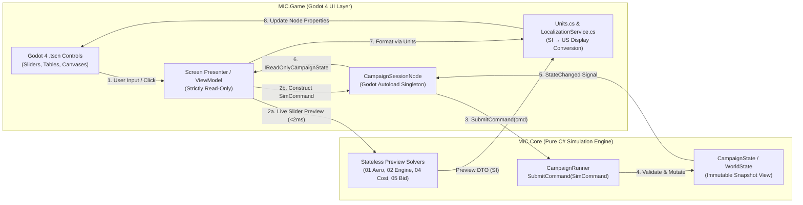

# 08 — UI/UX Architecture, Visual Style, and Godot 4 Screen Specification

> **Status**: v1.0 (MVP Ticket-Ready Commercial GDD & Godot 4 Implementation Specification)
> **Owner**: Module 08 (`MIC.Game` UI/UX Layer)
> **Conforms to**: `docs/spec/00_conventions.md` v1.2 (Locked Decisions D1–D10, §3 SI-to-US Display Units, §4 Shared Data Contracts, §6 Spec Template)
> **Dependencies**: Modules 01 (`01_aero_physics.md`), 02 (`02_engines.md`), 03 (`03_tech_tree.md`), 04 (`04_economy.md`), 05 (`05_procurement.md`), 06 (`06_testing_uncertainty.md`), 09 (`09_core_loop.md`), 10 (`10_content.md`)
> **Target Engine**: Godot 4.3+ (.NET 8.0 / C# 12), Assembly `MIC.Game` referencing pure-C# `MIC.Core`

---

## 1. Purpose, Player Fantasy & UI Data-Binding Architecture

### 1.1 Purpose & Player Fantasy ("The Chief Engineer's Drafting Table")
In *Military-Industrial Complex: Jet Age*, the user interface is not a generic modern sci-fi HUD—it is the **1945–1960 drafting board, slide rule, wind-tunnel schlieren viewer, and wood-paneled executive boardroom** of an American combat aircraft prime contractor. Every screen is engineered to make complex aerodynamic, thermodynamic, financial, and Bayesian-uncertainty trade-offs immediately legible and tactile:
- **Zero Spreadsheet Blindness**: When the player sweeps a wing from $0^\circ$ to $45^\circ$ or toggles `fuselage.area_ruled = true` in the Airframe Design Bureau, they do not merely see a number change—they watch the 3-view blueprint update in real time, the Sears–Haack cross-sectional area curve $A(x)$ smooth out its transonic second-derivative spike $|d^2A/dx^2|$, the Mach drag-rise curve drop by $35\%$, and the Boyd Specific Excess Power ($P_s$) Mach $\times$ Altitude contour envelope expand across Mach 1.0.
- **Visible Epistemic Uncertainty**: The player never sees raw `TrueAircraft` ground truth (`06_testing_uncertainty.md`). Every performance metric in the UI is rendered through a universal `EstimateBadge` widget displaying the current point estimate, the $\pm 1\sigma$ confidence interval whisker bar, and the provenance badge (`SIM`, `TUNNEL`, `GROUND`, `FLIGHT`, `SERVICE`). Shrinking error bars before submitting a binding Pentagon proposal feels tangibly rewarding.
- **High-Stakes Executive Agency**: From commissioning a twin-spool turbojet from Pratt & Whitney (Decision D9), to reading trade-press rumors about rival contenders before an RFP deadline (Decision D10), to choosing whether to ground a prototype for a $\$140\text{k}$ leading-edge slat fix or press on into a two-stage hardware fly-off (Decision D6), every UI workspace surfaces the exact risk/reward trade-off and dispatches a deterministic `SimCommand`.

---

### 1.2 UI Data-Binding Pattern (Strictly Read-Only `CampaignState` + Command Dispatch)

Per Locked Decision D1 (`00_conventions.md` §1) and `09_core_loop.md` §9.2, the C# solution is strictly partitioned into two assemblies:
1. **`MIC.Core` (`net8.0` class library, zero Godot dependency)**: Owns `WorldState` (aliased as `CampaignState` in UI presenters), `CampaignRunner`, `PCG32`, `GameCalendar`, and all domain modules (`01`–`07`, `09`, `10`).
2. **`MIC.Game` (Godot 4 C# assembly)**: Owns all `.tscn` scenes, `Control` nodes, custom 2D vector plotting canvases, and `Presenter` / `ViewModel` classes.

#### 1.2.1 Architectural Laws (Non-Negotiable for Implementers)
1. **Strictly Read-Only State Access**:
   - No class in `MIC.Game` may ever mutate any field, list, or dictionary inside `WorldState` / `CampaignState`, `CompanyState`, `AircraftDesign`, `EngineProjectState`, `Requirement`, or `TestProgrammeState`.
   - Presenters read state snapshots via `IReadOnlyCampaignState` exposed by the singleton Godot Autoload `CampaignSessionNode.Instance.State`.
   - In the Airframe Design Bureau (`DesignBureauScreen.tscn`) and Custom Engine Modal (`CustomEngineModal.tscn`), interactive slider scrubbing operates on a **transient UI working copy (`DraftDesignBuffer`)** that calls pure stateless preview evaluators (`AeroEvaluator.EvaluatePreview(...)`, `EngineCycleSolver.EvaluatePreview(...)`) in $< 2\text{ ms}$ without mutating `CampaignState`. Committing changes dispatches `design.create` or `design.modify`.
2. **All State Mutations Dispatch Typed `SimCommand` (`PlayerAction`) Instances**:
   - Every button click, slider commit, or modal confirmation constructs a strongly-typed `SimCommand` (wrapping `MIC.Core.Actions.PlayerAction` from `09_core_loop.md` §4.7) and submits it via:
     ```csharp
     ActionResult result = CampaignSessionNode.Instance.SubmitCommand(cmd);
     ```
   - If `result.IsSuccess == false`, the UI plays the error relay click (`sfx_ui_error_buzz`), flashes the offending control border in `COLOR_DANGER_RED` (`#D94A38`), and displays a localized toast notification translating `result.ErrorCode` (e.g., `ERR_DESIGN_FROZEN`, `ERR_INSUFFICIENT_FUNDS`, `ERR_TECH_CAP_EXCEEDED`).
   - If `result.IsSuccess == true`, `CampaignSessionNode` emits `[Signal] public delegate void StateChangedEventHandler(long currentDay, string lastCommandType)` which triggers active `IScreenPresenter.RefreshFromState(IReadOnlyCampaignState state)` in $< 1\text{ ms}$.
3. **Zero Hard-Coded Display Strings (Locked Decision D4)**:
   - Every company name, aircraft designation, engine name, chief designer, tech node, flaw name, and event text is resolved through `LocalizationService.TrKey(string nameKey)` backed by `sim/data/names/*.json` (supporting the `use_fictional_names` fallback toggle from `10_content.md` §5.3).



#### 1.2.2 Core C# Interfaces (`MIC.Game.Core`)

```csharp
namespace MIC.Game.Core;

using System;
using System.Collections.Generic;
using Godot;
using MIC.Core.Actions;
using MIC.Core.Campaign;

/// <summary>
/// Typed wrapper over MIC.Core.Actions.PlayerAction (09_core_loop.md §4.7).
/// Every UI mutation MUST go through CampaignSessionNode.SubmitCommand(SimCommand).
/// </summary>
public sealed record SimCommand(
    string ActionType,
    string ActorCompanyId,
    IReadOnlyDictionary<string, object?> Params
)
{
    public PlayerAction ToPlayerAction() => new(ActionType, ActorCompanyId, Params);
}

public interface IScreenPresenter
{
    /// <summary>Called once when the screen scene enters the tree.</summary>
    void BindView(Control rootControl);

    /// <summary>Called whenever CampaignState advances a day or processes a SimCommand.</summary>
    void RefreshFromState(IReadOnlyWorldState state);

    /// <summary>Called before switching workspaces; returns false if unsaved draft prompts confirmation.</summary>
    bool CanNavigateAway();
}
```

---

### 1.3 Exact `Units` C# Static Helper Specification (`MIC.Game.UI.Units`)

Per `00_conventions.md` §3, all internal simulation math and data structures use **SI units** (`m`, `kg`, `s`, `N`, `K`, `Pa`, `rad`, `m/s`, `kg/(N·s)`, nominal `USD`). The UI layer converts SI values to **US Customary / Aviation Display Units** exclusively at render time and converts user numeric inputs back to SI before constructing `SimCommand` payloads.

#### 1.3.1 Exact Conversion Constants & Formatting Rules Table

| Unit Key (`unit`) | Physical Quantity | Internal SI Unit | US Display Unit | Exact Conversion Formula ($\text{US} = f(\text{SI})$) | Precision / Format String | Example Output |
|---|---|---|---|---|---|---|
| `"mach"` | Mach number | dimensionless | `Mach` | $\text{US} = \text{SI}$ | `F2` (`0.00`) | `M 1.82` or `1.82 Mach` |
| `"m"` (altitude/ceiling) | Altitude / Ceiling | `m` | `ft` | $\text{ft} = \text{m} / 0.3048$ | Rounded to nearest `100 ft`, `N0` | `52,400 ft` |
| `"m_dim"` (dimensions) | Length / Span / Diameter | `m` | `ft` (or `ft-in`) | $\text{ft} = \text{m} / 0.3048$ | `F1` (`0.0 ft`) | `47.0 ft` |
| `"m_dist"` (takeoff/landing) | Runway Roll Distance | `m` | `ft` | $\text{ft} = \text{m} / 0.3048$ | Rounded to nearest `10 ft`, `N0` | `3,850 ft` |
| `"m_range"` (range/radius) | Combat Radius / Ferry Range | `m` | `nmi` | $\text{nmi} = \text{m} / 1852.0$ | `N0` (integer nautical miles) | `540 nmi` |
| `"m2"` (wing area) | Wing / Tail Area | $\text{m}^2$ | $\text{sq ft}$ ($\text{ft}^2$) | $\text{ft}^2 = \text{m}^2 / (0.3048^2) = \text{m}^2 / 0.09290304$ | `F1` (`0.0 sq ft`) | `385.0 sq ft` |
| `"m2_floor"` (factory) | Factory Floor Area | $\text{m}^2$ | $\text{sq ft}$ | $\text{ft}^2 = \text{m}^2 / 0.09290304$ | `N0` (or `k sq ft` / `M sq ft`) | `2,798,600 sq ft` |
| `"mps"` (airspeed) | Stall / Approach / Max Speed | $\text{m/s}$ | `kt` (knots) | $\text{kt} = \text{m/s} / 0.514444$ | `F0` (`N0 kt`) | `118 kt` |
| `"mps_climb"` (`ps`, `climb`) | Climb Rate / Specific Excess Power $P_s$ | $\text{m/s}$ | `ft/min` (`fpm`) | $\text{ft/min} = (\text{m/s} / 0.3048) \times 60.0$ | Rounded to nearest `50 ft/min`, `N0` | `24,800 ft/min` |
| `"dps"` | Turn Rate ($\dot{\psi}$) | $\text{deg/s}$ | `deg/s` (`°/s`) | $\text{US} = \text{SI}$ (already deg/s in `PerformanceReport`) | `F1` (`0.0 °/s`) | `14.2 °/s` |
| `"rad"` | Angle (internal radians) | `rad` | `deg` (`°`) | $\text{deg} = \text{rad} \times (180.0 / \pi)$ | `F1` (`0.0°`) | `45.0°` |
| `"deg"` | Angle (`_deg` fields) | `deg` | `deg` (`°`) | $\text{US} = \text{SI}$ | `F1` (`0.0°`) | `45.0°` |
| `"kg"` | Mass / Weight | `kg` | `lb` | $\text{lb} = \text{kg} / 0.45359237$ | `N0` (`< 1,000 lb`: `F0`; $\ge 1,000$: nearest `10 lb`) | `21,450 lb` |
| `"kgps"` | Engine Core Mass Flow $\dot{m}_0$ | $\text{kg/s}$ | `lb/s` | $\text{lb/s} = \text{kg/s} / 0.45359237$ | `F1` (`0.0 lb/s`) | `167.0 lb/s` |
| `"N"` | Engine Thrust | `N` | `lbf` | $\text{lbf} = \text{N} / 4.4482216152605$ | Rounded to nearest `10 lbf`, `N0` | `16,000 lbf` |
| `"tsfc"` | Thrust Specific Fuel Consumption | $\text{kg/(N}\cdot\text{s)}$ | $\text{lb/(lbf}\cdot\text{h)}$ | $\text{SFC}_{\text{US}} = \text{SI} \times \frac{3600.0 \times 4.4482216152605}{0.45359237} = \text{SI} \times 35303.940378$ | `F2` (`0.00 lb/(lbf·h)`) | `0.78 lb/(lbf·h)` |
| `"kgm2"` | Wing Loading ($W/S$) | $\text{kg/m}^2$ | $\text{lb/sq ft}$ | $\text{lb/ft}^2 = \text{kg/m}^2 \times \frac{0.3048^2}{0.45359237} = \text{kg/m}^2 \times 0.20481614$ | `F1` (`0.0 lb/sq ft`) | `72.4 lb/sq ft` |
| `"K"` | Temperature ($T_{t4}, T_{t7}, T_r$) | `K` | `°F` (with `K` in parens) | ${}^\circ\text{F} = (\text{K} - 273.15) \times 1.8 + 32.0$ | `F0` (`1,600 °F (1,144 K)`) | `1,600 °F` |
| `"Pa"` | Dynamic / Static Pressure | `Pa` | $\text{lb/sq ft}$ (`psf`) | $\text{psf} = \text{Pa} \times \frac{0.3048^2}{4.4482216152605} = \text{Pa} \times 0.020885434$ | `N0` (`0 psf`) | `1,480 psf` |
| `"s"` | Time to Climb | `s` | `min:sec` (or `s`) | $\text{min} = \lfloor \text{s}/60 \rfloor,\; \text{sec} = \text{round}(\text{s} \bmod 60)$ | `M:SS` (`< 90s` shows `XX.X s`) | `2:45` (`165 s`) |
| `"g"` | Load Factor | $g$ | `g` | $\text{US} = \text{SI}$ | `F2` (`+7.33 g`) | `7.33 g` |
| `"ratio"` / `"tw"` | Thrust-to-Weight / $t/c$ / OPR | dimensionless | ratio or `%` | $\text{US} = \text{SI}$ | `F2` (`0.68`) or `F1%` (`7.0%` for $t/c$) | `0.68` |
| `"mh_per_fh"` | Maintenance Burden | `MMH/FH` | `MMH/FH` | $\text{US} = \text{SI}$ | `F1` (`0.0 MMH/FH`) | `18.5 MMH/FH` |
| `"h"` | Engine MTBF | `h` | `hr` | $\text{US} = \text{SI}$ | `N0` (`0 hr`) | `420 hr` |
| `"usd"` | Currency (Then-Year or 1950 $) | `USD` | `$` (`$k`, `$M`) | $|\text{USD}| \ge 10^6 \to \text{\$X.XXM}$; $\ge 10^4 \to \text{\$XXXk}$; else `\$X,XXX` | Compact or full `N0` | `$24.50M` / `$780k` |

#### 1.3.2 Reference C# Implementation (`MIC.Game/UI/Units.cs`)

```csharp
namespace MIC.Game.UI;

using System;
using System.Globalization;
using MIC.Core.Testing;

public static class Units
{
    public const double MPerFt = 0.3048;
    public const double KgPerLb = 0.45359237;
    public const double NPerLbf = 4.4482216152605;
    public const double MpsPerKt = 0.514444;
    public const double MPerNmi = 1852.0;
    public const double SqMPerSqFt = MPerFt * MPerFt; // 0.09290304
    public const double FpmPerMps = 60.0 / MPerFt;    // 196.8503937007874
    public const double LbPerSqFtPerKgM2 = SqMPerSqFt / KgPerLb; // 0.2048161436225219
    public const double PsfPerPa = SqMPerSqFt / NPerLbf;         // 0.02088543423315013
    public const double SfcUsPerSi = 3600.0 * NPerLbf / KgPerLb; // 35303.94037846558

    private static readonly CultureInfo Invariant = CultureInfo.InvariantCulture;

    // --- SI to US Conversions ---
    public static double MToFt(double m) => m / MPerFt;
    public static double FtToM(double ft) => ft * MPerFt;
    public static double M2ToSqFt(double m2) => m2 / SqMPerSqFt;
    public static double SqFtToM2(double sqFt) => sqFt * SqMPerSqFt;
    public static double MToNmi(double m) => m / MPerNmi;
    public static double NmiToM(double nmi) => nmi * MPerNmi;
    public static double MpsToKt(double mps) => mps / MpsPerKt;
    public static double KtToMps(double kt) => kt * MpsPerKt;
    public static double MpsToFpm(double mps) => mps * FpmPerMps;
    public static double FpmToMps(double fpm) => fpm / FpmPerMps;
    public static double KgToLb(double kg) => kg / KgPerLb;
    public static double LbToKg(double lb) => lb * KgPerLb;
    public static double NToLbf(double n) => n / NPerLbf;
    public static double LbfToN(double lbf) => lbf * NPerLbf;
    public static double TsfcSiToUs(double tsfcSi) => tsfcSi * SfcUsPerSi;
    public static double KgM2ToLbSqFt(double kgm2) => kgm2 * LbPerSqFtPerKgM2;
    public static double KToFahrenheit(double k) => (k - 273.15) * 1.8 + 32.0;
    public static double FahrenheitToK(double f) => (f - 32.0) / 1.8 + 273.15;
    public static double PaToPsf(double pa) => pa * PsfPerPa;
    public static double RadToDeg(double rad) => rad * (180.0 / Math.PI);
    public static double DegToRad(double deg) => deg * (Math.PI / 180.0);

    /// <summary>
    /// Converts a PerformanceReport key or explicit unit key from SI to US display value.
    /// </summary>
    public static (double DisplayValue, string UnitSuffix, string FormatSpec) ConvertMetric(
        string metricOrUnitKey,
        double siValue)
    {
        return metricOrUnitKey switch
        {
            "max_mach_sl" or "max_mach_alt" or "mach" =>
                (siValue, "Mach", "F2"),
            "alt_of_max_mach_m" or "service_ceiling_m" or "m" =>
                (Math.Round(MToFt(siValue) / 100.0) * 100.0, "ft", "N0"),
            "takeoff_distance_m" or "landing_distance_m" or "m_dist" =>
                (Math.Round(MToFt(siValue) / 10.0) * 10.0, "ft", "N0"),
            "length_m" or "diameter_m" or "max_diameter_m" or "m_dim" =>
                (MToFt(siValue), "ft", "F1"),
            "area_m2" or "ht_area_m2" or "vt_area_m2" or "m2" =>
                (M2ToSqFt(siValue), "sq ft", "F1"),
            "factory_floor_m2" or "goco_floor_m2" or "m2_floor" =>
                (Math.Round(M2ToSqFt(siValue)), "sq ft", "N0"),
            "combat_radius_m" or "ferry_range_m" or "m_range" =>
                (MToNmi(siValue), "nmi", "N0"),
            "stall_speed_mps" or "mps" =>
                (MpsToKt(siValue), "kt", "N0"),
            "climb_rate_sl_mps" or "ps_mps_m09_4572m_1g" or "mps_climb" =>
                (Math.Round(MpsToFpm(siValue) / 50.0) * 50.0, "ft/min", "N0"),
            "time_to_alt_10668m_s" or "s" =>
                (siValue, "s", "F0"),
            "sustained_turn_dps_m08_4572m" or "instantaneous_turn_dps_m08_4572m" or "dps" =>
                (siValue, "deg/s", "F1"),
            "max_load_factor_g" or "design_load_factor_g" or "g" =>
                (siValue, "g", "F2"),
            "empty_mass_kg" or "mtow_kg" or "internal_fuel_kg" or "payload_kg" or "mass_kg" or "kg" =>
                (Math.Round(KgToLb(siValue) / 10.0) * 10.0, "lb", "N0"),
            "mass_flow_kgps" or "kgps" =>
                (KgToLb(siValue), "lb/s", "F1"),
            "thrust_N" or "sls_dry_thrust_N" or "sls_ab_thrust_N" or "N" =>
                (Math.Round(NToLbf(siValue) / 10.0) * 10.0, "lbf", "N0"),
            "tsfc" or "sls_dry_tsfc" or "sls_ab_tsfc" =>
                (TsfcSiToUs(siValue), "lb/(lbf·h)", "F2"),
            "thrust_to_weight_combat" or "ratio" =>
                (siValue, "", "F2"),
            "wing_loading_combat_kgm2" or "kgm2" =>
                (KgM2ToLbSqFt(siValue), "lb/sq ft", "F1"),
            "tit_K" or "ab_temp_K" or "K" =>
                (KToFahrenheit(siValue), "°F", "N0"),
            "unit_flyaway_cost_usd" or "dev_cost_usd_estimate" or "unit_cost" or "usd" =>
                (siValue, "$", "USD"),
            "maint_mh_per_fh" or "mh_per_fh" =>
                (siValue, "MMH/FH", "F1"),
            "mtbf_h" or "h" =>
                (siValue, "hr", "N0"),
            _ => (siValue, "", "F2")
        };
    }

    public static string FormatUsd(double usd, bool compact = true, bool showSign = false)
    {
        string sign = usd < 0 ? "-" : (showSign && usd > 0 ? "+" : "");
        double abs = Math.Abs(usd);
        if (!compact)
            return $"{sign}${abs.ToString("N0", Invariant)}";
        if (abs >= 1_000_000.0)
            return $"{sign}${(abs / 1_000_000.0).ToString("F2", Invariant)}M";
        if (abs >= 10_000.0)
            return $"{sign}${(abs / 1_000.0).ToString("F0", Invariant)}k";
        return $"{sign}${abs.ToString("N0", Invariant)}";
    }

    public static string FormatMetric(string metricOrUnitKey, double siValue, bool includeUnit = true)
    {
        var (val, unit, fmt) = ConvertMetric(metricOrUnitKey, siValue);
        if (fmt == "USD")
            return FormatUsd(val, compact: true);
        string num = val.ToString(fmt, Invariant);
        return includeUnit && !string.IsNullOrEmpty(unit) ? $"{num} {unit}" : num;
    }
}
```

---

### 1.4 Universal `EstimateBadge` Widget Specification (`res://ui/widgets/EstimateBadge.tscn`)

Per `00_conventions.md` §4.1 and `06_testing_uncertainty.md` §4.1, **every performance number the player sees** is an `Estimate { value, sigma, source, unit }`. The `EstimateBadge` custom Godot 4 control (`EstimateBadge : HBoxContainer`) provides a uniform visual language across the Airframe Design Bureau, Wind Tunnel & Flight Test Center, and Pentagon Procurement screens.

#### 1.4.1 Visual Anatomy & ASCII Wireframe

```
+---------------------------------------------------------------------------------+
| [TUNNEL]   1.25 Mach   ±0.04  [------|====*====|------]  (95% CI: 1.17 .. 1.33) |
|  ^Badge     ^Value      ^1σ     ^Whisker2σ ^1σBox ^Mean                          |
+---------------------------------------------------------------------------------+
```

#### 1.4.2 Godot 4 Node Tree (`EstimateBadge.tscn`)
```
EstimateBadge (HBoxContainer, custom_minimum_size = Vector2(280, 26))
├── SourceTagPanel (PanelContainer)
│   └── SourceTagLabel (Label, text="TUNNEL", theme_type_variation="BadgeMonospace")
├── ValueLabel (Label, text="1.25 Mach", custom_minimum_size = Vector2(92, 0), horizontal_alignment=Right)
├── SigmaLabel (Label, text="±0.04", custom_minimum_size = Vector2(56, 0), theme_type_variation="MutedMonospace")
└── WhiskerCanvas (Control, custom_minimum_size = Vector2(84, 18), script=EstimateWhiskerCanvas.cs)
```

#### 1.4.3 Source Badge Mapping & Color Coding

Notice how `06_testing_uncertainty.md` §11.2 notes that ground non-tunnel campaigns (`mockup_review`, `static_structural`, `engine_altitude_cell`) can be displayed with a `"GROUND"` badge in the UI while mapping cleanly from `"ground"` or `"tunnel"` source metadata:

| `Estimate.source` | Badge Text | Background Hex | Border / Text Hex | Icon / Glyph | Typical Relative $\sigma/\mu$ | Tooltip Explanation |
|---|---|---|---|---|---|---|
| `"sim"` | `SIM` | `#162C46` | `#5DA9E9` (Blueprint Cyan) | `[≈]` | $6\% \text{–} 25\%$ | *"Slide-rule & analytical simulator estimate. Subject to optimism bias on novel regimes."* |
| `"tunnel"` | `TUNNEL` | `#2B2512` | `#E09F3E` (Instrument Brass) | `[≋]` | $2.5\% \text{–} 7\%$ | *"Subsonic/Transonic/Supersonic scale-model wind tunnel measurement. Bounded by Reynolds floor."* |
| `"ground"` | `GROUND` | `#261E2E` | `#B388EB` (Rig Violet) | `[⚙]` | $1.5\% \text{–} 5\%$ | *"Full-scale engineering mock-up, static structural load frame, or altitude engine test cell."* |
| `"flight"` | `FLIGHT` | `#122E24` | `#3BCEAC` (Oscilloscope Green) | `[✈]` | $0.5\% \text{–} 2.0\%$ | *"Measured in prototype flight test via FM telemetry and photo-panel instrumentation."* |
| `"service"` | `SERVICE` | `#1E2E1E` | `#A3E635` (Verified Lime) | `[★]` | $< 0.5\%$ | *"Confirmed across $>1,000\text{ fleet flight hours}$ in operational squadron service."* |

#### 1.4.4 Whisker Bar Rendering Rules (`EstimateWhiskerCanvas._Draw()`)
- Given relative uncertainty $r_\sigma = \sigma / \max(|\text{value}|, 10^{-6})$, normalize against a reference full-scale half-width $R_{\max} = 0.25$ ($25\%$ relative error fills the 84 px canvas width):
  - Center tick at $x_c = 42\text{ px}$ represents the current point estimate $\hat{\mu}$.
  - Thin horizontal whisker line spans $[x_c - w_{2\sigma},\; x_c + w_{2\sigma}]$ where $w_{2\sigma} = \text{ clamp}(2 r_\sigma / R_{\max}, 0.04, 1.0) \times 38\text{ px}$, with vertical end-caps ($6\text{ px}$ tall).
  - Filled inner box spans $[x_c - w_{1\sigma},\; x_c + w_{1\sigma}]$ ($8\text{ px}$ tall) colored with the source's primary hex color at `0.65` alpha.
  - If an RFP threshold $T_i$ is bound to this `EstimateBadge`, a vertical dashed reference tick is drawn at $x_T = x_c + \text{clamp}\!\left(\frac{T_i - \hat{\mu}}{R_{\max}|\hat{\mu}|}, -1, 1\right) \times 38\text{ px}$ in `COLOR_GOLD` (`#F4B942`), immediately showing whether $T_i$ lies inside or outside the $\pm 1\sigma$ box!

---

## 2. Scope & Visual Style ("1950s Blueprint & Brass")

### 2.1 MVP Scope (In / Out)

| Feature Category | In Scope for MVP (USA 1945-01-01 → 1960-12-31) | Out of Scope (Deferred to Phase 11+) |
|---|---|---|
| **Workspaces & Modals** | All 9 specified screens/modals (Screens 0–8) + Global TopBar HUD + Left Navigation Dock + Right Collapsible Event Feed + Interactive Multi-Option Event Modal. | 3D hangar camera walkaround; 3D dogfight replay camera; diplomatic embassy map screen. |
| **Engineering Visualizations** | Procedural 2D 3-View Blueprint (`Top`/`Side`/`Front`), Airfoil & $C_p(x/c)$ plot, 64-station Sears–Haack $A(x)$ & $A''(x)$ area-rule plot, Drag Polar $C_D(C_L, M)$, $C_{D0}(M)$ transonic rise, $13 \times 10$ Boyd $P_s$ contour plot, Wright's Law learning curve plot. | Real-time 3D CFD streamline shaders; finite-element 3D stress mesh viewer. |
| **Procurement & Intelligence UI** | RFP board, Pre-Bid Trade-Press Rumors & Competitor Intelligence error-bar chart (D10), Two-Stage Hardware Fly-Off tracker (D6), Post-Award Source Selection Debrief modal with `S_perf, S_cost, S_sched, S_risk, S_pol, S_total` bars (D10). | Live voice-acted congressional hearing minigame. |
| **Testing & Flaws UI** | 10-driver Bayesian $\sigma$ shrinkage bars, wind-tunnel/ground booking, 4-phase flight test campaign manager, fictional test pilot roster (`pilot_names.json`, D9), sortie log, Flaw Discovery & Fix cards with fog-of-war (D7). | Manual stick-and-rudder flight test control (JSBSim Phase 6). |

---

### 2.2 Visual Style & Theme System ("1950s Blueprint & Brass")

The visual aesthetic evokes **1950s NACA Langley technical reports, Prussian-blue cyanotype drafting vellum, anodized aluminum instrument bezels, brushed brass vernier dials, and Tektronix CRT phosphor oscilloscopes**.

#### 2.2.1 Master Color Palette Hex Codes (`res://ui/theme/Palette.cs`)

| Token Name | Hex Code | RGBA `(R, G, B, A)` | Usage in UI |
|---|---|---|---|
| `BG_BLUEPRINT_DEEP` | `#0B1528` | `(11, 21, 40, 255)` | Root background of drafting viewports and main canvas. |
| `BG_PANEL_BAKELITE` | `#121E31` | `(18, 30, 49, 255)` | Primary panel background (sidebars, cards, tables). |
| `BG_PANEL_ELEVATED` | `#1A2B44` | `(26, 43, 68, 255)` | Hover states, modal dialogs, active tab headers. |
| `BG_INPUT_WELL` | `#08101E` | `(8, 16, 30, 255)` | Recessed slider tracks, text inputs, log scrollboxes. |
| `GRID_CYAN_MAJOR` | `#1E3F66` | `(30, 63, 102, 255)` | Major $100\text{ px}$ blueprint grid lines ($1.0\text{ px}$ width). |
| `GRID_CYAN_MINOR` | `#142A47` | `(20, 42, 71, 255)` | Minor $20\text{ px}$ blueprint grid lines ($1.0\text{ px}$ width). |
| `LINE_VELLUM_WHITE` | `#E8F1F5` | `(232, 241, 245, 255)` | Primary aircraft 3-view geometry outlines ($2.0\text{ px}$ antialiased) & primary text. |
| `TEXT_SECONDARY_STEEL` | `#94ADC7` | `(148, 173, 199, 255)` | Field labels, units, secondary table columns. |
| `TEXT_MUTED_SLATE` | `#5C7693` | `(92, 118, 147, 255)` | Disabled controls, historical notes, subtle captions. |
| `ACCENT_BRASS_PRIMARY` | `#D4AF37` | `(212, 175, 55, 255)` | Active borders, primary CTA buttons, selected tab underlines, RFP objective markers. |
| `ACCENT_AMBER_WARM` | `#E09F3E` | `(224, 159, 62, 255)` | Warnings, ahead-of-time research penalties, `TUNNEL` badge, transonic wave-drag bump highlight. |
| `ACCENT_CRT_GREEN` | `#3BCEAC` | `(59, 206, 172, 255)` | Positive cash flow, passed gates, `FLIGHT` badge, ideal Sears–Haack curve, $P_s > 0$ contours. |
| `ACCENT_CYAN_SIM` | `#5DA9E9` | `(93, 169, 233, 255)` | `SIM` badge, subsonic curves, NACA diffusion indicators. |
| `STATUS_DANGER_RED` | `#D94A38` | `(217, 74, 56, 255)` | Severe flaws (Sev 4–5), gate disqualifications, negative cash, thermal/structural limit lines. |
| `STATUS_PURPLE_RIG` | `#B388EB` | `(179, 136, 235, 255)` | `GROUND` test badge, supersonic aerodynamic center (`x_ac_sup`) marker. |
| `SERVICE_USAF_BLUE` | `#3B82F6` | `(59, 130, 246, 255)` | USAF customer badge & reputation bar fill. |
| `SERVICE_USN_GOLD` | `#F59E0B` | `(245, 158, 11, 255)` | USN BuAer customer badge & reputation bar fill. |

#### 2.2.2 Typography Roles & Font Stack (`res://ui/theme/fonts/`)

| Role | Font Family | Fallback | Size (`px`) | Weight / Features | Usage |
|---|---|---|---|---|---|
| `HeaderStencil` | `DIN 1451 Engschrift` / `Oswald` | `Inter Bold` | `22px` (`H1`), `17px` (`H2`) | Uppercase, `letter_spacing = 1.5px` | Screen titles, military program designations (`WS-201A`), modal headers. |
| `BodySans` | `IBM Plex Sans` | `Inter` | `14px` (Regular), `12px` (Caption) | Regular (`400`) & SemiBold (`600`) | Narrative event descriptions, flaw cards, debrief prose, tooltips. |
| `DataMono` | `IBM Plex Mono` / `JetBrains Mono` | `Courier New` | `13px` (Table), `15px` (KPI), `11px` (Axis) | `tnum` (tabular numerals), zero-slash | All numeric readouts, `EstimateBadge` values, dates, P&L ledger rows, blueprint dimensions. |

#### 2.2.3 Custom Godot 4 `Theme` Structure (`res://ui/theme/blueprint_brass_theme.tres`)
- **`PanelContainer` (`PanelBakelite`)**: `StyleBoxFlat` with `bg_color = #121E31`, `border_width_all = 1`, `border_color = #2A4365`, `corner_radius_all = 2`, `content_margin = (10, 8, 10, 8)`.
- **`PanelContainer` (`PanelBrassHighlight`)**: `StyleBoxFlat` with `bg_color = #1A2B44`, `border_width_all = 1`, `border_color = #D4AF37`, `shadow_color = rgba(0,0,0,0.45)`, `shadow_size = 4`.
- **`Button` (`PrimaryBrassButton`)**: Normal `bg_color = #2B2413`, `border_color = #D4AF37`, text `#F4E3B2`; Hover `bg_color = #3F341A`, `border_color = #FFE066`; Pressed `bg_color = #D4AF37`, text `#0B1528`; Disabled `bg_color = #141D2B`, `border_color = #2D3B4E`, text `#5C7693`.
- **`HSlider` (`VernierSlider`)**: Track `StyleBoxFlat` (`bg_color = #08101E`, `border_color = #1E3F66`, height `6px`), Grabber area `#5DA9E9`, Grabber icon `12×18 px` brushed-brass knurled thumb texture with tick marks.

#### 2.2.4 Sound & Visual Feedback Hooks (`AudioService.cs`)
Every interactive control binds to the `AudioService` autoload routing through Godot AudioBuses `Master -> { UI_SFX, Ambient_Lab, Alerts }`:
- `sfx_ui_toggle_snap`: Mechanical toggle switch click when changing boolean checkboxes (e.g., `fuselage.area_ruled`, `has_afterburner`).
- `sfx_ui_slider_detent`: Subtle $15\text{ ms}$ vernier tick throttled to at most 1 play per $40\text{ ms}$ during slider drag.
- `sfx_ui_stamp_commit`: Heavy ink-stamp thud when freezing a design (`design.freeze`), submitting a proposal (`proc.submit_proposal`), or signing a contract.
- `sfx_alert_rfp_teletype`: 1950s Teletype Model 15 bell + 4-character clatter when a new RFP (`rfp_issued`) or major historical event fires.
- `sfx_alert_flaw_klaxon`: Muffled cockpit master-caution chime when a Severity $\ge 4$ flaw or prototype crash occurs in flight test.

---

## 3. Global Application Shell, Top Bar HUD, Navigation Dock & Event Feed

### 3.1 Master Application Shell (`res://ui/shell/MainShell.tscn`)

The game runs at a base reference resolution of **`1920 × 1080`** (`canvas_items` stretch mode, `expand` aspect, minimum supported window `1280 × 720`). `MainShell.tscn` remains mounted throughout the entire campaign and swaps the active workspace inside `WorkspaceHost` without recreating the HUD.

#### 3.1.1 Master Shell ASCII Layout (`1920 × 1080`)

```
+======================================================================================================================+
| TopBarHUD (Height: 56px, Full Width)                                                                                 |
| [15 SEP 1952 | FY53 Q1] [||][1x][2x][3x][4x][5x][Smart][Gear] | Cash: $24.80M (+$0.42M/mo) | Cred: $30M | USAF:84 ... |
+------------------+--------------------------------------------------------------------------------+------------------+
| LeftNavDock      | WorkspaceHost (MarginContainer: 1420 x 1024 px when EventFeed open,            | RightEventFeed   |
| (Width: 180px)   |                1700 x 1024 px when EventFeed collapsed)                        | (Width: 320px,   |
|                  |                                                                                |  Collapsible)    |
| [F1] Dashboard   |  +--------------------------------------------------------------------------+  |                  |
| [F2] Design Bur. |  |                                                                          |  | [!] Alerts (3)   |
| [F3] Propulsion  |  |                    ACTIVE WORKSPACE SCREEN (Screens 1..7)                |  | ---------------  |
| [F4] Test Center |  |                                                                          |  | * 15 SEP 1952    |
| [F5] Procurement |  |   - Screen 1: ExecutiveDashboardScreen.tscn                              |  |   OS-130 Issued  |
| [F6] Tech Tree   |  |   - Screen 2: DesignBureauScreen.tscn                                    |  |   [Jump to RFP]  |
| [F7] Company Mgt |  |   - Screen 3: PropulsionScreen.tscn                                      |  |                  |
|                  |  |   - Screen 4: TestCenterScreen.tscn                                      |  | * 15 SEP 1952    |
| ---------------- |  |   - Screen 5: ProcurementScreen.tscn                                     |  |   Whitcomb Area  |
| Active Projects: |  |   - Screen 6: TechTreeScreen.tscn                                        |  |   Rule NACA RM   |
| * YF-102 (Fly)   |  |   - Screen 7: CompanyManagementScreen.tscn                               |  |   [View Event]   |
| * J57-P-7 (R&D)  |  |                                                                          |  |                  |
| * Area Rule 68%  |  +--------------------------------------------------------------------------+  | [<< Collapse]    |
+------------------+--------------------------------------------------------------------------------+------------------+
```

#### 3.1.2 `MainShell.tscn` Godot 4 Node Tree
```
MainShell (Control, anchors_preset=15 FullRect, script=MainShellPresenter.cs)
├── BackgroundWallpaper (ColorRect, color=#0B1528)
├── MainVBox (VBoxContainer, anchors_preset=15)
│   ├── TopBarHUD (Instance of res://ui/shell/TopBarHUD.tscn, custom_minimum_size=Vector2(0, 56))
│   └── BodyHBox (HBoxContainer, size_flags_vertical=ExpandFill)
│       ├── LeftNavDock (PanelContainer, custom_minimum_size=Vector2(180, 0), script=LeftNavDockPresenter.cs)
│       │   └── NavVBox (VBoxContainer)
│       │       ├── NavButtonsVBox (VBoxContainer)
│       │       │   ├── BtnNavDashboard (Button, toggle_mode=true, shortcut=F1, text="1. EXEC DASHBOARD")
│       │       │   ├── BtnNavDesign (Button, toggle_mode=true, shortcut=F2, text="2. DESIGN BUREAU")
│       │       │   ├── BtnNavPropulsion (Button, toggle_mode=true, shortcut=F3, text="3. PROPULSION R&D")
│       │       │   ├── BtnNavTesting (Button, toggle_mode=true, shortcut=F4, text="4. TEST CENTER")
│       │       │   ├── BtnNavProcurement (Button, toggle_mode=true, shortcut=F5, text="5. PROCUREMENT")
│       │       │   ├── BtnNavTechTree (Button, toggle_mode=true, shortcut=F6, text="6. TECH TREE")
│       │       │   └── BtnNavCompany (Button, toggle_mode=true, shortcut=F7, text="7. COMPANY & PLANT")
│       │       ├── HSeparator (HSeparator)
│       │       ├── QuickOutlinerHeader (Label, text="ACTIVE PROJECTS")
│       │       └── QuickOutlinerScroll (ScrollContainer, size_flags_vertical=ExpandFill)
│       │           └── QuickOutlinerList (VBoxContainer)
│       ├── WorkspaceHost (MarginContainer, size_flags_horizontal=ExpandFill, size_flags_vertical=ExpandFill)
│       └── RightEventFeed (PanelContainer, custom_minimum_size=Vector2(320, 0), script=RightEventFeedPresenter.cs)
│           └── FeedVBox (VBoxContainer)
│               ├── FeedHeaderHBox (HBoxContainer)
│               │   ├── FeedTitleLabel (Label, text="TELETYPE & ALERTS")
│               │   ├── BtnDismissAllRead (Button, text="Clear Info")
│               │   └── BtnToggleCollapse (Button, text=">>")
│               ├── PendingChoicesContainer (VBoxContainer)
│               ├── HSeparator (HSeparator)
│               └── NotificationScroll (ScrollContainer, size_flags_vertical=ExpandFill)
│                   └── NotificationListVBox (VBoxContainer)
└── ModalOverlayLayer (CanvasLayer, layer=20)
    ├── ModalDimmer (ColorRect, color=rgba(5, 10, 20, 0.72), visible=false)
    └── ModalCenterContainer (CenterContainer, anchors_preset=15, visible=false)
```

---

### 3.2 Global Top Bar (`res://ui/shell/TopBarHUD.tscn`)

#### 3.2.1 Speed Controls & Clock Cadence
Note: To reconcile the prompt's speed labels (`1x (1d/s)`, `2x (3d/s)`, `3x (7d/s)`, `4x (15d/s)`, `5x (30d/s)`) with `09_core_loop.md` §6, `CampaignSessionNode` uses the exact UI-selected cadence table below:

| Button ID | Label | Hotkey | Days per Real Second | `SecondsPerDay` ($\Delta t_{\text{tick}}$) | Intended Gameplay Phase |
|---|---|---|---:|---:|---|
| `BtnSpeedPause` | `\|\| PAUSE` | `Space` | `0 d/s` | $\infty$ (paused) | Designing aircraft, authoring RFP bids, reviewing debriefs/flaws. |
| `BtnSpeed1x` | `1x` | `Key1` | `1 d/s` | `1.0000 s` | Final week before `proposal_due` or critical flight-test envelope expansion. |
| `BtnSpeed2x` | `2x` | `Key2` | `3 d/s` | `0.3333 s` | Active prototype flight-test syllabus monitoring. |
| `BtnSpeed3x` | `3x` | `Key3` | `7 d/s` (`1 wk/s`) | `0.1429 s` | Standard campaign cruise speed during R&D and wind-tunnel runs. |
| `BtnSpeed4x` | `4x` | `Key4` | `15 d/s` (`0.5 mo/s`) | `0.0667 s` | Waiting on prototype shop fabrication or long NACA tunnel queues. |
| `BtnSpeed5x` | `5x` | `Key5` | `30 d/s` (`1 mo/s`) | `0.0333 s` | Fast-forwarding across multi-year peacetime production or 1946–1947 trough. |
| `BtnSmartSpeed` | `SMART` | `Tab` | Auto (`5x` $\to$ `2x`) | Dynamic | Runs at `5x` until within `14 days` (`lookahead_days`) of a deadline/milestone, then drops to `2x`. |

#### 3.2.2 Company Vitals Strip Data Bindings (`TopBarHUD.tscn`)

| Widget Node Name | Bound Source Field (`IReadOnlyWorldState`) | Display Format & Formula | Tooltip & Color Thresholds |
|---|---|---|---|
| `LblCompanyName` | `PlayerCompany.name_key` | `LocalizationService.TrKey(name_key)` | Shows Chief Designer name & HQ city on hover. |
| `LblCurrentDate` | `Calendar.day` (`09_core_loop.md` §4.1) | `DD MMM YYYY` (e.g., `15 SEP 1952`) | Shows day index (`Day 2,814`) and exact weekday. |
| `LblFiscalQuarter` | `TickSchedule.fiscal_year`, `fiscal_quarter` | `FY1953 Q1` | Shows current US Aircraft Procurement Budget (`$9,200M`, budget index `1.35x`). |
| `LblCashBalance` | `PlayerCompany.cash_usd` | `Units.FormatUsd(cash_usd)` | Green (`#3BCEAC`) if $> \$5\text{M}$; Amber (`#E09F3E`) if $\$0\text{–}\$5\text{M}$; Red (`#D94A38`) + pulsing border if $< \$0$ (shows insolvency grace days remaining). |
| `LblMonthlyNetBurn` | `EconModule.LastMonthNetCashFlowUsd` | `±$X.XXM/mo` (`showSign: true`) | Green if $\ge 0$, Amber if negative but runway $> 12\text{ mo}$, Red if runway $< 6\text{ mo}$. |
| `LblCreditHeadroom` | `EconModule.AvailableCreditHeadroomUsd` | `Cred: $XX.XM` ( + `[Rating]`) | `MaxCreditLimit - debt_usd`. Shows current `credit_rating` (`AAA`..`D`) and V-Loan eligibility. |
| `GaugeRepUSAF` | `PlayerCompany.reputation["USAF"]` | `USAF: 84/100` (`ProgressBar` `0..100`) | Note: If module stores `[0..1]`, multiplies by `100.0`. Shows credibility impact $C$ in USAF bids. |
| `GaugeRepUSN` | `PlayerCompany.reputation["USN"]` | `USN: 62/100` (`ProgressBar` `0..100`) | Shows BuAer credibility impact $C$ in USN carrier fighter bids. |
| `GaugePolCapital` | `PlayerCompany.political_capital` | `Pol: 45/100` (`ProgressBar` `0..100`) | Iron-Triangle leverage available for GFE bailment (`8 PC`), RFP lobbying, and intelligence. |
| `GaugeEngUtil` | `PlayerCompany.engineers`, `AllocatedEngineers` | `Eng: 92% (350/380)` | `(TotalAssigned / TotalHeadcount) * 100`. Flashes Amber if $> 15\%$ engineers sit idle. |
| `GaugeFactoryUtil` | `PlayerCompany.facilities`, `ActiveLines` | `Plant: 78%` | `UsedFloorM2 / (factory_floor_m2 + goco_floor_m2)`. |

#### 3.2.3 Auto-Pause Settings Modal (`AutoPauseModal.tscn`)
Clicking `BtnAutoPauseSettings` (`[Gear]` icon next to speed buttons) opens a popup listing all 11 notification categories from `09_core_loop.md` §3.1 (`rfp_issued`, `proposal_due_7d`, `contract_awarded`, `flyoff_result`, `prototype_rollout`, `prototype_first_flight`, `major_flaw_discovered`, `prototype_crash`, `tech_unlocked`, `event_choice_required`, `low_cash_warning`). Each row has two checkboxes: `[x] Auto-Pause Clock` and `[x] Popup Modal / Toast`. Changes persist in `user://ui_settings.json`.

---

### 3.3 Right Collapsible Event & Alert Feed (`RightEventFeed.tscn`) & Multi-Option Event Modal

Every `Notification` / `SimEvent` emitted into `WorldState.Notifications` or `WorldState.Events.PendingChoices` renders as a card in `RightEventFeed`:
1. **Pending Multi-Option Events (`PendingChoicesContainer`)**:
   -Pinned at the top of the feed with a pulsing brass border and a live countdown badge (`24d left` out of the 30-day timeout in `09_core_loop.md` §3.1).
   - Clicking a pending event card opens `HistoricalEventModal.tscn`, which displays the archival headline, historical narrative text (`desc_key`), and 2–3 option buttons (`opt.label_key`) with exact effect previews (e.g., `-$350k Cash, +3.0 Political Capital`).
   - Selecting an option dispatches:
     ```json
     { "ActionType": "core.choose_event_option", "ActorCompanyId": "player_co", "Params": { "event_id": "evt_1949_revolt_of_admirals", "option_id": "back_navy_supercarriers" } }
     ```
2. **Click-to-Jump Notification Cards (`NotificationListVBox`)**:
   - Each card shows `[Date ISO]`, category icon, localized title, and two buttons:
     - **`[Jump]`**: Switches `MainShell` to the relevant workspace and selects the target entity (`rfp_issued` / `proposal_due_7d` / `contract_awarded` $\to$ **Screen 5 Procurement** with `requirement_id` selected; `prototype_first_flight` / `major_flaw_discovered` / `prototype_crash` $\to$ **Screen 4 Test Center** with `design_id` selected; `tech_unlocked` $\to$ **Screen 6 Tech Tree** centered on `tech_id`; `low_cash_warning` $\to$ **Screen 7 Company Management** Finance tab).
     - **`[X]` (Dismiss)**: Dispatches `SimCommand("core.dismiss_notification", playerCompanyId, { "notification_id": notif.Id })`.

---
## 4. Screen-by-Screen Wireframes, Godot 4 Node Trees, Data Bindings & `SimCommand` Payloads

### 4.0 Screen 0: New Campaign Setup & Historical Rule Toggles (`res://ui/screens/NewCampaignScreen.tscn`)

Before entering `MainShell.tscn`, the player configures their 1945–1960 campaign in `NewCampaignScreen.tscn` (`09_core_loop.md` §2.2, `10_content.md` §1).

#### 4.0.1 ASCII Layout Wireframe (`NewCampaignScreen.tscn`)
```
+----------------------------------------------------------------------------------------------------------------------+
|  MILITARY-INDUSTRIAL COMPLEX: JET AGE — NEW CAMPAIGN BRIEFING (01 JAN 1945)                           [Back to Menu] |
+------------------------------------+-----------------------------------------+---------------------------------------+
| 1. SELECT PRIME CONTRACTOR         | 2. COMPANY DOSSIER & CHIEF DESIGNER     | 3. CAMPAIGN RULES & HISTORICAL TOGGLES|
| +--------------------------------+ | +-------------------------------------+ | +-----------------------------------+ |
| | > [x] Lockheed Aircraft Corp.  | | | LOCKHEED AIRCRAFT (Burbank, CA)     | | | RNG Campaign Seed: [ 19450902 ]   | |
| |   [ ] North American Aviation  | | | Cash: $28.0M  | Debt: $0.0M         | | |                                   | |
| |   [ ] Douglas Aircraft Co.     | | | Plant: 85,000 m² (+35,000 m² GOCO)  | | | PROCUREMENT DOCTRINE (Decision D6)| |
| |   [ ] Boeing Airplane Co.      | | | Tunnel: Low-Speed Subsonic (M 0.45) | | | (*) Always Two-Stage Fly-Off      | |
| |   [ ] Northrop Aircraft Inc.   | | | USAF Rep: 85/100 | USN Rep: 45/100  | | |     (Default: 2 XF/YF prototypes  | |
| |   [ ] Republic Aviation Corp.  | | +-------------------------------------+ | |     Always compete before LRIP)   | |
| |   [ ] Grumman Aircraft Eng.    | | | CHIEF DESIGNER: Kelly Johnson       | | | ( ) Strict Historical Cook-Craigie| |
| |   [ ] Convair (Consolidated)   | | | "Skunk Works Autonomy"              | | |     (1953+ single-stage paper-to- | |
| |   [ ] Custom Contractor...     | | | * Prototype Shop Cost: -15%         | | |     tooling on WS-201A / F-102A)  | |
| +--------------------------------+ | | * Prototype Build Time: -15%        | | +-----------------------------------+ |
|                                    | | * Drag Cleanup Bonus: -4% C_D0      | | | AERODYNAMIC HINDSIGHT (Decision D7| |
| STARTING ACTIVE CONTRACTS (JAN 45) | | * High-Risk Flaw Mitig.: +15%       | | | (*) Standard Era Fog-of-War       | |
| * P-80A Shooting Star (LRIP)       | +-------------------------------------+ | |     (Shows "Uncharted High-Speed  | |
|   140 units @ $92k | Line #1       | | STARTING ENGINEERING STAFF (410)    | | |     Regime Risks" before 1948/53) | |
| * XP-80A Flight Test (Muroc)       | | Aero: 135 | Struct: 120             | | | ( ) Historical Hindsight Mode     | |
|   2 Prototypes | Phase 3 Envelope  | | Prop: 65  | Avion:  90              | | |     (Reveals exact latent flaw    | |
|                                    | +-------------------------------------+ | |     names & Fix Techs from Day 1) | |
|                                    |                                         | +-----------------------------------+ |
|                                    |                                         | | [ ] Use Fictional Designation Pack| |
|                                    |                                         | | [   LAUNCH CAMPAIGN (01 JAN 45) ] | |
+------------------------------------+-----------------------------------------+---------------------------------------+
```

#### 4.0.2 `NewCampaignScreen.tscn` Godot 4 Node Tree & Initialization Contract
```
NewCampaignScreen (Control, anchors_preset=15, script=NewCampaignPresenter.cs)
└── MainMargin (MarginContainer)
    └── MainVBox (VBoxContainer)
        ├── HeaderHBox (HBoxContainer) -> LblTitle (Label), BtnBackToMainMenu (Button)
        └── ColumnsHBox (HBoxContainer, size_flags_vertical=ExpandFill)
            ├── ContractorListPanel (PanelContainer) -> ContractorItemList (ItemList), ActiveProgramsList (VBoxContainer)
            ├── DossierPanel (PanelContainer)
            │   └── DossierVBox (VBoxContainer)
            │       ├── FinancialsGrid (GridContainer, columns=2)
            │       ├── ChiefDesignerCard (PanelContainer) -> LblDesignerName, LblDesignerBio, ModifiersListVBox
            │       └── StaffBreakdownGrid (GridContainer, columns=4)
            └── RulesPanel (PanelContainer)
                └── RulesVBox (VBoxContainer)
                    ├── SeedHBox (HBoxContainer) -> SpinSeed (SpinBox), BtnRandomizeSeed (Button)
                    ├── GroupProcurementD6 (VBoxContainer)
                    │   ├── RadioTwoStageDefault (CheckBox, button_group=ProcGroup, button_pressed=true)
                    │   └── RadioStrictCookCraigie (CheckBox, button_group=ProcGroup)
                    ├── GroupHindsightD7 (VBoxContainer)
                    │   ├── RadioStandardFogDefault (CheckBox, button_group=HindsightGroup, button_pressed=true)
                    │   └── RadioHistoricalHindsight (CheckBox, button_group=HindsightGroup)
                    ├── ChkUseFictionalNamesD4 (CheckBox, text="Use Fictional Designation Pack")
                    └── BtnLaunchCampaign (Button, custom_minimum_size=Vector2(0, 52), text="LAUNCH CAMPAIGN (01 JAN 1945)")
```
- **Launch Action**: Clicking `BtnLaunchCampaign` constructs `CampaignConfig(PlayerCompanyId, Seed, StrictCookCraigie: RadioStrictCookCraigie.ButtonPressed, FlawHindsight: RadioHistoricalHindsight.ButtonPressed, UseFictionalNames: ChkUseFictionalNamesD4.ButtonPressed)` (`09_core_loop.md` §2.2) and invokes `CampaignSessionNode.Instance.StartNewCampaign(config)`, transitioning to `res://ui/shell/MainShell.tscn`.

---

### 4.1 Screen 1: Executive Dashboard (`res://ui/screens/ExecutiveDashboardScreen.tscn`)

The Executive Dashboard (`F1`) gives the company president a single-screen morning briefing across finance, active contracts, testing milestones, and Cold War macro-budget pressure.

#### 4.1.1 ASCII Layout Wireframe (`ExecutiveDashboardScreen.tscn`)
```
+------------------------------------------------------------------------------------------------------+
| EXECUTIVE BOARDROOM BRIEFING — LOCKHEED AIRCRAFT CORP.                                 FY1952 Q3     |
+--------------------------------------------------+---------------------------------------------------+
| 1. CASH RUNWAY & 24-MONTH LIQUIDITY PROJECTION   | 2. COLD WAR TENSION & PENTAGON PROCUREMENT BUDGET |
| Cash: $18.40M | Burn: -$0.42M/mo | Runway: 43 mo | National Budget: $11.2B/yr (Budget Index: 1.65x)  |
| [$M]                                             | Era: Korean War Surge (1950–1953)                 |
| 30 |       .--.                                  | USAF Share: 64% ($7.17B) | USN Share: 36% ($4.03B)|
| 15 |----.-'    '-. - - - - - - - - - (Projected) | Upcoming RFPs (Next 180d):                        |
|  0 +-------------------------------------------- | * WS-201A Supersonic Interceptor (Est. Q4 1952)   |
|   -12m        NOW                         +12m   | * USN Day Jet Fighter VFX (Est. Q1 1953)          |
+--------------------------------------------------+---------------------------------------------------+
| 3. ACTIVE AIRCRAFT & ENGINE PROGRAMS             | 4. CRITICAL BOTTLENECKS & ACTION ITEMS            |
| +----------------------------------------------+ | * [!] YF-104A Prototype #1 Rollout in 18 days     |
| | ID       Role        Stage      Next Milest. | |   [Jump to Test Center]                           |
| | F-94C    Interceptor LRIP #2    8/12 Deliv.  | | * [!] WS-110A RFP Proposal Due in 11 days         |
| | YF-104A  Day Fighter Proto Shop Rollout 18d  | |   [Jump to Procurement]                           |
| | XJ79-GE  Turbojet    Bench Test Qual in 42d  | | * [i] 42 Structures Engineers Unassigned (11%)    |
| +----------------------------------------------+ |   [Jump to Company Mgt]                           |
+--------------------------------------------------+---------------------------------------------------+
```

#### 4.1.2 `ExecutiveDashboardScreen.tscn` Node Tree & Data Bindings
```
ExecutiveDashboardScreen (MarginContainer, script=ExecutiveDashboardPresenter.cs)
└── DashboardGrid (GridContainer, columns=2)
    ├── CardLiquidityRunway (PanelContainer)
    │   └── VBox -> HeaderLabel, KPIStripHBox, CashProjectionCanvas (Control, script=CashRunwayChartCanvas.cs)
    ├── CardMacroBudget (PanelContainer)
    │   └── VBox -> HeaderLabel, TensionGaugeBar (ProgressBar), ServiceSplitBar, UpcomingRfpList (VBoxContainer)
    ├── CardActivePrograms (PanelContainer)
    │   └── VBox -> HeaderLabel, ProgramsTreeTable (Tree, columns=5)
    └── CardActionItems (PanelContainer)
        └── VBox -> HeaderLabel, BottleneckAlertsVBox (VBoxContainer)
```
- **Data Bindings**:
  - `CashProjectionCanvas`: Plots trailing 12-month historical `CompanyLedger.MonthlyClosingCashUsd` (solid `#3BCEAC` line) and forward 12-month projected cash assuming current monthly payroll + active R&D burn + scheduled contract progress/delivery payments (`04_economy.md` §5, dashed `#E09F3E` line, with `$0` insolvency line in `#D94A38`).
  - `CardMacroBudget`: Reads `WorldState.MacroEconomy.AnnualDefenseBudgetUsd`, `BudgetMultiplier`, and scans `ProcurementModule.UpcomingRequirements` within a 180-day horizon (displaying noisy pre-RFP rumor dates).

---

### 4.2 Screen 2 (Part A): Airframe Design Bureau — Parametric Controls & Live `PerformanceReport` (`res://ui/screens/DesignBureauScreen.tscn`)

The Airframe Design Bureau (`F2`) is the core engineering workspace where players create new aircraft (`design.create`), adjust parametric geometry (`design.modify`), freeze designs to build XF/YF prototypes (`design.freeze_and_build_prototypes`), or branch variants (`design.create_variant`).

#### 4.2.1 ASCII Layout Wireframe (`DesignBureauScreen.tscn`)
```
+----------------------------------------------------------------------------------------------------------------------+
| DESIGN BUREAU: [ YF-104A "Starfighter" (Draft) v ] [New Design] [Save Changes] [Create Variant] [Freeze & Build (2)] |
+----------------------------------+------------------------------------------------+----------------------------------+
| PARAMETRIC GEOMETRY & SYSTEMS    | INTERACTIVE ENGINEERING CANVASES               | LIVE PERFORMANCE & COST REPORT   |
| [Tab: Wing | Fuselage | Systems] | [Tab A: 3-View] [Tab B: Airfoil]               | Provenance: [SIM +/-12%]         |
|                                  | [Tab C: Area Rule A(x)] [Tab D: Drag & P_s]    | +------------------------------+ |
| WING GEOMETRY                    | +--------------------------------------------+ | | Max Level Mach (35k ft):     | |
| Area S_ref:   [===|====] 196 sqf | |                                            | | | 1.92 M  [--|===|--] ±0.14 M  | |
| Span b:       [==|=====] 21.9 ft | |                                            | | | Combat Ceiling:              | |
| Aspect Ratio: 2.45 (Computed)    | |     (See Section 4.3 for Tabs A, B, C, D   | | | 56,400 ft [-|==|-] ±2,800 ft | |
| Sweep Lambda: [|=======] 18.0 deg| |      2D Vector Canvases & Shaders)         | | | Max Rate of Climb (SL):      | |
| Taper lambda: [====|===] 0.35    | |                                            | | | 48,200 fpm [-|==|-] ±4,100   | |
| Thickness t/c:[|=======] 3.4 %   | |                                            | | | Combat Radius (Hi-Lo-Hi):    | |
|   (Tech Cap: >= 3.0% Thin Wing)  | |                                            | | | 410 nm    [--|==|--] ±45 nm  | |
| Airfoil:      [Biconvex 3.4% v]  | |                                            | | | Sustained Turn (M 0.9, 15k): | |
| High-Lift:    [LE/TE Flaps   v]  | |                                            | | | 9.4 deg/s [-|==|-] ±1.1 d/s  | |
|                                  | +--------------------------------------------+ | | Takeoff Ground Roll:         | |
| FUSELAGE & EMPRENNAGE            | STABILITY & TRIM STRIP                         | | 3,450 ft  [-|==|-] ±310 ft   | |
| Length L:     [======|=] 54.8 ft | Static Margin: +4.2% MAC (Stable) | Trim: OK   | | Carrier WOD: N/A (Land Base) | |
| Max Dia D:    [===|====] 4.6 ft  | +--------------------------------------------+ | +------------------------------+ |
| [x] Whitcomb Area-Ruled Waist    | LATENT REGIME RISK WARNINGS (06_testing §3)    | WEIGHT & COST BREAKDOWN          |
| Intake Type:  [Shock Cone    v]  | [!] Pitch-Up Risk: MODERATE (Low T-tail/AR)    | Empty: 13,900 lb | Fuel: 6,200 lb|
| Tail Config:  [T-Tail        v]  | [!] Transonic Tuck: MITIGATED (All-Moving Tail)| TOGW:  22,150 lb | Wing: 113 psf |
| Pitch Ctrl:   [All-Moving    v]  | [!] High Wing Loading Stall: 168 kt V_app      | Est. Flyaway (N=100): $740k      |
| Engine:       [1x J79-GE-3A  v]  |                                                | Prototype Build (2x): $4.85M     |
+----------------------------------+------------------------------------------------+----------------------------------+
```

#### 4.2.2 `DesignBureauScreen.tscn` Node Tree & `SimCommand` Payloads
```
DesignBureauScreen (HBoxContainer, anchors_preset=15, script=DesignBureauPresenter.cs)
├── LeftParametricDock (PanelContainer, custom_minimum_size=Vector2(330, 0))
│   └── VBox (VBoxContainer)
│       ├── DesignSelectorHBox -> OptionDesignSelect (OptionButton), BtnNewDesign (Button), BtnVariant (Button)
│       ├── ParametricTabs (TabContainer)
│       │   ├── TabWing (ScrollContainer) -> VBox (Sliders: Sref, Span, Sweep, Taper, TcRoot, TcTip; Dropdowns: Airfoil, HighLift)
│       │   ├── TabFuselageTail (ScrollContainer) -> VBox (Length, Diameter, ChkAreaRuled, IntakeType, TailType, PitchControlType, YawDamper)
│       │   └── TabPropulsionAvionics (ScrollContainer) -> VBox (EngineSelect, EngineCount, InternalFuelKg, RadarSelect,Hardpoints, ChkCarrierGear)
│       └── ActionFooterVBox -> BtnSaveModify (Button), BtnFreezeAndBuild (Button)
├── CenterCanvasColumn (VBoxContainer, size_flags_horizontal=ExpandFill)
│   ├── CanvasTabBar (TabBar: "A: 3-View Blueprint", "B: Airfoil & Cp", "C: Sears-Haack Area Rule", "D: Drag Polar & Boyd Ps")
│   ├── CanvasViewportContainer (PanelContainer, size_flags_vertical=ExpandFill)
│   │   ├── Blueprint3ViewCanvas (Control, script=Blueprint3ViewCanvas.cs)
│   │   ├── AirfoilSectionCanvas (Control, script=AirfoilSectionCanvas.cs, visible=false)
│   │   ├── AreaRuleCanvas (Control, script=AreaRuleCanvas.cs, visible=false)
│   │   └── PsContourCanvas (Control, script=PsContourCanvas.cs, visible=false)
│   └── StabilityAndRiskDrawer (PanelContainer, custom_minimum_size=Vector2(0, 110))
└── RightPerformanceInspector (PanelContainer, custom_minimum_size=Vector2(340, 0))
    └── VBox -> EstimateBadgeList (VBoxContainer of 10 EstimateBadge instances), WeightBreakdownGrid, CostPreviewGrid
```
- **Tech-Cap Slider Clamping (`03_tech_tree.md` §4)**: Each slider reads `TechTreeModule.GetUnlockedParameterBounds(playerCompany)`. For example, `SliderSweepDeg` is clamped to `[0°, 35°]` until `aero_swept_wing_45` is unlocked; `ChkAreaRuled` is disabled with tooltip `"Requires Tech: Transonic Area Rule (aero_area_rule)"` until unlocked.
- **Dispatched `SimCommand` Payloads**:
  - `design.create`: `{ "name": "XF-104", "role": "Interceptor", "spec": AircraftDesignSpecDto }`
  - `design.modify`: `{ "design_id": "des_yf104", "spec": AircraftDesignSpecDto }` (Only enabled while `design.Stage == Draft`).
  - `design.freeze_and_build_prototypes`: `{ "design_id": "des_yf104", "prototype_count": 2, "linked_rfp_id": "rfp_1952_day_fighter" }`
  - `design.create_variant`: `{ "parent_design_id": "des_f86a", "variant_Designation": "F-86D", "spec": ModifiedSpecDto }` (`01_aero_physics.md` §10).

---
### 4.3 Screen 2 (Part B): Airframe Design Bureau Interactive 2D Vector Canvases

All four engineering tabs in `DesignBureauScreen.tscn` inherit from `EngineeringPlotCanvas : Control` and render crisp anti-aliased vector geometry at 60 FPS using Godot 4's `CanvasItem._Draw()` API (`DrawPolyline`, `DrawColoredPolygon`, `DrawDashedLine`, `DrawString`) over a blueprint grid shader. When any parametric slider moves, `DesignBureauPresenter` evaluates `AeroEvaluator.EvaluatePreview(draftSpec, companyTechState)` in $< 1.5\text{ ms}$ and calls `QueueRedraw()` on the active canvas.

#### 4.3.1 Tab A: Parametric 3-View Blueprint (`res://ui/canvases/Blueprint3ViewCanvas.cs`)
- **Orthographic Quadrants**: Divides the canvas into **Top Planform (UL)**, **Front View (UR)**, **Side Profile (LL)**, and **Static Margin & Trim Bar (LR)** using a shared pixels-per-meter scale factor auto-fitted to $\max(b, L_{\text{fus}})$.
- **Procedural Geometry Generation**:
  - **Top Planform**: Computes wing leading-edge sweep $\Lambda_{\text{LE}}$ from $\Lambda_{c/4}$, root chord $c_r = \frac{2 S_{\text{ref}}}{b(1+\lambda)}$, and tip chord $c_t = \lambda c_r$. Draws the fuselage contour (`DiameterM` waisted by `22%` at the wing root chord station when `area_ruled == true`), wing planform, control surfaces (ailerons, flaps, leading-edge slats/droops), horizontal/vertical tail, and Mean Aerodynamic Chord ($\bar{c}$) callout line.
  - **CG vs. AC Markers & Static Margin Bar**: Draws the Center of Gravity marker ($\oplus$ in `#E09F3E` Amber) and subsonic/supersonic Aerodynamic Center markers ($\triangle$ in `#00F0FF` Cyan for $M=0.5$, `#3BCEAC` Teal for $M=1.4$). The LR quadrant renders a horizontal gauge of Static Margin $\text{SM} = (x_{\text{AC}} - x_{\text{CG}})/\bar{c}$ (`% MAC`), shading the unstable zone ($< 0\%$), agile fighter zone ($+2\% \text{ to } +8\%$), and heavy trim-drag zone ($> +12\%$).

#### 4.3.2 Tab B: Airfoil Section & Pressure Plot (`res://ui/canvases/AirfoilSectionCanvas.cs`)
- **Upper Half**: Renders the selected root/tip airfoil $(x/c, z/c)$ cross-section (NACA 4-digit, NACA 64A-series laminar, or supersonic biconvex/double-wedge from `01_aero_physics.md` §3.1) scaled to actual $(t/c)_{\text{root}}$ and $(t/c)_{\text{tip}}$, showing the mean camber line and maximum thickness station.
- **Lower Half**: Plots the chordwise pressure coefficient distribution $C_p(x/c)$ for the current preview flight condition against the critical pressure coefficient $C_{p,\text{crit}}(M_\infty)$ horizontal dashed line. Wherever upper-surface $-C_p$ exceeds $-C_{p,\text{crit}}$, the canvas shades the supersonic pocket in translucent Amber and draws a vertical normal shock wave marker at the recovery station, visually explaining the onset of $M_{\text{cr}}$ and $M_{\text{DD}}$.

#### 4.3.3 Tab C: Sears–Haack Area Rule $A(x)$ Cross-Section Plot (`res://ui/canvases/AreaRuleCanvas.cs`)
This signature visualization makes Richard Whitcomb's 1952 NACA transonic area rule (`01_aero_physics.md` §3.4) immediately intuitive:
```
 Cross-Sectional Area A(x) [sq.ft]
 40 |                     .---.  <-- Un-waisted Total A(x): Severe Wing-Body Bump!
 30 |                  .-'     '-.     (High |d²A/dx²| Wave Drag Hotspot shaded RED)
 20 |            ..--''  .......  ''--..  <-- Ideal Sears-Haack Spindle A_SH(x) (Cyan Dashed)
 10 |      ..--''    .-''       ''-.    ''--.. <-- Area-Ruled Total A(x) (Teal Solid, K_AR=0.65)
  0 +-----------------------------------------------------> Longitudinal Station x/L [0..1]
     Nose (0.0)        Wing Root (0.45)     Tail (0.85)   Exhaust (1.0)
```
- **Mathematical Curves Plotted (`50` longitudinal stations $x_i \in [0, L]$)**:
  1. **Component Breakdown Curves (Stacked Translucent Fill)**: Fuselage $A_{\text{fus}}(x)$, Wing $A_{\text{wing}}(x)$, Nacelles/Inlets $A_{\text{nac}}(x)$, and Empennage $A_{\text{tail}}(x)$.
  2. **Ideal Sears–Haack Minimum-Wave-Drag Spindle Curve (`#00F0FF` Dashed Line)**:
     $$A_{\text{SH}}(x) = A_{\max} \left[ 4 \left(\frac{x}{L}\right) \left(1 - \frac{x}{L}\right) \right]^{3/2}$$
  3. **Actual Total Cross-Sectional Area $A(x)$ (`#F4F7FA` Solid Line)** and **Wave-Drag Curvature Hotspots**: Evaluates the discrete second derivative $\left|\frac{d^2 A}{dx^2}\right|$ at each station. Stations where curvature exceeds the Sears–Haack baseline by $> 25\%$ are shaded in translucent `#D94A38` Red with a callout badge: `"Transonic Wave-Drag Spike: C_D,wave = 0.038 (+54%)"`.
  4. **Live `area_ruled` Toggle Feedback**: Toggling `[x] Whitcomb Area-Ruled Waist` visibly carves a "Coke-bottle" indentation out of $A_{\text{fus}}(x)$ across the wing chord stations, pulling the total $A(x)$ curve flush against the cyan Sears–Haack spindle and dropping $C_{D,\text{wave}}$ by $35\%$ ($K_{\text{area\_rule}} = 0.65$).

#### 4.3.4 Tab D: Drag Polar $C_D(C_L, M)$ & Boyd $P_s$ Contour Plot (`res://ui/canvases/PsContourCanvas.cs`)
- **Sub-Mode 1: Transonic Drag Rise & Polar (`BtnPlotDragPolar`)**: Left plot shows Zero-Lift Drag $C_{D0}(M)$ vs. Mach ($0.2 \to 2.2$) with vertical markers at $M_{\text{cr}}$ and $M_{\text{DD}}$; Right plot shows $C_D$ vs. $C_L$ polars at $M \in \{0.6, 0.9, 1.2, 1.8\}$.
- **Sub-Mode 2: Boyd Energy-Maneuverability $P_s$ Envelope (`BtnPlotBoydPs`)**: Evaluates Specific Excess Power $P_s(M, h) = \frac{(T(M, h) - D(M, h, n=1)) V}{W}$ on a $24 \times 20$ grid across Mach $M \in [0.2, 2.4]$ (X-axis) and Altitude $h \in [0, 65,000\text{ ft}]$ (Y-axis). Renders filled iso-contours (`0`, `+5,000`, `+15,000`, `+30,000 ft/min`), the bold **`1g` Level Flight Envelope ($P_s = 0$)** boundary, the low-speed $C_{L,\max}$ stall boundary, and the dynamic pressure / thermal limit line $q_{\max}$.

---

### 4.4 Screen 3: Propulsion & Engine R&D (`res://ui/screens/PropulsionScreen.tscn`)

Screen 3 (`F3`) manages off-the-shelf GFE engine bailments, licensed engines, and custom engine development (`02_engines.md`, Locked Decision D9).

#### 4.4.1 ASCII Wireframe (`PropulsionScreen.tscn` & `CustomEngineModal.tscn`)
```
+----------------------------------------------------------------------------------------------------------------------+
| PROPULSION & ENGINE R&D                              [+ Commission Custom Engine] [Request GFE Engine Bailment (8 PC)]|
+------------------------------------------------+---------------------------------------------------------------------+
| ENGINE CATALOG & ACTIVE R&D PROJECTS           | THERMODYNAMIC CYCLE & ENVELOPE INSPECTOR: [ J57-P-7 (Pratt) ]       |
| [Filter: All | GFE | In-House/Vendor | Active] | Type: Axial Twin-Spool Turbojet + Afterburner | Status: Qualified   |
| +--------------------------------------------+ | Dry Thrust (SL): 10,000 lbf [EST ±2%] | Wet: 16,000 lbf [EST ±2%]   |
| | ID        Vendor     Dry/Wet lbf   Stage   | | Dry SFC: 0.80 lb/(lbf*hr)   | Weight: 4,150 lb | Dia: 39.5 in       |
| | J33-A-23  Allison    4,600 / --    GFE Avl | | +-----------------------------------------------------------------+ |
| | J47-GE-13 GE         5,200 / --    GFE Avl | | | Thrust F_n(M, h) & SFC Curves [SL | 15,000 ft | 36,089 ft]      | |
| | J57-P-7   P&W       10,000/16,000  Qualif. | | | 16k lbf |---------..__                 .--'' (Wet M 0.0 -> 2.0) | |
| | XJ79-GE-1 GE         9,600/15,000  Bench   | | | 10k lbf |-------------''--.._______..-'      (Dry)              | |
| +--------------------------------------------+ | +-----------------------------------------------------------------+ |
| ACTIVE ENGINE R&D ALLOCATION                   | +-----------------------------------------------------------------+ |
| * XJ79-GE-1 (GE Contract): 45 Propulsion Eng.  | | COMMISSION CUSTOM ENGINE MODAL (Decision D9 Historical Vendors) | |
|   Reliab. MTBF: 68 hr [-|==|-] | Qual: 42 days | | Select Prime Engine Partner (`02_engines.md` §10):              | |
|   [Slider: 45 Eng] [Commit] [Cancel Project]   | | (*) Pratt & Whitney ("Twin-Spool Mastery: -8% SFC, +12% MTBF")  | |
|                                                | | ( ) General Electric ("High-Mach Stators: +10% M>1.5 Thrust")   | |
|                                                | | ( ) Allison ("Rapid Production & Turboprop: -15% Unit Cost")    | |
|                                                | | ( ) Curtiss-Wright ("High Thrust-to-Weight: -8% Dry Weight")    | |
|                                                | | ( ) Westinghouse ("Compact Naval Axial: -6% Frontal Diameter")  | |
|                                                | | Cycle: [Axial Twin-Spool v] OPR: [11.5] TIT: [1180 K] [x] A/B   | |
+------------------------------------------------+---------------------------------------------------------------------+
```

#### 4.4.2 `PropulsionScreen.tscn` Node Tree & `SimCommand` Payloads
```
PropulsionScreen (HBoxContainer, anchors_preset=15, script=PropulsionPresenter.cs)
├── LeftCatalogColumn (VBoxContainer, custom_minimum_size=Vector2(420, 0))
│   ├── TopActionHBox -> BtnOpenCustomEngineModal (Button), BtnRequestGfeBailment (Button)
│   ├── EngineCatalogTree (Tree, columns=5, size_flags_vertical=ExpandFill)
│   └── ActiveProjectsScroll (ScrollContainer) -> ActiveEngineProjectCardsVBox (VBoxContainer)
└── RightEngineInspector (PanelContainer, size_flags_horizontal=ExpandFill)
    └── VBox -> SpecsGrid (GridContainer), EngineThrustCurveCanvas (Control, script=EngineCurveCanvas.cs)
```
- **Dispatched `SimCommand` Payloads**:
  - `engine.start_project`: `{ "designation": "XJ79-GE-1", "vendor_id": "vendor_ge", "architecture": "AxialTwinSpool", "opr": 12.0, "tit_k": 1190.0, "mass_flow_kg_s": 76.0, "has_afterburner": true }` (Vendor modifiers from `10_content.md` §2 are previewed live in `CustomEngineModal.tscn`).
  - `engine.allocate_engineers`: `{ "engine_project_id": "eng_xj79", "propulsion_engineers": 45 }`
  - `engine.cancel_project`: `{ "engine_project_id": "eng_xj79" }`
  - `procurement.request_gfe_bailment`: `{ "engine_id": "J57-P-1", "quantity": 4 }` (Costs `8 Political Capital`, `05_procurement.md` §7.2).

---
### 4.5 Screen 4: Wind Tunnel, Ground Test & Flight Test Center (`res://ui/screens/TestCenterScreen.tscn`)

Screen 4 (`F4`) manages Bayesian uncertainty shrinkage (`06_testing_uncertainty.md` §2), wind-tunnel & ground-rig queues, the 4-phase flight test campaign at Muroc / Edwards AFB & NAS Patuxent River, fictional test-pilot assignment (Decision D9), and aerodynamic/structural flaw remediation (`test.apply_flaw_fix`).

#### 4.5.1 ASCII Layout Wireframe (`TestCenterScreen.tscn`)
```
+----------------------------------------------------------------------------------------------------------------------+
| TEST CENTER: [ YF-100A Super Sabre (2 Prototypes Active) v ]       [Book Wind Tunnel] [Run Static Ground Rig ($180k)]|
+------------------------------------+-----------------------------------------+---------------------------------------+
| 1. BAYESIAN UNCERTAINTY SHRINKAGE  | 2. 4-PHASE FLIGHT TEST CAMPAIGN (MUROC) | 3. LATENT RISKS & DISCOVERED FLAWS    |
| Provenance: [FLIGHT ±3.1%]         | Assigned Chief Test Pilot (Decision D9):| [!] UNCHARTED HIGH-SPEED REGIME RISKS |
|                                    | [ Capt. "Duke" Vance (Skill 88) v ]     |     (Era Fog-of-War D7: Before 1953,  |
| C_D0 (Zero-Lift): 0.0148           |   * Flaw Discovery Rate: +18%           |      Swept Low-AR Inertial Coupling   |
|   Prior (±15%): [------|------]    |   * Crash Ejection Survival: +22%       |      is an uncatalogued regime risk!) |
|   Now   (±2.8%):     [-|-]         |                                         |                                       |
|                                    | SYLLABUS PHASE SELECTOR                 | DISCOVERED FLAWS (2 Active)           |
| C_D,wave (Transonic): 0.0240       | [x] Ph 1: Taxi & First Flight (100%)    | +-----------------------------------+ |
|   Prior (±30%): [------------|----]| [x] Ph 2: Subsonic Handling (100%)      | | [CRITICAL] Roll-Yaw Inertial      | |
|   Now   (±4.5%):      [--|--]      | [>] Ph 3: High-Mach Envelope (64% / 40h)| | Coupling (`flaw_inertial_coupl`)  | |
|                                    | [ ] Ph 4: Weapons & Service Trials (0%) | | Discovered: Flight #14 (M 1.15)   | |
| Stability dCm/dCL: -0.042          |                                         | | Effect: +3.8% Crash/Sortie at M>1 | |
|   Now   (±3.2%):      [-|-]        | Sortie Pace: (*) Conservative (1x)      | | Fix: Enlarged Vertical Tail +     | |
|                                    |              ( ) Aggressive (2x, +Risk) | |      3-Axis Yaw Damper            | |
| TUNNEL QUEUE: NACA Ames Transonic  | Prototype #1 (#52-5754): Airworthy      | | Cost: $240k | Grounding: 28 days  | |
| Status: Complete (-58% Wave Sigma) | Prototype #2 (#52-5755): Grounded (Fix) | | [ Ground & Apply Fix ($240k) ]    | |
+------------------------------------+-----------------------------------------+---------------------------------------+
```

#### 4.5.2 `TestCenterScreen.tscn` Node Tree & `SimCommand` Payloads
```
TestCenterScreen (HBoxContainer, anchors_preset=15, script=TestCenterPresenter.cs)
├── LeftBayesianColumn (PanelContainer, custom_minimum_size=Vector2(340, 0))
│   └── VBox -> OptionTestDesignSelect (OptionButton), UncertaintyBarsVBox (VBoxContainer), TunnelBookingBox (VBoxContainer)
├── CenterFlightTestColumn (PanelContainer, size_flags_horizontal=ExpandFill)
│   └── VBox -> OptionTestPilotSelect (OptionButton), PilotStatsCard, SyllabusPhaseList (VBoxContainer), SortiePaceButtons, PrototypeAirframeCardsVBox, FlightLogTable (Tree)
└── RightFlawRemediationColumn (PanelContainer, custom_minimum_size=Vector2(360, 0))
    └── VBox -> UnchartedRegimeBanner (PanelContainer), DiscoveredFlawCardsScroll (ScrollContainer -> VBoxContainer)
```
- **Locked Decision D7 UI Behavior (`UnchartedRegimeBanner`)**: When `CampaignConfig.FlawHindsight == false` (Default) and `Calendar.Year < flaw.known_from_year` (`06_testing_uncertainty.md` §3.1), untriggered latent flaws in that regime are grouped under an amber banner: `"UNCHARTED HIGH-SPEED REGIME RISKS: Swept-wing transonic flight beyond Mach 0.92 carries unquantified stability hazards."` When `FlawHindsight == true` (or `Year >= known_from_year`), the exact flaw name and preventive `fix_tech_id` are listed in the pre-flight checklist.
- **Locked Decision D9 Test Pilot Roster (`OptionTestPilotSelect`)**: Populated strictly from `sim/data/names/pilot_names.json` (`10_content.md` §3, fictionalized golden-age test pilots with `skill`, `boldness`, and `systems_aptitude` traits).
- **Dispatched `SimCommand` Payloads**:
  - `test.run_wind_tunnel`: `{ "design_id": "des_yf100", "tunnel_tier": "Transonic_NACA", "use_naca_consortium": true }`
  - `test.run_ground_test`: `{ "design_id": "des_yf100", "rig_type": "StaticStructuralAndAvionics" }`
  - `test.set_flight_test_syllabus`: `{ "design_id": "des_yf100", "active_phase": "Phase3_HighMachEnvelope", "pace": "Conservative", "assigned_pilot_id": "pilot_duke_vance" }`
  - `test.apply_flaw_fix`: `{ "design_id": "des_yf100", "flaw_id": "flaw_inertial_coupling", "apply_to_all_prototypes": true }`

---

### 4.6 Screen 5: Pentagon Procurement & Bidding (`res://ui/screens/ProcurementScreen.tscn`)

Screen 5 (`F5`) is the Pentagon & BuAer contracting board (`05_procurement.md`), featuring the **Pre-Bid Trade-Press Rumors & Competitor Intelligence Panel** (Locked Decision D10), the **Two-Stage Hardware Fly-Off Tracker** (Locked Decision D6), and the **Post-Award Source Selection Debrief Modal** (Locked Decision D10).

#### 4.6.1 ASCII Layout Wireframe (`ProcurementScreen.tscn` & `SourceSelectionDebriefModal.tscn`)
```
+----------------------------------------------------------------------------------------------------------------------+
| PENTAGON & BUAER PROCUREMENT BOARD                                      [Lobby Spec (+3% Weight, 10 PC)] [Submit Bid]|
+----------------------------------+-----------------------------------------------+-----------------------------------+
| ACTIVE & UPCOMING RFPs           | RFP SPECIFICATION: WS-201A (1954 INTERCEPTOR) | PRE-BID COMPETITOR INTEL (D10)    |
| +------------------------------+ | Customer: USAF ADC | Doctrine: Two-Stage (D6) | Source: Aviation Week & AF Plant  |
| | > WS-201A Interceptor (Open) | | Proposal Due: 15 MAR 1953 (22 days left)      | [Gather Deep Intel (5 Pol. Cap.)] |
| |   OS-130A Carrier Ftr (Fly)  | | Target Production: 450 units (LRIP: 30 units) |                                   |
| |   TX-1953 Trainer (Awarded)  | | +-------------------------------------------+ | * CONVAIR "Model 8-80" (YF-102)   |
| +------------------------------+ | | Metric         Threshold   Obj.    Weight | |   Est. Speed: 1.38M [--|===|--]   |
|                                  | | Max Level Mach >= 1.25 M   1.60 M   30%   | |   Est. Radius: 360nm [--|==|--]   |
| TWO-STAGE FLY-OFF TRACKER (D6)   | | Climb to 35k   <= 4.5 min  2.5 min  25%   | |   Est. Bid: $890k [-|===|-]       |
| Contract: OS-130A USN Fighter    | | Combat Radius  >= 325 nm   500 nm   20%   | | * REPUBLIC "AP-57" (XF-103)       |
| Stage 2 Fly-Off: Day 140 / 270   | | All-Weather    Fire-Ctrl   MA-1     25%   | |   Est. Speed: 2.10M [----|====|--]|
| * Player XF9F-9: 18 Sorties (OK) | +-------------------------------------------+ |   Schedule Risk: HIGH (Titanium)  |
| * Rival XF8U-1:  21 Sorties      | YOUR BID PACKAGE: [ Design: YF-104A v ]       +-----------------------------------+
|   (Rumored Mach 1.32 achieved)   | Bid Unit Flyaway Price: [ $765,000 ]          | SOURCE SELECTION DEBRIEF (D10)    |
|   [View Fly-Off Telemetry]       | Promised IOC Delivery:  [ 24 Months ]         | [Open Debrief: TX-1953 Trainer]   |
|                                  | Credibility Factor C:   0.94 (High Tunnel/Sim)| Shows exact S_perf, S_cost,       |
|                                  | Est. Composite Score:   78.4 ± 6.2 pts        | S_sched, S_risk, S_pol table!     |
+----------------------------------+-----------------------------------------------+-----------------------------------+
```

#### 4.6.2 `ProcurementScreen.tscn` Node Tree & `SimCommand` Payloads
```
ProcurementScreen (HBoxContainer, anchors_preset=15, script=ProcurementPresenter.cs)
├── LeftRfpListColumn (VBoxContainer, custom_minimum_size=Vector2(310, 0))
│   ├── RfpItemList (ItemList, size_flags_vertical=ExpandFill)
│   └── FlyOffTrackerCard (PanelContainer) -> FlyOffProgressBar, ContenderStatusVBox, BtnOpenDebriefModal
├── CenterRfpSpecAndBidColumn (PanelContainer, size_flags_horizontal=ExpandFill)
│   └── VBox -> RfpHeaderGrid, RequirementThresholdsTable (Tree), BidFormPanel (OptionDesign, SpinBidPriceUsd, SpinDeliveryMonths, CredibilityBadge, BtnSubmitProposal, BtnWithdrawProposal)
└── RightCompetitorIntelColumn (PanelContainer, custom_minimum_size=Vector2(350, 0))
    └── VBox -> IntelHeaderHBox (BtnBuyIntelWithPC), RivalRumorCardsScroll (ScrollContainer -> VBoxContainer of RivalIntelCard)
```
- **Locked Decision D10 Pre-Bid & Post-Award UI**:
  - **Pre-Bid (`RivalIntelCard`)**: Displays each AI rival's rumored contender using `EstimateBadge` widgets with $\pm 15\%$ default noise (`05_procurement.md` §5.5). Clicking `BtnBuyIntelWithPC` (`5 Political Capital`) shrinks competitor rumor uncertainty to $\pm 5\%$.
  - **Post-Award (`SourceSelectionDebriefModal.tscn`)**: Opens automatically (or via button) when `contract_awarded` or `flyoff_result` fires, rendering a comparative multi-column breakdown of the player's bid vs. every AI rival across $S_{\text{perf}}$, $S_{\text{cost}}$, $S_{\text{sched}}$, $S_{\text{risk}}$, $S_{\text{pol}}$, and final $S_{\text{total}}$, plus the board's narrative justification string (`"Convair YF-102 selected for Phase I Prototype Contract (+4.2 pts in All-Weather Avionics)"`).
- **Dispatched `SimCommand` Payloads**:
  - `procurement.submit_proposal`: `{ "requirement_id": "rfp_ws201a", "design_id": "des_yf104", "bid_unit_price_usd": 765000.0, "promised_delivery_months": 24 }`
  - `procurement.withdraw_proposal`: `{ "requirement_id": "rfp_ws201a" }`
  - `procurement.accept_lrip_contract`: `{ "contract_id": "cnt_ws201a_lrip", "allocated_factory_m2": 35000.0, "tooling_investment_usd": 2400000.0 }`
  - `procurement.lobby_requirement`: `{ "requirement_id": "rfp_ws201a", "action": "GatherCompetitorIntel" | "FavorMetricWeight", "target_metric": "MaxMach" }`

---
### 4.7 Screen 6: Research & Tech Tree (`res://ui/screens/TechTreeScreen.tscn`)

Screen 6 (`F6`) renders the 65-node 1945–1960 technology DAG (`03_tech_tree.md`). Per **Locked Decision D7**, all 65 nodes, prerequisite arrows, parameter caps, and `fix_tech_id` links are **100% visible and inspectable from Day 1 (1945-01-01)**.

#### 4.7.1 ASCII Layout Wireframe & Node Tree (`TechTreeScreen.tscn`)
```
+----------------------------------------------------------------------------------------------------------------------+
| RESEARCH & TECH TREE (ALL 1945–1960 NODES VISIBLE — DECISION D7)   R&D Budget: [$450k/mo] [===|===] (100% Funded)    |
+---------------------------------------------------------------------------------+------------------------------------+
| YEAR COLUMNS:  1945        1947        1949        1952        1955        1958 | SELECTED NODE INSPECTOR            |
| +-----------------------------------------------------------------------------+ | [ aero_area_rule ]                 |
| | AERO     [Swept 35]--->[Slats]---->[Area Rule (68%)]-->[Conical Camber]     | | Transonic Area Rule (Whitcomb)     |
| | STRUCT   [7075-T6 ]--->[Integr.Skin]-->[Titanium Alloy]-->[Steel Honeycomb] | | Historical Year: 1952 (Ahead: 0y)  |
| | PROPUL   [Centrif.]--->[Axial 1-Sp]--->[Afterburner  ]-->[Twin-Spool J57 ]  | | Ahead-of-Time Penalty: 1.00x (None)|
| | AVIONICS [APG-30  ]--->[AI Mk.IV   ]-->[Pulse-Doppler]-->[MA-1 Fire Ctrl ]  | | NACA Public Diffusion: +25% Spill  |
| | CONTROLS [Boosted ]--->[Irrev. Hyd ]-->[All-Moving Tl]-->[3-Axis Damper  ]  | | Unlocks: [x] Area-Ruled Fuselage   |
| | WEAPONS  [M3 .50  ]--->[FFAR Pod   ]-->[AIM-9B IR    ]-->[AIM-7C SARH    ]  | |   (C_D,wave * 0.65)                |
| +-----------------------------------------------------------------------------+ | Assigned Aero Eng: [ 45 ] [Commit] |
|                                                                                 | Maturity post-unlock: 0.72 / 1.00  |
+---------------------------------------------------------------------------------+------------------------------------+
```
```
TechTreeScreen (HBoxContainer, anchors_preset=15, script=TechTreePresenter.cs)
├── LeftDagColumn (VBoxContainer, size_flags_horizontal=ExpandFill)
│   ├── TopBudgetBarHBox -> SliderMonthlyRdBudgetUsd (HSlider), LblTotalResearchPointsPerDay (Label), DisciplineFilterBar
│   └── DagScrollViewport (ScrollContainer, size_flags_vertical=ExpandFill)
│       └── TechDagCanvas (Control, custom_minimum_size=Vector2(2600, 960), script=TechDagCanvas.cs) # Draws Bezier prereq edges & 65 TechNodeCard instances
└── RightNodeInspector (PanelContainer, custom_minimum_size=Vector2(340, 0))
    └── VBox -> LblNodeTitle, AheadOfTimeBadge, MaturityProgressBar, UnlocksListVBox, SpinAssignedEngineers, BtnCommitAllocation
```
- **Dispatched `SimCommand` Payloads**:
  - `tech.set_allocations`: `{ "allocations": { "aero_area_rule": 45, "prop_twin_spool": 30, "ctrl_all_moving_tail": 25 } }`
  - `tech.set_rd_budget`: `{ "monthly_budget_usd": 450000.0 }`

---

### 4.8 Screen 7: Finance, Workforce, Factory & Politics (`res://ui/screens/CompanyManagementScreen.tscn`)

Screen 7 (`F7`) consolidates corporate operations (`04_economy.md`) into four sub-tabs: **1. Finance & Credit**, **2. Factory & Wright's Law Production**, **3. Engineering Workforce**, and **4. Facilities & Political Capital**.

#### 4.8.1 ASCII Layout Wireframe & Node Tree (`CompanyManagementScreen.tscn`)
```
+----------------------------------------------------------------------------------------------------------------------+
| COMPANY & PLANT MANAGEMENT   [Tab 1: Finance & P&L] [Tab 2: Factory & Wright's Law] [Tab 3: Workforce] [Tab 4: Plant]|
+-------------------------------------------------------+--------------------------------------------------------------+
| WRIGHT'S LAW LEARNING CURVE & ACTIVE PRODUCTION LINES | ENGINEERING WORKFORCE & DISCIPLINE ALLOCATION (`04` §3)      |
| Unit Flyaway Cost ($k) vs Cumulative Units N          | Discipline       Total   Assigned   Idle   Salary/mo  Action |
| $1,200k | * (Unit #1)                                 | Aerodynamics:     135      125       10     $1,150    [+][-] |
|   $740k |       *  (Slope b = 0.815)                  | Structures:       120      120        0     $1,100    [+][-] |
|   $510k |                 *----*----* (Unit #250)     | Propulsion:        65       60        5     $1,200    [+][-] |
|         +-------------------------------------------> | Avionics/Sys:      90       85        5     $1,250    [+][-] |
| Line #1: F-94C (18,000 m², Rate: 12/mo, Margin: +11%) | FACILITY UPGRADES (`facility.upgrade`)                       |
| Line #2: YF-104A Proto Shop (4,500 m², Rollout: 18d)  | * Own Transonic Tunnel (M 1.3): $3.5M / 270d  [Build Tunnel] |
| CREDIT & V-LOANS: Debt $2.0M / $15.0M [Borrow] [Repay]| * Expand Burbank Plant (+15,000 m²): $2.2M    [Expand Plant] |
+-------------------------------------------------------+--------------------------------------------------------------+
```
```
CompanyManagementScreen (VBoxContainer, anchors_preset=15, script=CompanyManagementPresenter.cs)
├── SubTabBar (TabBar: "1. Finance & P&L", "2. Factory & Learning Curve", "3. Engineering Workforce", "4. Facilities & Politics")
└── SubTabStack (MarginContainer, size_flags_vertical=ExpandFill)
    ├── FinanceTabHBox -> MonthlyPnLTable (Tree), CreditFacilityCard (SpinBorrowUsd, BtnBorrow, BtnRepay)
    ├── FactoryTabHBox -> ProductionLineCardsVBox, WrightsLawCurveCanvas (Control, script=WrightsLawChartCanvas.cs)
    ├── WorkforceTabVBox -> DisciplineAllocationTable (Tree), HiringPoolControlsHBox (SpinHireDelta, BtnHireFire)
    └── FacilitiesTabHBox -> FacilityUpgradeCardsVBox (Tunnel, Floor, TestRig), GocoLeaseSummaryCard
```
- **Dispatched `SimCommand` Payloads**:
  - `finance.borrow`: `{ "amount_usd": 2000000.0, "use_v_loan_guarantee": true }`
  - `finance.repay`: `{ "amount_usd": 1000000.0 }`
  - `workforce.hire_fire`: `{ "discipline": "Aerodynamics", "delta_headcount": 10 }`
  - `workforce.assign_engineers`: `{ "project_id": "des_yf104", "discipline_counts": { "Aerodynamics": 40, "Structures": 35 } }`
  - `production.allocate_factory`: `{ "contract_id": "cnt_f94c", "floor_area_m2": 18000.0, "target_monthly_rate": 12 }`
  - `facility.upgrade`: `{ "facility_type": "WindTunnel_Transonic" | "FactoryFloor_15000m2" | "GroundTestRig_Tier2" }`

---

### 4.9 Screen 8: 1960 Campaign Epilogue & Sandbox Continuation Modal (`res://ui/modals/CampaignEpilogueModal.tscn`)

Per **Locked Decision D8** (`09_core_loop.md` §8.2), when the simulation clock reaches `1960-12-31` (`day == 5843`) or when insolvency ends the run early, `MainShell` pauses the clock and opens `CampaignEpilogueModal.tscn`:
- **Left Column (Historical Executive Scorecard)**: Displays total Composite Prestige Score, Letter Grade (`S` through `F`), Net Worth + Backlog Valuation, Total Aircraft Delivered to USAF/USN, World Speed/Altitude Records Set, and a chronological timeline of every XF/YF prototype and production fighter built during 1945–1960.
- **Right Column (Endless Sandbox Continuation — Decision D8)**:
  - **`[ Continue in Sandbox (Post-1960 Dynamic RFPs) ]`** (`BtnContinueSandbox`): Dispatches `SimCommand("core.continue_sandbox", playerCompanyId, {})`, sets `CampaignState.IsEndlessSandbox = true`, closes the modal, and resumes the campaign from `1961-01-01` with procedural Cold War RFPs generated every $180 \pm 45$ days (`09_core_loop.md` §8.2).
  - **`[ Export Campaign Ledger JSON ]`** & **`[ Return to Main Menu ]`**.

---

## 5. Complete 26-Command UI Dispatch Coverage Table & Cross-Module Verification

Every one of the 26 `PlayerAction` / `SimCommand` types defined in `09_core_loop.md` §4.7 is wired to an explicit Godot 4 UI control specified in this document:

| # | `ActionType` (`SimCommand`) | Source Screen / Modal (`.tscn`) | Trigger Widget | Target Domain Module |
|---:|---|---|---|---|
| 1 | `core.set_speed` | `TopBarHUD.tscn` (§3.2.1) | `BtnSpeedPause`..`BtnSpeed5x`, `BtnSmartSpeed` | `09` Core Loop |
| 2 | `core.choose_event_option` | `HistoricalEventModal.tscn` (§3.3) | `BtnEventOption[0..2]` | `09` / `10` Events |
| 3 | `core.dismiss_notification` | `RightEventFeed.tscn` (§3.3) | `NotificationCard.BtnDismiss` | `09` Core Loop |
| 4 | `core.save_game` | `TopBarHUD.tscn` / `PauseMenuModal.tscn` | `BtnQuickSave` (`F9`), `BtnSaveCampaign` | `09` Persistence |
| 5 | `core.load_game` | `MainMenuScreen.tscn` / `PauseMenuModal` | `BtnLoadSaveSlot` | `09` Persistence |
| 6 | `core.continue_sandbox` | `CampaignEpilogueModal.tscn` (§4.9) | `BtnContinueSandbox` (Decision D8) | `09` Core Loop |
| 7 | `design.create` | `DesignBureauScreen.tscn` (§4.2) | `BtnNewDesign` | `01` Aero Physics |
| 8 | `design.modify` | `DesignBureauScreen.tscn` (§4.2) | `BtnSaveModify` | `01` Aero Physics |
| 9 | `design.freeze_and_build_prototypes` | `DesignBureauScreen.tscn` (§4.2) | `BtnFreezeAndBuild` | `01` / `04` / `06` |
| 10 | `design.create_variant` | `DesignBureauScreen.tscn` (§4.2) | `BtnVariant` | `01` Aero Physics |
| 11 | `engine.start_project` | `CustomEngineModal.tscn` (§4.4) | `BtnConfirmCommissionEngine` (Decision D9) | `02` Engines |
| 12 | `engine.allocate_engineers` | `PropulsionScreen.tscn` (§4.4) | `ActiveEngineCard.BtnCommitEng` | `02` Engines |
| 13 | `engine.cancel_project` | `PropulsionScreen.tscn` (§4.4) | `ActiveEngineCard.BtnCancel` | `02` Engines |
| 14 | `tech.set_allocations` | `TechTreeScreen.tscn` (§4.7) | `BtnCommitAllocation` | `03` Tech Tree |
| 15 | `tech.set_rd_budget` | `TechTreeScreen.tscn` (§4.7) | `SliderMonthlyRdBudgetUsd` | `03` / `04` Economy |
| 16 | `finance.borrow` | `CompanyManagementScreen.tscn` (§4.8) | `CreditFacilityCard.BtnBorrow` | `04` Economy |
| 17 | `finance.repay` | `CompanyManagementScreen.tscn` (§4.8) | `CreditFacilityCard.BtnRepay` | `04` Economy |
| 18 | `workforce.hire_fire` | `CompanyManagementScreen.tscn` (§4.8) | `HiringPoolControlsHBox.BtnHireFire` | `04` Economy |
| 19 | `workforce.assign_engineers` | `CompanyManagementScreen.tscn` (§4.8) | `DisciplineAllocationTable` | `04` Economy |
| 20 | `production.allocate_factory` | `CompanyManagementScreen.tscn` (§4.8) | `ProductionLineCard.BtnCommitLine` | `04` Economy |
| 21 | `facility.upgrade` | `CompanyManagementScreen.tscn` (§4.8) | `FacilityUpgradeCard.BtnBuildUpgrade` | `04` / `06` Testing |
| 22 | `procurement.submit_proposal` | `ProcurementScreen.tscn` (§4.6) | `BidFormPanel.BtnSubmitProposal` | `05` Procurement |
| 23 | `procurement.withdraw_proposal` | `ProcurementScreen.tscn` (§4.6) | `BidFormPanel.BtnWithdrawProposal` | `05` Procurement |
| 24 | `procurement.accept_lrip_contract` | `ProcurementScreen.tscn` (§4.6) | `ContractAwardModal.BtnAcceptLrip` | `05` / `04` Economy |
| 25 | `procurement.request_gfe_bailment` | `PropulsionScreen.tscn` (§4.4) | `BtnRequestGfeBailment` | `05` / `02` Engines |
| 26 | `procurement.lobby_requirement` | `ProcurementScreen.tscn` (§4.6) | `BtnBuyIntelWithPC`, `BtnLobbyWeight` | `05` Procurement |
| 27 | `test.run_wind_tunnel` | `TestCenterScreen.tscn` (§4.5) | `TunnelBookingBox.BtnBookTunnel` | `06` Testing |
| 28 | `test.run_ground_test` | `TestCenterScreen.tscn` (§4.5) | `BtnRunStaticGroundRig` | `06` Testing |
| 29 | `test.set_flight_test_syllabus` | `TestCenterScreen.tscn` (§4.5) | `SyllabusPhaseList`, `OptionTestPilotSelect` | `06` Testing |
| 30 | `test.apply_flaw_fix` | `TestCenterScreen.tscn` (§4.5) | `DiscoveredFlawCard.BtnGroundAndApplyFix` | `06` Testing |
