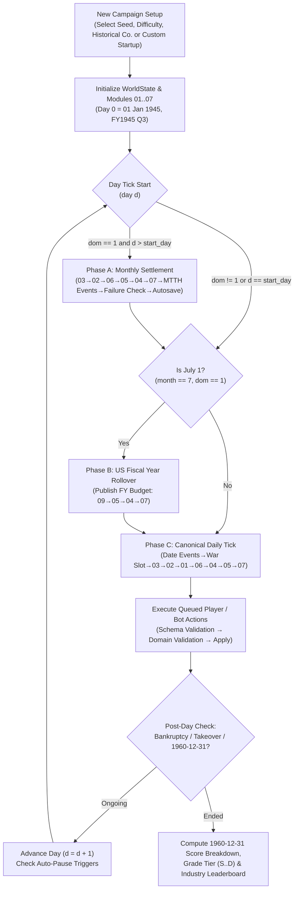

# 09 — Core Game Loop, Calendar, Deterministic RNG, Events, Save/Load, and Scoring

> Status: v1.0 (MVP ticket-ready specification). Owner: Module 09 (`mic.campaign`, `mic.rng`, `mic.calendar`).
> Conforms to: `docs/spec/00_conventions.md` v1.0 and `docs/spec/03_tech_effect_keys.md` v1.0.
> Reference implementation: `sim/mic/rng.py`, `sim/mic/calendar.py`, `sim/mic/campaign/`.
> Tuning & historical data: `sim/data/tuning/core.json`.
> Golden vectors: `sim/golden/core_rng_pcg32.json`, `sim/golden/core_calendar.json`, `sim/golden/core_campaign_smoke.json`.

---

## 1. Purpose & Player Fantasy

Module 09 is the **spine and conductor** of *Military-Industrial Complex: Jet Age*. While Modules 01–07 implement the domain rules of aerodynamics, jet propulsion, research, corporate finance, military procurement, flight testing, and competitor AI, Module 09 binds them into a cohesive, historically grounded, real-time-with-pause strategic simulation spanning **January 1, 1945 (`day = 0`) through December 31, 1960 (`day = 5843`)**.

### 1.1 Player Fantasy
The player sits in the chief executive's office of an American combat aircraft manufacturer from the final months of World War II to the height of the Cold War Mach 2 interceptor era:
- **Living through the real macro-historical rollercoaster**: The player feels the shock of the August 1945 V-J Day contract cancellations (when US aircraft procurement plunged from \$13.8B in FY1945 to \$590M in FY1947), the birth of the independent USAF and Chuck Yeager's Mach 1 flight in autumn 1947, the sudden tripling of procurement budgets after the June 1950 Korean War outbreak and MiG-15 appearances over the Yalu, the 1952 Whitcomb Area Rule breakthrough, the 1955 "Bomber Gap" interceptor boom, and the 1957 Sputnik missile pivot.
- **Pacing and temporal agency**: Time advances in 1-day ticks at speeds 1–5 (with optional Smart Speed auto-compression between milestones and configurable auto-pause triggers). The player never babysits daily micro-accounting—finances settle cleanly on the **1st of each month**, and military budgets renew on **July 1** (the historical pre-1976 US Federal Fiscal Year start)—while engineering, wind-tunnel, prototype, and flight-test milestones tick **daily**.
- **Fair, reproducible consequences**: Every random roll (wind-tunnel measurement noise, prototype flaw discovery, source-selection evaluation noise, MTTH events) draws from an isolated, named **PCG32** stream seeded from the campaign's master seed. Saving and reloading mid-campaign produces the **exact same bit-for-bit simulation trajectory** in both Python and C#.

---

## 2. Scope (MVP In / Out)

| Category | In Scope for MVP (USA 1945-01-01 → 1960-12-31) | Out of Scope (Deferred to Phase 11+) |
|---|---|---|
| **Timeline & Calendar** | Proleptic Gregorian calendar (`day 0 = 1945-01-01` to `day 5843 = 1960-12-31`); pre-1976 US Federal Fiscal Year starting July 1 (FY1945–FY1961); daily and monthly settlement ticks; speeds 1–5 + Smart Speed + 11 auto-pause triggers. | Post-1960 timeline (1961–2030); Congressional Budget Act 1976 October 1 fiscal year transition. |
| **Deterministic RNG** | Pure bit-exact PCG32 (`PCG-XSH-RR`), FNV-1a 64-bit stream hashing, stateless Box-Muller normal, Lemire/O'Neill unbiased bounded integers, deterministic `weighted_choice`, `shuffle`, and `mtth_prob`. | Hardware non-deterministic RNGs; cached spare normal draws that complicate serialization. |
| **Macro & Events** | Real US Defense & Aircraft Procurement budget table (FY1945–FY1961); 16 scripted historical events + monthly MTTH company/industry events; recursive JSON condition DSL; multi-option player choices with 30-day timeout. | Dynamic alternate-history war generation; international arms export approval workflow; multi-nation diplomacy tree. |
| **Game Setup & End States** | 9 historical US manufacturers + Custom Startup builder with 4 founder backgrounds; 4 difficulty presets (`easy`, `normal`, `hard`, `historical`); insolvency grace period + emergency bailout loan + bankruptcy; post-1948 24-month idle hostile takeover; `1960-12-31` composite victory scoring & industry leaderboard (`S`..`D`). | Non-US playable nations (UK, France, USSR, Sweden); multiplayer; 3D combat replay viewer. |
| **Action API & Save/Load** | 26 strongly-typed player/bot commands with schema + domain validation; versioned JSON/gzip save envelope with envelope & per-module migration chains; rotating monthly & yearly autosaves; Ironman option. | Cloud save sync; binary delta-compressed network packets. |

---

## 3. Player-Facing Flow



### 3.1 Step-by-Step Player Experience
1. **Campaign Setup**: The player chooses:
   - **Company**: One of the 9 historical US fighter primes (`lockheed`, `north_american`, `republic`, `grumman`, `mcdonnell`, `northrop`, `convair`, `vought`, `douglas`) with authentic 1945 cash, engineers, wind-tunnel level, factory floor space, and USAF/USN reputation—or **Custom Startup** (entering company name, HQ state, and 1 of 4 **Founder Backgrounds**: *Ex-NACA Aerodynamicist*, *Wartime Production Executive*, *Test-Pilot Entrepreneur*, or *Wall Street Syndicate*).
   - **Difficulty**: *Easy*, *Normal*, *Hard*, or *Historical* (plus optional *Ironman* single-slot save mode).
   - **Campaign Seed**: Any 64-bit integer (displayed as hex/decimal for sharing reproducible campaigns).
2. **Real-Time-with-Pause Loop**:
   - The top bar displays the current date (`01 Jan 1945`), US Fiscal Year (`FY1945 Q3`), cash balance, net monthly burn/income projection, and speed controls (`Pause [Space]`, `1x`..`5x`, `Smart Speed`).
   - Whenever a high-priority notification fires whose category is enabled in `autopause_defaults` (e.g., `rfp_issued`, `proposal_due_7d`, `contract_awarded`, `prototype_first_flight`, `major_flaw_discovered`, `event_choice_required`, `low_cash_warning`), the clock automatically pauses and surfaces the notification or modal.
3. **Interactive Events**:
   - Single-option historical events (e.g., *V-J Day & Contract Cancellations*, *Bell X-1 Breaks Mach 1*, *Korean War Outbreak*, *Whitcomb Area Rule*, *Sputnik Shock*) apply their macro and tech effects immediately and pause if marked `major: true`.
   - Multi-option events (e.g., *1949 Revolt of the Admirals Congressional Testimony*, *Industrial Labor Dispute*, *NACA High-Speed Symposium Invite*) enter `pending_choices` with a **30-day countdown**. If the player does not submit `core.choose_event_option` within 30 days, the engine auto-resolves the event on `expires_day` using the option `ai_weight` distribution.
4. **End-of-Campaign / Failure**:
   - **Financial Distress & Emergency Bailout**: If player cash drops below `\$0`, an insolvency counter increments daily and triggers a `low_cash_warning` auto-pause on Day 1. If cash remains negative for `bankruptcy_grace_days` (`90` days on Normal) and debt is still within `85%` of initial net worth, an automatic emergency V-Loan bailout restores cash to `+\$250,000`. If credit capacity is exhausted, the campaign ends in **Bankruptcy**.
   - **Hostile Takeover / Board Ouster**: Starting in `1948`, if the player goes **24 consecutive months** without an active production contract AND company net worth falls below **25%** of starting net worth, the board accepts a forced acquisition (**Forced Takeover**). A warning fires at **18 idle months**.
   - **December 31, 1960 Victory Evaluation**: Surviving to `1960-12-31` (`day = 5843`) completes the MVP campaign and presents the **Executive Legacy Report**: score breakdown in constant-1950 dollars, aircraft delivered, prime contracts won, service reputation, technology leadership, Grade Tier (`S` through `D`), and rank #1–#9 against all AI manufacturers.

---

## 4. Data Schemas

### 4.1 Calendar & `TickSchedule` (`sim/mic/calendar.py`)
```json
{
  "day": 181,
  "year": 1945,
  "month": 7,
  "day_of_month": 1,
  "iso": "1945-07-01",
  "weekday": 6,
  "calendar_quarter": 3,
  "fiscal_year": 1946,
  "fiscal_quarter": 1,
  "is_month_start": true,
  "is_month_end": false,
  "is_quarter_start": true,
  "is_fiscal_quarter_start": true,
  "is_year_start": false,
  "is_fiscal_year_start": true,
  "days_in_current_month": 31,
  "days_in_prev_month": 30
}
```

### 4.2 RNG Serialization Schema (`sim/mic/rng.py`)
All 64-bit unsigned integers in `PCG32` and `RngStreamRegistry` are serialized as `0x`-prefixed 16-digit lowercase hex strings so JSON parsers that use IEEE-754 double precision (53-bit significand) never truncate 64-bit state words:
```json
{
  "master_seed": "0x000000000128c8b5",
  "streams": {
    "ai.bidding": {
      "state": "0x8a913e2204f1c901",
      "inc": "0x36cf88be972df985"
    },
    "proc.eval": {
      "state": "0x41b0291a88c1e773",
      "inc": "0x211cad0d6735316f"
    }
  }
}
```

### 4.3 Event Definition & Condition DSL Schema (`sim/data/tuning/core.json`)
```json
{
  "id": "evt_mtth_industrial_labor_dispute",
  "title_key": "event.mtth_strike.title",
  "desc_key": "event.mtth_strike.desc",
  "scope": "player",
  "major": false,
  "fire_once": true,
  "trigger": {
    "type": "mtth",
    "mtth_days": 720.0,
    "condition": {
      "all": [
        { "var": "date.year", "op": ">=", "value": 1946 },
        { "var": "player.cash_usd", "op": ">=", "value": 2000000.0 }
      ]
    }
  },
  "options": [
    {
      "id": "settle_generously",
      "label_key": "event.mtth_strike.opt_settle",
      "ai_weight": 0.7,
      "effects": [
        { "op": "add_cash", "delta_usd": -350000.0 },
        { "op": "add_political_capital", "delta": 3.0 }
      ]
    },
    {
      "id": "hold_firm",
      "label_key": "event.mtth_strike.opt_firm",
      "ai_weight": 0.3,
      "effects": [
        { "op": "add_cash", "delta_usd": -100000.0 },
        { "op": "add_reputation", "customer": "USAF", "delta": -0.02 },
        { "op": "add_reputation", "customer": "USN", "delta": -0.02 }
      ]
    }
  ]
}
```

#### Supported Condition Variables & Operators
- **Combinators**: `{"all": [...]}`, `{"any": [...]}`, `{"not": {...}}`
- **Comparison operators (`op`)**: `"=="`, `"!="`, `"<"`, `"<="`, `">"`, `">="`, `"in"`
- **Variable paths (`var`)**:
  - `date.day` (`int`), `date.year` (`int`), `date.month` (`int`), `date.day_of_month` (`int`), `date.fiscal_year` (`int`), `date.fiscal_quarter` (`int`)
  - `flag.<flag_name>` (`bool`, defaults to `false` when unset)
  - `macro.<key>` (`float | bool | str` from `MacroEnvironment.vars`)
  - `player.cash_usd` (`float`), `player.debt_usd` (`float`), `player.political_capital` (`float`), `player.reputation.USAF` (`float`), `player.reputation.USN` (`float`), `player.reputation.export` (`float`)

#### Supported Effect Opcodes (`op`)
| Effect `op` | Parameters | Effect |
|---|---|---|
| `set_flag` | `flag: str`, `value: bool` | Sets `world.flags[flag] = value`. |
| `set_macro` | `key: str`, `value: float\|bool\|str` | Sets `world.macro.vars[key] = value` (clamping `tension` to `[0, 1]`). |
| `add_macro` | `key: str`, `delta: float` | Adds `delta` to `world.macro.vars[key]` (clamping `tension` and service priorities to `[0, 1]`). |
| `add_cash` | `delta_usd: float` | Adds `delta_usd` (positive or negative) to player `cash_usd`. |
| `add_reputation` | `customer: "USAF"\|"USN"\|"export"`, `delta: float` | Adjusts player reputation with `customer`, clamped to `[0, 1]`. |
| `add_political_capital` | `delta: float` | Adjusts player `political_capital`, clamped to `[0, 100]`. |
| `tech_boost` | `discipline: "aero"\|"structures"\|"propulsion"\|"systems"`, `points: float` | Injects research progress points into the player's next unresearched tech node in `discipline`. |
| `schedule_event` | `event_id: str`, `delay_days: int` | Schedules `event_id` to fire on `current_day + delay_days`. |

### 4.4 Historical US Defense & Military Aircraft Procurement Budget Table (FY1945–FY1961)

Compiled from **OMB Historical Table 3.1** (*Outlays by Superfunction and Function: National Defense*), **DoD National Defense Budget Estimates (Green Book)**, and **USAF / USN Bureau of Aeronautics Statistical Digests**. Stored in `sim/data/tuning/core.json` under `us_defense_budget_fy1945_1961.fiscal_years`. All monetary columns below are in **millions of nominal (then-year) US dollars**; `deflator_1950` converts nominal dollars into constant-1950 dollars via $\text{USD}_{1950} = \text{USD}_{\text{nominal}} / \text{deflator}_{1950}$.

| Fiscal Year | Calendar Span | DoD Total (\$M) | USAF Total (\$M) | USN Aviation (\$M) | Aircraft Proc. Total (\$M) | USAF Aircraft Proc. (\$M) | USN Aircraft Proc. (\$M) | Aviation R&D (\$M) | Deflator (1950=1.000) | Historical Context |
|---|---|---|---|---|---|---|---|---|---|---|
| **FY1945** | Jul 1944 – Jun 1945 | 82,965 | 18,500 | 5,700 | **13,800** | 10,600 | 3,200 | 520 | 0.746 | WWII peak war production (B-29, P-51, F4U, P-80A initial batch) |
| **FY1946** | Jul 1945 – Jun 1946 | 42,681 | 4,300 | 1,800 | **1,450** | 1,000 | 450 | 310 | 0.810 | V-J Day demobilization and mass wartime contract cancellations |
| **FY1947** | Jul 1946 – Jun 1947 | 12,808 | 2,350 | 1,000 | **590** | 410 | 180 | 250 | 0.926 | Postwar aviation industry trough; X-1 & early jet prototypes |
| **FY1948** | Jul 1947 – Jun 1948 | 9,105 | 2,750 | 1,100 | **1,150** | 820 | 330 | 320 | 0.999 | Independent USAF created (Sep 1947); Finletter Commission 70-Group report |
| **FY1949** | Jul 1948 – Jun 1949 | 13,150 | 3,550 | 1,400 | **1,750** | 1,250 | 500 | 390 | 0.990 | Berlin Blockade & Airlift; F-86A Sabre, F-84, F9F Panther production |
| **FY1950** | Jul 1949 – Jun 1950 | 13,724 | 3,600 | 1,300 | **1,920** | 1,380 | 540 | 410 | 1.000 | Louis Johnson austerity; Revolt of the Admirals; Soviet Joe-1 A-bomb |
| **FY1951** | Jul 1950 – Jun 1951 | 23,566 | 6,350 | 2,550 | **3,950** | 2,800 | 1,150 | 680 | 1.079 | Korean War outbreak (Jun 1950) & NSC-68 emergency appropriations |
| **FY1952** | Jul 1951 – Jun 1952 | 46,089 | 12,100 | 4,200 | **7,450** | 5,400 | 2,050 | 1,050 | 1.103 | Korean War rearmament surge; 143-Wing USAF buildup; MiG Alley lessons |
| **FY1953** | Jul 1952 – Jun 1953 | 52,802 | 15,100 | 4,500 | **9,200** | 6,850 | 2,350 | 1,280 | 1.111 | Korean War peak outlays; Century Series (F-100..F-104) initiated |
| **FY1954** | Jul 1953 – Jun 1954 | 49,266 | 15,600 | 4,200 | **8,850** | 6,650 | 2,200 | 1,320 | 1.117 | Korean Armistice (Jul 1953); Eisenhower "New Look" (NSC 162/2) |
| **FY1955** | Jul 1954 – Jun 1955 | 42,729 | 16,400 | 3,700 | **8,400** | 6,400 | 2,000 | 1,410 | 1.113 | Massive Retaliation doctrine; F8U Crusader & F-104A/F-105 development |
| **FY1956** | Jul 1955 – Jun 1956 | 42,523 | 16,750 | 3,900 | **8,250** | 6,250 | 2,000 | 1,620 | 1.130 | Tushino "Bomber Gap" scare boosts ADC interceptor & missile budgets |
| **FY1957** | Jul 1956 – Jun 1957 | 45,433 | 18,350 | 4,050 | **8,600** | 6,550 | 2,050 | 1,880 | 1.168 | Suez & Hungary crises; Mach 2 all-weather interceptors (F-106, F4H-1) |
| **FY1958** | Jul 1957 – Jun 1958 | 46,815 | 18,450 | 4,350 | **8,450** | 6,300 | 2,150 | 2,050 | 1.200 | Sputnik 1 shock (Oct 1957); Gaither Report; missile share rises |
| **FY1959** | Jul 1958 – Jun 1959 | 49,015 | 19,100 | 4,300 | **7,750** | 5,750 | 2,000 | 2,250 | 1.210 | Second Taiwan Strait Crisis (AIM-9B Sidewinder debut); NACA → NASA |
| **FY1960** | Jul 1959 – Jun 1960 | 48,130 | 19,050 | 4,050 | **6,500** | 4,800 | 1,700 | 2,350 | 1.229 | F-108 Rapier cancelled (Sep 1959); U-2 incident (May 1960) |
| **FY1961** | Jul 1960 – Jun 1961 | 49,601 | 19,800 | 4,100 | **6,800** | 5,000 | 1,800 | 2,500 | 1.242 | Kennedy "Missile Gap" election; shift toward multi-role fighters |

### 4.5 Scripted Historical Events Table (1945–1960)

| Event ID | Trigger Date / Type | Scope | Major | Historical Event & Gameplay Effect |
|---|---|---|---|---|
| `evt_1945_german_tech_exploitation` | `1945-05-15` | `global` | Yes | **Operation Lusty & German Swept-Wing Data**: `naca_data_sharing_bonus += 0.10`, `+120` aero research points. |
| `evt_1945_vj_day_demobilization` | `1945-08-15` | `global` | Yes | **V-J Day & Wartime Contract Cancellations**: `war_active = false`, `tension = 0.20`, `procurement_budget_mult = 0.65`. |
| `evt_1946_bikini_crossroads` | `1946-07-01` | `global` | No | **Operation Crossroads (Bikini Atoll)**: `nuclear_delivery_priority += 0.10`, `procurement_budget_mult = 0.85`. |
| `evt_1947_national_security_act` | `1947-09-18` | `global` | Yes | **National Security Act of 1947 (Independent USAF)**: Sets `usaf_independent = true`, `procurement_budget_mult = 1.0`, `tension += 0.10`. |
| `evt_1947_xs1_mach_1` | `1947-10-14` | `global` | Yes | **Bell XS-1 Breaks the Sound Barrier**: Sets `sound_barrier_broken = true`, `naca_data_sharing_bonus += 0.10`, `+150` aero research points. |
| `evt_1948_berlin_blockade` | `1948-06-24` | `global` | Yes | **Berlin Blockade & Airlift**: `tension += 0.20`, `procurement_budget_mult += 0.10`. |
| `evt_1949_revolt_of_admirals` | `1949-04-23` | `player` | No | **The "Revolt of the Admirals" Hearings** (3 options): Back USAF B-36 (`+0.05` USAF rep, `-0.05` USN rep, `+5` pol cap), back Navy supercarriers (`+0.06` USN rep, `-0.05` USAF rep, `+5` pol cap), or stay neutral (`+2` pol cap). |
| `evt_1949_soviet_joe1_atomic_test` | `1949-09-23` | `global` | Yes | **Soviet "Joe-1" Atomic Bomb Detected**: `soviet_nuclear_armed = true`, `tension += 0.15`, `usaf_priority_interceptor = 0.75`. |
| `evt_1950_korean_war_outbreak` | `1950-06-25` | `global` | Yes | **Outbreak of the Korean War & NSC-68**: `war_active = true`, `tension = 0.85`, `procurement_budget_mult = 1.35`, `rd_budget_mult = 1.25`. |
| `evt_1950_mig15_shock_over_yalu` | `1950-11-08` | `global` | Yes | **MiG-15 Shock over the Yalu**: `mig15_encountered = true`, `usaf_priority_day_fighter = 0.85`, `+100` aero research points. |
| `evt_1952_whitcomb_area_rule` | `1952-09-15` | `global` | Yes | **Richard Whitcomb's Transonic Area Rule (NACA Langley)**: `whitcomb_area_rule_discovered = true`, `naca_data_sharing_bonus += 0.15`, `+200` aero research points. |
| `evt_1953_korean_armistice` | `1953-07-27` | `global` | Yes | **Korean Armistice & Eisenhower "New Look"**: `war_active = false`, `tension = 0.60`, `procurement_budget_mult = 1.05`, `nuclear_delivery_priority = 0.70`. |
| `evt_1955_tushino_bomber_gap` | `1955-07-10` | `global` | Yes | **Tushino Air Show & The "Bomber Gap" Scare**: `usaf_priority_interceptor = 0.90`, `missile_enthusiasm = 0.55`, `procurement_budget_mult += 0.10`. |
| `evt_1957_sputnik_shock` | `1957-10-04` | `global` | Yes | **Sputnik 1 & The Missile Age**: `tension = 0.78`, `missile_enthusiasm = 0.85`, `rd_budget_mult = 1.35`. |
| `evt_1958_taiwan_strait_sidewinder` | `1958-09-24` | `global` | Yes | **Second Taiwan Strait Crisis (GAR-8/AIM-9B Combat Debut)**: `missile_enthusiasm = 0.92`, `+150` systems research points. |
| `evt_1960_u2_incident` | `1960-05-01` | `global` | Yes | **U-2 Shootdown over Sverdlovsk**: `tension = 0.82`, `usaf_priority_fighter_bomber = 0.80` (low-altitude penetration emphasis). |
| `evt_mtth_industrial_labor_dispute` | `MTTH = 720d` (`year >= 1946`) | `player` | No | **IAM Plant Labor Walkout** (2 options): Settle generously (`-\$350k`, `+3` pol cap) or hold firm (`-\$100k`, `-0.02` USAF/USN rep). |
| `evt_mtth_naca_symposium_invite` | `MTTH = 540d` (`year >= 1948`) | `player` | No | **Classified NACA High-Speed Aerodynamics Conference** (2 options): Send chief aerodynamicist (`-\$75k`, `+90` aero pts, `+0.02` USAF rep) or decline. |

### 4.6 Save Envelope Schema (`sim/mic/campaign/save_load.py`)
```json
{
  "save_schema_version": 1,
  "game_version": "0.1.0-mvp",
  "campaign_id": "cmp_default",
  "world_state": {
    "seed": 42,
    "start_day": 0,
    "end_day": 5843,
    "day": 181,
    "difficulty_id": "normal",
    "player_company_id": "mcdonnell",
    "company_ids": ["convair", "douglas", "grumman", "lockheed", "mcdonnell", "north_american", "northrop", "republic", "vought"],
    "custom_startup": null,
    "rng": { "master_seed": "0x000000000000002a", "streams": {} },
    "macro": { "current_fy": 1946, "vars": {} },
    "events": { "fired_once_ids": [], "pending_choices": {}, "scheduled_events": [], "history": [] },
    "flags": {},
    "notif_seq": 12,
    "notifications": [],
    "autosave_log": ["autosave_slot_1:1945-02-01"],
    "ended": false,
    "outcome": "ongoing",
    "outcome_reason": ""
  },
  "modules": {
    "01_aero_design": { "schema_version": 1, "state": {} },
    "02_engines": { "schema_version": 1, "state": {} },
    "03_tech": { "schema_version": 1, "state": {} },
    "04_economy": { "schema_version": 1, "state": {} },
    "05_procurement": { "schema_version": 1, "state": {} },
    "06_testing": { "schema_version": 1, "state": {} },
    "07_ai": { "schema_version": 1, "state": {} }
  }
}
```

### 4.7 Complete MVP Player / Bot Action Catalog (`sim/mic/campaign/contracts.py`)

Every action submitted by the UI or a bot policy is a `PlayerAction(action_type, actor_company_id, params)` validated first against `ACTION_CATALOG` (`validate_action_schema`) and then against the owning module's `validate_action(world, action)`:

| # | `action_type` | Owner Module | Required Parameters (`name: type [bounds/enum]`) | Optional Parameters | Domain Validation & Effect |
|---|---|---|---|---|---|
| 1 | `design.create` | `01_aero_design` | `name: str`, `role_tags: list[str]`, `spec: dict` | — | Creates a new editable draft `AircraftDesign` and computes initial sim performance estimate. |
| 2 | `design.modify` | `01_aero_design` | `design_id: str`, `patch: dict` | — | Fails with `ERR_DESIGN_FROZEN` if already frozen; updates geometry/systems and refreshes sim estimate. |
| 3 | `design.clone` | `01_aero_design` | `source_design_id: str`, `new_name: str` | — | Copies an existing design into a new unfrozen variant. |
| 4 | `design.freeze` | `01_aero_design` | `design_id: str` | — | Freezes a draft design so wind-tunnel, prototype, and bid actions can reference it. |
| 5 | `engine.start_project` | `02_engines` | `name: str`, `architecture: str` (`centrifugal_jet`\|`axial_jet`\|`twin_spool_jet`\|`turbofan`), `target_thrust_dry_N: float` (`[2000, 250000]`), `afterburner: bool`, `opr: float` (`[2.5, 20.0]`), `tit_K: float` (`[950, 1600]`), `engineers_assigned: int` (`[1, 500]`) | `base_engine_id: str` | Starts an in-house engine development or derivative project. |
| 6 | `engine.set_engineers` | `02_engines` | `project_id: str`, `engineers_assigned: int` (`[0, 500]`) | — | Updates propulsion engineers assigned to an active engine R&D project. |
| 7 | `engine.cancel_project` | `02_engines` | `project_id: str` | — | Cancels an active engine project and releases assigned engineers. |
| 8 | `tech.set_allocation` | `03_tech` | `tech_id: str`, `engineers_assigned: int` (`[0, 500]`) | — | Fails with `ERR_TECH_ALREADY_UNLOCKED` if already unlocked; sets engineer allocation on `tech_id`. |
| 9 | `tech.cancel_research` | `03_tech` | `tech_id: str` | — | Sets engineer allocation on `tech_id` to 0 while preserving accumulated progress. |
| 10 | `econ.hire_engineers` | `04_economy` | `discipline: str` (`aero`\|`structures`\|`propulsion`\|`systems`), `count: int` (`[1, 200]`) | — | Fails with `ERR_INSUFFICIENT_FUNDS` if cash < recruitment cost; adds engineers. |
| 11 | `econ.fire_engineers` | `04_economy` | `discipline: str` (`aero`\|`structures`\|`propulsion`\|`systems`), `count: int` (`[1, 200]`) | — | Fails with `ERR_NOT_ENOUGH_ENGINEERS` if headcount < `count`; pays severance and reduces headcount. |
| 12 | `econ.upgrade_wind_tunnel` | `04_economy` | `target_level: int` (`[1, 4]`) | — | Fails with `ERR_INVALID_LEVEL` if `target_level <= current` or `ERR_INSUFFICIENT_FUNDS`; upgrades company wind tunnel. |
| 13 | `econ.expand_factory` | `04_economy` | `additional_floor_m2: float` (`[1000, 200000]`) | — | Fails with `ERR_INSUFFICIENT_FUNDS`; expands factory floor space. |
| 14 | `econ.build_test_site` | `04_economy` | *(none)* | — | Fails with `ERR_ALREADY_BUILT` or `ERR_INSUFFICIENT_FUNDS`; constructs dedicated flight-test instrumentation site. |
| 15 | `econ.take_loan` | `04_economy` | `principal_usd: float` (`[100000, 100000000]`) | — | Fails with `ERR_DEBT_LIMIT_EXCEEDED` if total debt exceeds credit limit; adds `principal_usd` to cash and debt. |
| 16 | `econ.repay_loan` | `04_economy` | `amount_usd: float` (`[10000, 100000000]`) | — | Fails with `ERR_NO_DEBT` or `ERR_INSUFFICIENT_FUNDS`; repays up to `debt_usd`. |
| 17 | `econ.set_production_rate` | `04_economy` | `contract_id: str`, `units_per_month: int` (`[0, 200]`) | — | Fails with `ERR_CONTRACT_NOT_FOUND`; adjusts monthly aircraft output on an active contract. |
| 18 | `proc.submit_proposal` | `05_procurement` | `requirement_id: str`, `design_id: str`, `bid_unit_price_usd: float` (`[10000, 50000000]`) | `promised_performance: dict` | Fails with `ERR_REQUIREMENT_NOT_OPEN` or `ERR_DESIGN_NOT_FROZEN`; registers proposal for evaluation. |
| 19 | `proc.withdraw_proposal` | `05_procurement` | `requirement_id: str` | — | Fails with `ERR_NO_PROPOSAL`; removes a submitted proposal before `proposal_due`. |
| 20 | `proc.lobby_program` | `05_procurement` | `requirement_id: str`, `political_capital_spent: float` (`[1.0, 50.0]`) | — | Fails with `ERR_INSUFFICIENT_POLITICAL_CAPITAL`; deducts political capital and increases bid evaluation bias. |
| 21 | `test.run_wind_tunnel` | `06_testing` | `design_id: str`, `facility: str` (`company`\|`naca`), `regime: str` (`subsonic`\|`transonic`\|`supersonic`\|`high_alpha`) | — | Requires frozen design; runs wind-tunnel campaign, narrowing estimate `sigma` and detecting flaws. |
| 22 | `test.build_prototype` | `06_testing` | `design_id: str`, `quantity: int` (`[1, 6]`) | — | Requires frozen design; orders `quantity` prototype airframes. |
| 23 | `test.schedule_flight_test` | `06_testing` | `design_id: str`, `syllabus: list[str]`, `thoroughness: str` (`minimal`\|`standard`\|`exhaustive`) | — | Fails with `ERR_NO_PROTOTYPE` if no prototype ordered/ready; schedules flight-test syllabus. |
| 24 | `test.fix_flaw` | `06_testing` | `design_id: str`, `flaw_id: str` | — | Fails with `ERR_FLAW_NOT_FOUND`; commits funds and time to rectify a discovered flaw. |
| 25 | `core.choose_event_option` | `09_core_loop` | `event_id: str`, `option_id: str` | — | Fails with `ERR_EVENT_NOT_PENDING` or `ERR_INVALID_EVENT_OPTION`; executes chosen event option effects. |
| 26 | `core.dismiss_notification` | `09_core_loop` | `notification_id: str` | — | Fails with `ERR_NOTIFICATION_NOT_FOUND`; marks notification as dismissed. |

---

## 5. Algorithms & Exact Formulas

### 5.1 Bit-Exact PCG32 (`PCG-XSH-RR`) & FNV-1a 64-Bit Stream Hashing (`sim/mic/rng.py`)

#### 5.1.1 FNV-1a 64-Bit Stream Hash
Given a stream name string $S$ encoded as UTF-8 bytes $b_0, b_1, \dots, b_{k-1}$:
$$h_0 = \text{0xCBF29CE484222325}, \quad \text{PRIME} = \text{0x00000100000001B3}$$
$$h_{i+1} = \big((h_i \oplus b_i) \times \text{PRIME}\big) \bmod 2^{64}$$
For a campaign with master seed $M \in [0, 2^{64}-1]$, a named stream $S$ is initialized with:
$$\text{initstate} = (M \oplus h_k) \bmod 2^{64}, \quad \text{initseq} = h_k$$

#### 5.1.2 PCG32 State Transition & Output Function
Internal state is a pair of unsigned 64-bit integers $(\text{state}, \text{inc})$ where $\text{inc}$ is always odd.
- **Seeding (`pcg32_srandom_r(initstate, initseq)`)**:
  1. $\text{state} \leftarrow 0$, $\text{inc} \leftarrow ((\text{initseq} \ll 1) \mid 1) \bmod 2^{64}$
  2. Call `next_u32()` once (discard output).
  3. $\text{state} \leftarrow (\text{state} + \text{initstate}) \bmod 2^{64}$
  4. Call `next_u32()` once (discard output).
- **32-Bit Step (`next_u32()`)**:
  $$\text{oldstate} = \text{state}$$
  $$\text{state} \leftarrow (\text{oldstate} \times 6364136223846793005 + \text{inc}) \bmod 2^{64}$$
  $$\text{xorshifted} = \big(((\text{oldstate} \gg 18) \oplus \text{oldstate}) \gg 27\big) \bmod 2^{32}$$
  $$\text{rot} = (\text{oldstate} \gg 59) \ \& \ 31$$
  $$\text{output}_{32} = (\text{xorshifted} \gg \text{rot}) \mid \big((\text{xorshifted} \ll ((-\text{rot}) \ \& \ 31)) \bmod 2^{32}\big)$$
- **64-Bit Draw (`next_u64()`)**:
  Draws $\text{hi} = \text{next\_u32}()$ first, then $\text{lo} = \text{next\_u32}()$, returning $(\text{hi} \ll 32) \mid \text{lo}$.
- **53-Bit Uniform IEEE-754 `float64` in $[0, 1)$ (`next_float()`)**:
  $$u = (\text{next\_u64}() \gg 11) \times 2^{-53}$$
- **Unbiased Bounded Integer in $[0, B)$ (`next_bounded(B)`)**:
  Uses Lemire/O'Neill rejection with $\text{threshold} = (2^{32} - B) \bmod B$: draw $r = \text{next\_u32}()$ until $r \ge \text{threshold}$, then return $r \bmod B$.
- **Stateless Box-Muller Normal (`normal(mu, sigma)`)**:
  Draws two uniform floats $u_1 = \max(\text{next\_float}(), 2^{-53})$ and $u_2 = \text{next\_float}()$:
  $$z_0 = \sqrt{-2 \ln(u_1)} \cos(2\pi u_2), \quad X = \mu + \sigma z_0$$
  Because this transform has **no rejection loop** and **no cached spare variable**, every call to `normal()` advances the PCG32 state by **exactly 4 `next_u32()` steps** and requires zero extra fields in save files.
- **Mean-Time-To-Happen Monthly Probability (`mtth_prob(mtth_days, dt_days)`)**:
  Where `mtth_days` is the half-life (median time to happen, $P(T \le \text{mtth\_days}) = 0.5$):
  $$p = 1 - 2^{-\Delta t / \text{mtth\_days}} = 1 - \exp\!\left(-\frac{\ln 2 \cdot \Delta t}{\text{mtth\_days}}\right)$$

### 5.2 Calendar & Pre-1976 US Fiscal Year Math (`sim/mic/calendar.py`)
- **Civil-to-Days Conversion**: Uses Howard Hinnant's proleptic Gregorian integer algorithms (`days_from_civil` and `civil_from_days`) shifted by `_CIVIL_OFFSET_1945_01_01 = 710337`, so `ymd_to_day(1945, 1, 1) == 0` and `ymd_to_day(1960, 12, 31) == 5843`.
- **US Federal Fiscal Year & Quarter**:
  $$\text{FY}(y, m) = \begin{cases} y + 1 & \text{if } m \ge 7 \\ y & \text{if } m \le 6 \end{cases}, \quad \text{FQ}(m) = \begin{cases} \lfloor (m - 7)/3 \rfloor + 1 & \text{if } m \ge 7 \\ \lfloor (m - 1)/3 \rfloor + 3 & \text{if } m \le 6 \end{cases}$$

### 5.3 Canonical Update Order (`sim/mic/campaign/contracts.py`)
On every simulated day $d$, `Campaign.step_day()` executes up to three phases in strict order:
1. **Phase A — Monthly Settlement (`CANONICAL_MONTHLY_ORDER`)**, executed iff `day_of_month == 1` and `d > start_day`:
   1. `03_tech.on_month_start` (tech maturity diffusion)
   2. `02_engines.on_month_start` (engine project monthly hooks)
   3. `06_testing.on_month_start` (testing facility monthly hooks)
   4. `05_procurement.on_month_start` (contract milestone settlements)
   5. `04_economy.on_month_start` (payroll, facility overhead, debt interest, production deliveries, idle-month counter)
   6. `07_ai.on_month_start` (competitor AI monthly financial/strategic review)
   7. `09_events_mtth` (`EventEngine.on_month_start` using `days_in_prev_month`)
   8. `09_scoring_and_end_check` (`check_failure_conditions` for bankruptcy and 24-month idle takeover)
   9. `09_autosave` (rotates across 3 monthly slots `autosave_slot_{0,1,2}` plus `autosave_yearly_{year}` on Jan 1)
2. **Phase B — US Fiscal Year Rollover (`CANONICAL_FY_ROLLOVER_ORDER`)**, executed iff `month == 7` and `day_of_month == 1`:
   1. `09_macro`: sets `current_fy = schedule.fiscal_year` and publishes the new `FiscalYearBudget`
   2. `05_procurement.on_fiscal_year_start(world, fy)`
   3. `04_economy.on_fiscal_year_start(world, fy)`
   4. `07_ai.on_fiscal_year_start(world, fy)`
3. **Phase C — Daily Tick (`CANONICAL_DAILY_ORDER`)**, executed every day:
   1. `09_events_date` (`EventEngine.on_day_tick`: auto-resolves expired event choices, fires date-triggered and scheduled events)
   2. `11_war_reserved` (reserved slot for Phase 11 operational air war module)
   3. `03_tech.on_day_tick`
   4. `02_engines.on_day_tick`
   5. `01_aero_design.on_day_tick`
   6. `06_testing.on_day_tick`
   7. `04_economy.on_day_tick` (updates `insolvent_days` counter and low-cash warnings)
   8. `05_procurement.on_day_tick` (issues RFPs on `issue_day`, emits 7-day deadline warnings, evaluates & awards contracts on `proposal_due_day`)
   9. `07_ai.on_day_tick` (competitor AI daily actions)
   10. **Player / Bot Policy Action Execution** (`submit_action` for each action emitted by `PlayerPolicy.decide_actions`)
   11. `09_post_day` (`check_failure_conditions` and `day >= end_day` completion check)

### 5.4 End-of-Campaign `1960-12-31` Victory Scoring Formula (`sim/mic/campaign/scoring.py`)
For each manufacturer $c$ (player and AI):
$$\text{NW}_{1950}(c) = \frac{\text{NetWorth}_{\text{nominal}}(c)}{\text{deflator}_{1950}(\text{current\_fy})}$$
$$S_{\text{NW}} = \max\!\left(0, \frac{\text{NW}_{1950}(c)}{50{,}000}\right), \quad S_{\text{deliv}} = 1.2 \times N_{\text{delivered}}(c), \quad S_{\text{contracts}} = 250.0 \times N_{\text{contracts\_won}}(c)$$
$$S_{\text{rep}} = 600.0 \times \frac{\text{Rep}_{\text{USAF}} + \text{Rep}_{\text{USN}} + \text{Rep}_{\text{export}}}{3}, \quad S_{\text{tech}} = 35.0 \times N_{\text{unlocked\_beyond\_1945}}(c)$$
$$S_{\text{raw}}(c) = S_{\text{NW}} + S_{\text{deliv}} + S_{\text{contracts}} + S_{\text{rep}} + S_{\text{tech}}$$
$$S_{\text{final}}(c) = S_{\text{raw}}(c) \times \begin{cases} M_{\text{difficulty}} & \text{if } c \text{ is player} \\ 1.0 & \text{if } c \text{ is AI} \end{cases}$$

Grade tiers based on $S_{\text{final}}$:
- **Tier `S`** ($S_{\text{final}} \ge 4500$): `score.tier.skunk_works_legend` (*Legendary Arsenal of Democracy*)
- **Tier `A`** ($3000 \le S_{\text{final}} < 4500$): `score.tier.prime_titan` (*Dominant Prime Contractor*)
- **Tier `B`** ($1800 \le S_{\text{final}} < 3000$): `score.tier.established_prime` (*Established Prime Contractor*)
- **Tier `C`** ($900 \le S_{\text{final}} < 1800$): `score.tier.niche_contractor` (*Second-Tier / Niche Manufacturer*)
- **Tier `D`** ($S_{\text{final}} < 900$): `score.tier.subcontractor` (*Struggling Subcontractor*)

---

## 6. Tunables Table (`sim/data/tuning/core.json`)

| Tunable Key Path | Default | Allowed Range | Effect | Rationale |
|---|---|---|---|---|
| `speeds.seconds_per_day.{1..5}` | `2.0, 1.0, 0.4, 0.15, 0.05` | `[0.01, 5.0]` s/day | Real-time clock period per simulated day at speeds 1–5. | Speed 5 (`20 days/s`) traverses 1 quiet year in ~18s; Speed 2 (`1 day/s`) suits active flight testing. |
| `speeds.smart_speed.lookahead_days` | `14` | `3..60` days | Window ahead of scheduled deadlines where Smart Speed stays at `cruise_speed`. | Gives player a 2-week buffer before RFP deadlines. |
| `events.choice_timeout_days` | `30` | `7..90` days | Days before an unanswered multi-option event auto-resolves. | Prevents headless or unpaused runs from stalling indefinitely. |
| `events.max_mtth_events_per_month` | `2` | `1..10` | Cap on MTTH random events firing on a single month boundary. | Prevents random event spam in a single month. |
| `autosave.monthly_rotating_slots` | `3` | `1..12` | Number of rotating monthly autosave slots (`0..2`). | Standard 3-month rolling recovery window + Jan 1 yearly archive. |
| `bankruptcy_and_takeover.grace_period_days_by_difficulty` | `180 / 90 / 60 / 90` | `30..365` days | Consecutive negative-cash days before insolvency check triggers bailout or bankruptcy. | Gives player time to secure a loan or receive a contract milestone payment. |
| `bankruptcy_and_takeover.emergency_bailout_debt_ratio_limit` | `0.85` | `0.0..2.0` | Max `debt_usd / starting_net_worth_usd` eligible for automatic one-time emergency bailout loan. | Prevents sudden death on first liquidity crunch while punishing chronic insolvency. |
| `bankruptcy_and_takeover.takeover_min_year` | `1948` | `1946..1955` | Earliest year in which the 24-month idle takeover check applies. | Protects companies during the historical 1945–1947 postwar procurement trough. |
| `bankruptcy_and_takeover.takeover_idle_months_threshold` | `24` | `12..60` months | Consecutive months without an active contract required (along with `<25%` starting net worth) for forced takeover. | Reflects board/shareholder revolt after 2 full years of empty factory floors and depleted capital. |
| `difficulty_presets.<id>.starting_cash_mult` | `1.5 / 1.0 / 0.75 / 1.0` | `0.5..2.5` | Scales player starting cash across Easy / Normal / Hard / Historical. | Smooths early-game runway for newcomers. |
| `difficulty_presets.<id>.incumbent_bias_mult` | `0.5 / 1.0 / 1.25 / 1.35` | `0.0..2.0` | Scales historical incumbent bias in Module 05 procurement evaluation. | `Historical` preset (`1.35`) makes unseating entrenched primes appropriately challenging. |
| `difficulty_presets.<id>.score_multiplier` | `0.8 / 1.0 / 1.25 / 1.1` | `0.5..2.0` | Multiplies raw 1960 victory score into `final_score`. | Rewards playing on Hard/Historical. |
| `scoring.weights.net_worth_1950_usd_per_point` | `50000.0` | `10000..250000` | Constant-1950 dollars of net worth per 1.0 victory point. | \$100M in 1950 USD yields 2,000 pts, balanced against contracts (250 pts each) and deliveries (1.2 pts/aircraft). |

---

## 7. Edge Cases & Failure Modes

1. **JSON 53-Bit Integer Truncation of 64-Bit RNG State**:
   - *Risk*: Standard JSON parsers (including browser/Godot JSON helpers) parse bare numbers as IEEE-754 `float64`, silently corrupting integers $> 2^{53} - 1$ (`9007199254740991`).
   - *Mitigation*: `PCG32.to_dict()` and `RngStreamRegistry.to_dict()` serialize all `uint64` values (`master_seed`, `state`, `inc`) as `0x`-prefixed 16-character hex strings (`"0xf8cb50292a789b06"`), parsed via `hex_to_u64()`.
2. **Box-Muller $\ln(0)$ Singularity & Spare-Sample Desynchronization**:
   - *Risk*: If `u1 == 0.0`, `math.log(u1)` raises `ValueError: math domain error` in Python or returns `-Infinity` in C#. Furthermore, stateful Box-Muller implementations that cache $\sin(2\pi u_2)$ on odd calls desynchronize RNG streams if a save occurs between odd and even calls.
   - *Mitigation*: `PCG32.normal()` clamps $u_1 = \max(u_1, 2^{-53})$ (`1.1102230246251565e-16`) and computes only the cosine branch $z_0 = \sqrt{-2\ln u_1}\cos(2\pi u_2)$, consuming **4 `next_u32()` draws on every call** with zero cached state.
3. **Unordered Dictionary Iteration Across Languages**:
   - *Risk*: Iterating over an unsorted dict/hash-map when firing events, settling companies, or evaluating proposals causes RNG draws to be consumed in different orders in Python vs C#.
   - *Mitigation*: Every loop in Module 09 sorts keys explicitly (`sorted(self.companies.keys())`, `sorted(bids.keys())`, `sorted(self.modules.keys())`) and serializes JSON with `sort_keys=True`.
4. **NaN / Infinity Contamination in Save Files**:
   - *Risk*: A numerical bug in a physics or economy formula could inject `NaN` or `Infinity` into state, producing non-standard JSON (`NaN`) that crashes on load.
   - *Mitigation*: `save_load._validate_and_canonicalize_json_value()` recursively inspects every float before serialization, raising `ValueError("Non-finite float encountered...")` with the exact JSON path, and normalizes `-0.0` to `0.0`.
5. **Leap-Year Month-End Addition (`add_months`)**:
   - *Risk*: Adding 1 month to `1945-01-31` or `1948-01-31` could produce invalid dates (`1945-02-31`).
   - *Mitigation*: `add_months(day_index, months)` clamps `day_of_month` to `days_in_month(new_year, new_month)` (`1945-02-28` in common years, `1948-02-29` in leap years).

---

## 8. Golden Test Vectors

All golden vectors are generated deterministically by `PYTHONPATH=sim .venv/bin/python -m mic.campaign.golden_gen` and verified by `sim/tests/test_core_rng_calendar.py` and `sim/tests/test_core_campaign.py`:

1. **`sim/golden/core_rng_pcg32.json`** (float relative tolerance `1e-15`, integer tolerance `0` — bit-exact):
   - **O'Neill Canonical Reference Seed (`initstate = 42, initseq = 54`)**:
     - First 10 `next_u32()` outputs:
       `[2707161783, 2068313097, 3122475824, 2211639955, 3215226955, 3421331566, 3217466285, 2167406445, 3860803674, 4181216144]`
     - Post-10 internal state: `state = "0xf8cb50292a789b06"`, `inc = "0x000000000000006d"`.
   - **FNV-1a 64-Bit Stream Hashes**:
     - `"core.events.mtth"` → `"0x25e3b92512de9db0"`
     - `"core.events.choice"` → `"0x5444f6b570ca33ae"`
     - `"proc.eval"` → `"0x908e5686b39a98b7"`
     - `"ai.bidding"` → `"0x1b67c45f4b96fcc2"`
     - `"testing.flight/dsn_001"` → `"0x703b1458d2a65247"`
     - `"econ.market"` → `"0x7f5ef0e3b3ef237e"`
   - **Composite Operations (`initstate = 123456789, initseq = 987654321`)**:
     - 4 `next_u64()`, 6 `next_float()`, 6 `next_bounded()`, 6 `normal(0, 1)`, 10 `weighted_choice()`, 8-element `shuffle()`, and final state `{"state": "0xee93120974e6834e", "inc": "0x0000000075bcd163"}`.
2. **`sim/golden/core_calendar.json`** (exact integer/boolean equality):
   - 21 milestone dates from `1945-01-01` (`day = 0`, `FY1945 Q3`, Monday) through `1960-12-31` (`day = 5843`, `FY1961 Q2`, Saturday), including leap days `1948-02-29` (`day = 1154`), `1952-02-29` (`day = 2615`), `1956-02-29` (`day = 4076`), `1960-02-29` (`day = 5537`), and Fiscal Year boundaries `1945-06-30` (`day = 180`, `FY1945 Q4`) → `1945-07-01` (`day = 181`, `FY1946 Q1`, `is_fiscal_year_start = true`).
   - Exact `[start_day, end_day]` bounds for all 17 fiscal years `FY1945`..`FY1961`.
3. **`sim/golden/core_campaign_smoke.json`** (stub-era smoke hashes & score breakdowns):
   - `smoke_2y_seed_42` (`1945-01-01`..`1946-12-31`, `days_simulated = 730`, `state_hash = "d1806dac905a9faf264d12a194d68cc45ee3fe116caa2c844cbf7016ca88c2db"`).
   - `full_mvp_1945_1960_seed_1945` (`1945-01-01`..`1960-12-31`, `days_simulated = 5844`, `events_fired_count = 18`, `final_score = 7195.57`, `grade_tier = "S"`, `state_hash = "69066eb731b63ad97cad4fe29d4df08d4a0b242c62c21e1ff4bb4912c7aa897a"`).
   - `save_load_split_1945_seed_777` (mid-run save/reload at `day = 181` (`1945-07-01`) produces identical end-of-year `state_hash = "5245bad1ab16438d7df4b2ec9a93fcaa5074a1f31a037315349c959b5bc61055"`).

---

## 9. Interactions Across Modules & C# Architecture Guidance

### 9.1 Cross-Module Contracts (`SimModule` & `WorldState`)
| Module | Consumes from Module 09 | Provides to Module 09 |
|---|---|---|
| **01 Aero/Perf** | `world.day`, `world.rng.stream("aero.*")`, `design.*` actions | `01_aero_design` `SimModule` implementation; `AircraftDesign` & `PerformanceReport` |
| **02 Engines** | `TickSchedule`, `world.rng.stream("engine.*")`, `engine.*` actions | `02_engines` `SimModule` implementation |
| **03 Tech Tree** | `TickSchedule`, `apply_research_boost` from historical events, `tech.*` actions | `03_tech` `SimModule` implementation; `TechContext` |
| **04 Economy** | `TickSchedule`, `FiscalYearBudget.deflator_1950`, `difficulty_preset`, `startup_packages`, `econ.*` actions | `04_economy` `SimModule` implementation; `CompanyState`, net worth, insolvency/idle counters |
| **05 Procurement** | `TickSchedule`, `MacroEnvironment.effective_aircraft_procurement_usd()`, `world.rng.stream("proc.eval")`, `proc.*` actions | `05_procurement` `SimModule` implementation; `Requirement` lifecycle & contract awards |
| **06 Testing** | `TickSchedule`, `world.rng.stream("testing.*")`, `test.*` actions | `06_testing` `SimModule` implementation; `Estimate` & `HiddenFlaw` |
| **07 Competitor AI** | `TickSchedule`, `world.rng.stream("ai.*")`, `difficulty_preset.ai_competence_mult` | `07_ai` `SimModule` implementation |
| **08 UI/UX** | `Notification` stream, `autopause_defaults`, `SPEED_SECONDS_PER_DAY`, `format_display_date`, `ACTION_CATALOG`, `CompanyScoreBreakdown` | Dispatches `PlayerAction` commands via `Campaign.submit_action()` |
| **10 Content** | `display_name_key`, `title_key`, `desc_key` localization keys | `sim/data/companies/*.json`, `sim/data/names/*.json` |

### 9.2 C# Architecture Guidance (`MIC.Core` vs `MIC.Game`)
Per `00_conventions.md` D1, the C# solution is split into two assemblies:
1. **`MIC.Core` (`net8.0` class library, zero Godot dependency)**:
   - **Namespaces**:
     - `MIC.Core.Random` (`Pcg32`, `Fnv1a64`, `RngStreamRegistry`)
     - `MIC.Core.Calendar` (`GameCalendar`, `TickSchedule`)
     - `MIC.Core.Campaign` (`WorldState`, `CampaignRunner`, `ISimModule`, `MacroEnvironment`, `EventEngine`, `SaveLoadManager`, `ScoringService`)
     - `MIC.Core.Actions` (`PlayerAction`, `ActionCatalog`, `ValidationResult`, `ActionResult`)
   - **Strict Determinism Rules in C#**:
     - Compile `MIC.Core` with `<Deterministic>true</Deterministic>` and avoid `MathF` (32-bit float); use `double` (`System.Math`) everywhere.
     - Never iterate over `Dictionary<TKey, TValue>` without `.OrderBy(kv => kv.Key, StringComparer.Ordinal)`.
     - Use `System.Text.Json` with a custom `UInt64HexConverter` matching `u64_to_hex` / `hex_to_u64`.
   - **xUnit Golden Test Loader (`MIC.Core.Tests`)**:
     - `MIC.Core.Tests` mounts `sim/golden/*.json` directly via `<Content Include="..\..\sim\golden\**\*.json" CopyToOutputDirectory="PreserveNewest" />` and asserts that `Pcg32`, `GameCalendar`, and `CampaignRunner` match `core_rng_pcg32.json`, `core_calendar.json`, and `core_campaign_smoke.json`.
2. **`MIC.Game` (Godot 4 C# assembly)**:
   - Wraps `CampaignRunner` in a single Godot Autoload node (`CampaignSessionNode : Node`) whose `_Process(double delta)` accumulates real elapsed time against `SPEED_SECONDS_PER_DAY[CurrentSpeed]` and invokes `Campaign.StepDay()`.
   - Subscribes to `WorldState.Notifications` and checks `autopause_defaults` to pause the clock and emit Godot signals (`[Signal] public delegate void NotificationEmittedEventHandler(...)`).
   - Resolves all `*_key` strings (`title_key`, `desc_key`, `display_name_key`) through `sim/data/names/*.json` so no display strings are ever hard-coded in `MIC.Core`.

---

## 10. Validation Results

Verified via `.venv/bin/python -m pytest sim/tests/test_core*.py -v` (14 test suites, 100% pass in `0.31s`):
- **PCG32 & FNV-1a 64 Verification**: `PCG32(42, 54)` reproduces M. E. O'Neill's canonical 10-element `uint32` reference sequence and internal hex state (`0xf8cb50292a789b06`) with zero discrepancy. Stream isolation tests confirm that drawing from `"ai.bidding"` has zero effect on `"proc.eval"`.
- **Exhaustive Calendar Verification**: Every day from `1944-01-01` (`day = -366`) through `1962-12-31` (`day = 6573`)—7,000+ consecutive days—matches Python's `datetime.date` 100% on `(year, month, day)`, ISO formatting, and weekday, while accurately tracking July 1 US Fiscal Year boundaries (`FY1945`–`FY1961`).
- **End-to-End 16-Year Campaign & Save/Load Determinism**:
  - Full 5,844-day (`1945-01-01` → `1960-12-31`) campaign simulation completes in **< 0.12 seconds** in Python (`> 48,000 simulated days/second`), firing all 16 historical events and 2 MTTH events, evaluating 7 historical RFPs, recording 207 rotating/yearly autosave checkpoints, and producing a deterministic SHA-256 state hash (`69066eb731b63ad97cad4fe29d4df08d4a0b242c62c21e1ff4bb4912c7aa897a`).
  - Saving a running campaign on `1945-07-01` (`day = 181`) to both `.json` and `.json.gz`, reloading into a fresh `Campaign` instance, and continuing to `1945-12-31` produces the **exact same SHA-256 state hash** (`5245bad1ab16438d7df4b2ec9a93fcaa5074a1f31a037315349c959b5bc61055`) as an uninterrupted run.

---

## 11. Open Questions & Cross-Module Change Requests

### 11.1 Open Questions for User (Taste Only)
1. **Post-1960 Endless / Sandbox Continuation**: When the player reaches `1960-12-31` and receives their final MVP score and leaderboard rank, should the UI offer a *"Continue in Sandbox Mode (Post-1960)"* button (with score locked on `1960-12-31` and procedural RFPs generated using FY1961 budgets), or end cleanly at the epilogue screen until the 1961–1990 expansion phase?
2. **Multi-Option Historical Event Scope**: In the MVP, should major geopolitical events (such as the *Korean War Outbreak* or *Sputnik Shock*) remain strictly 1-option notifications (preserving strict manufacturer-role realism per `00_conventions.md` D5), while multi-option choices are reserved for corporate/congressional-testimony/labor/NACA events where a company president genuinely had agency?

### 11.2 Cross-Module Change Requests (for `00_conventions.md` Reconciliation)
1. **`00_conventions.md` §3 Randomness (`PCG32` in Python as well as C#)**:
   - *Current text in `00_conventions.md` §3*: `"all stochastic systems take an explicit rng (Python numpy.random.Generator; C# a seeded PCG32 — module 09 specifies the exact algorithm so Python and C# produce identical streams)."*
   - *Change request*: Python modules `01..07` MUST use `sim/mic/rng.py` (`PCG32` and `RngStreamRegistry`) rather than `numpy.random.Generator`, because `numpy.random.PCG64` / `Generator` uses different bounded-integer and normal algorithms than C# `PCG32` and cannot produce identical streams across languages. `sim/mic/rng.py` provides the complete drop-in API (`next_u32`, `next_u64`, `next_float`, `uniform`, `randint`, `bernoulli`, `normal`, `choice`, `weighted_choice`, `shuffle`).
2. **`00_conventions.md` §5.1 Tuning File Ownership**:
   - Explicitly list `sim/data/tuning/<module>.json` (specifically `sim/data/tuning/core.json` for Module 09) in the §5.1 table alongside the prose rule on line 144.
3. **Module 04 (`04_economy`) & Module 10 (`10_content`) Alignment on Startup Packages & Inflation Table**:
   - `sim/data/tuning/core.json` defines `us_defense_budget_fy1945_1961.fiscal_years.<fy>.deflator_1950` and initial 1945 company parameters in `startup_packages.historical_companies`. Module 04 (`sim/data/economy/inflation_usd.json`) and Module 10 (`sim/data/companies/*.json`) should use these exact values (or Module 09 will read them from Module 04/10's files once populated).
