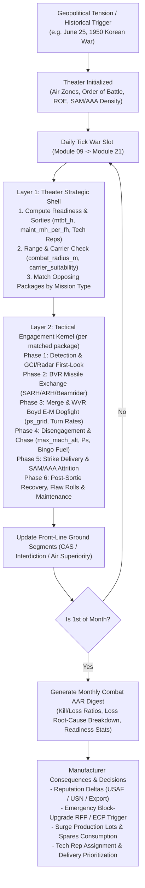

# 21 — Regional Wars, Two-Layer Air Combat Simulation, and Combat After-Action Reports

> **Status**: v1.0 (Phase 2 System-Design Specification — Forward-Compatible with MVP v1.0 Contracts)
> **Owner**: Module 21 (`mic.war` — Phase 2 expansion)
> **Conforms to**: [`docs/spec/00_conventions.md`](file:///Users/xtxsinan/.gemini/antigravity/scratch/military_industrial_complex_jet_age/docs/spec/00_conventions.md) (Locked Decisions D1, D2, D5; §4 Shared Contracts), [`docs/spec/01_aero_physics.md`](file:///Users/xtxsinan/.gemini/antigravity/scratch/military_industrial_complex_jet_age/docs/spec/01_aero_physics.md) (`PerformanceReport`, `ps_grid`, `aero_diagnostics`), [`docs/spec/05_procurement.md`](file:///Users/xtxsinan/.gemini/antigravity/scratch/military_industrial_complex_jet_age/docs/spec/05_procurement.md) (`Requirement`, emergency ECP/block procurement hooks), and [`docs/spec/09_core_loop.md`](file:///Users/xtxsinan/.gemini/antigravity/scratch/military_industrial_complex_jet_age/docs/spec/09_core_loop.md) (`War Slot` in canonical daily tick).
> **Tunables**: `sim/data/tuning/war.json` (Phase 2)
> **Historical Data**: `sim/data/wars/*.json`, `sim/data/aircraft_adversary/*.json` (Phase 2)

---

## 1. Purpose & Player Fantasy

### 1.1 Core Philosophy (Locked Decision D5: Strictly the Manufacturer)
In *Military-Industrial Complex: Jet Age*, **design is the protagonist; war is the proving ground**. Per Locked Decision **D5**, the player is strictly the chief executive and chief designer of an aircraft manufacturer:
- **The player never declares war, draws front-line arrows, or commands squadrons in the main campaign.** Wars erupt as external historical or tension-driven geopolitical events (`Korean War 1950–1953`, `Taiwan Strait Crises 1954/1958`, `Vietnam War 1964–1973`, `Middle East Wars 1956/1967/1973`, `Indo-Pakistani Wars 1965/1971`).
- **The customer air forces fight the war with the aircraft the player sold them.** Once the player delivers squadrons of fighters to the USAF, USN, or foreign export customers (Module 22), AI theater commanders deploy those aircraft into combat zones against historical adversary aircraft (`MiG-15bis`, `MiG-17F`, `MiG-19S`, `MiG-21PFM/bis`, `MiG-23MLD`, `MiG-25PD`) and integrated air defense networks (`SA-2 Guideline`, `SA-3 Goa`, `SA-6 Gainful`, `ZSU-23-4 Shilka`).
- **Every aerodynamic and systems trade-off made years earlier in the Design Bureau is ruthlessly audited by combat.** A high-wing-loading interceptor optimized to win a peacetime Mach 2 dash RFP may suffer catastrophic losses when rules of engagement (ROE) or early missile unreliability force it into a low-altitude subsonic dogfight against nimble `MiG-17`s. Conversely, an aircraft with superior Boyd Specific Excess Power ($P_s$) in the transonic combat arena, high reliability (`mtbf_h`), and low maintenance burden (`maint_mh_per_fh`) dominates sortie generation and achieves legendary kill-to-loss ratios.

### 1.2 Manufacturer Agency During Wartime
While the player does not fly the airplanes or assign squadrons to airbases, war transforms the manufacturer's executive boardroom into a crisis center with five high-stakes decisions:
1. **Reading the Combat After-Action Reports (AARs):** Every month during an active conflict, the player receives a detailed **War Theater Digest** breaking down kill-to-loss ratios by opponent type, mission attrition, readiness rates, and **exact engineering root causes of combat losses** (e.g., *"38% of F-4B losses occurred in WVR sustained turns at 4,500 m where MiG-17F held a +4.2 deg/s turn rate advantage after AIM-7D radar lock failures"*).
2. **Emergency Combat Block Upgrades (ECPs / Quick-Reaction Modifications):** Based on AAR diagnostics, either the military issues an urgent **Wartime Engineering Change Proposal (ECP)** or the player pitches an unsolicited combat block upgrade—such as strapping an internal `M61 Vulcan` cannon and leading-edge combat slats onto the `F-4E`, upgrading `F-86A` to the all-flying tail `F-86E/F`, or adding RWR/ECM pods.
3. **Field Service Technical Representatives (Tech Reps):** The player can deploy company engineers (`aero`, `propulsion`, `systems`) to forward airbases and aircraft carriers. Tech Reps boost frontline operational readiness, accelerate discovery of remaining `HiddenFlaw`s under combat loads, and feed live combat telemetry back to the design bureau—at the cost of stripping engineers from domestic R&D projects.
4. **Wartime Surge Production & Subcontracting:** The Pentagon triggers emergency surge lot multipliers (`05_procurement.md` §5.8.2) and offers `GOCO` plant reactivation (`04_economy.md`). The player must decide whether to expand factory capacity and take on debt to meet wartime demand—risking a brutal post-armistice cancellation cliff (as in July 1953 after Korea).
5. **Delivery Priority Allocation (Domestic vs. Export):** When wartime attrition outstrips monthly output, the player must prioritize deliveries between domestic services (`USAF`/`USN`) and embattled foreign customers, trading off domestic `political_capital` against international `reputation.export`.

---

## 2. Scope

| Feature | MVP (Phase 1: US 1945–1960) | Phase 2 War Expansion (`21_war_system.md`) | Later Phases (Phases 3–6) |
|---|---|---|---|
| **Historical Conflicts (1945–1960)** | Macro budget & event hooks only (`Korean War Outbreak` in `09_core_loop.md`, threat shocks in `05_procurement.md`) | Full two-layer simulation of **Korean War (1950–1953)**, **First & Second Taiwan Strait Crises (1954, 1958)**, and **1956 Suez Crisis** | **Vietnam War (1964–1973)**, **Six-Day War (1967)**, **Indo-Pakistani Wars (1965/1971)**, **Yom Kippur War (1973)**, **1982 Falklands / Bekaa Valley**, **1991 Gulf War** |
| **Layer 1: Theater Shell** | Reserved `War Slot` in daily tick (`09_core_loop.md` §3) | Air zones, airbases & carrier task forces, sortie generation from `maint_mh_per_fh` & `mtbf_h`, 6 mission types, abstract Lanchester ground front | Multi-theater coalition tasking, AWACS/tanker support orbits, naval strike warfare |
| **Layer 2: Engagement Kernel** | `PerformanceReport` & `ps_grid` pre-built for combat consumption (`01_aero_physics.md`) | 6-phase stochastic engagement resolver (Detection → BVR → WVR Boyd E-M Duel → Escape → SAM/AAA → Post-Sortie Maintenance) | 2D top-down animated battle replay viewer (`game_design.md` §10.2); JSBSim 6-DOF tactical fly-off (Phase 6) |
| **Manufacturer Loop** | Scripted historical RFPs & budget surges | Dynamic Monthly War Theater AARs, root-cause loss telemetry, Emergency Block-Upgrade RFPs (ECPs), Tech Rep deployment | Full sandbox theater commander mode (`game_design.md` §13) |

---

## 3. Player-Facing Flow



### 3.1 Step-by-Step Experience
1. **Outbreak Notification & Order of Battle (OOB) Inspection:**
   - When a war or border skirmish erupts, an auto-pausing major notification displays the **Theater Order of Battle**: which customer squadrons are deployed, how many of the player's aircraft (by design/block, e.g., `F-86A`, `F-86F`, `F9F-2`, `F-100D`) are on the front line, and what adversary types intelligence has identified in theater.
2. **Wartime Management Panel:**
   - Without issuing tactical orders to squadrons, the player accesses the **Company War Support Panel** to:
     - Assign `0..50` Field Service Tech Reps to the theater (`war.set_tech_reps`).
     - View real-time spares consumption and authorize overtime spares production.
     - Propose or bid on **Emergency Block Modifications (ECPs)** when combat telemetry reveals a vulnerability.
3. **Monthly Combat After-Action Report (AAR) Modal:**
   - On the 1st of every month during an active war, the **Combat AAR Digest** summarizes all sorties flown by player-built aircraft over the prior 30 days:
     - **Scorecard:** Sorties flown, air-to-air kills (by victim type), air-to-air losses (by killer type), SAM/AAA losses, operational non-combat losses, and **Exchange Ratio ($K/L$)**.
     - **Tactical Phase Breakdown:** Percentage of kills and losses occurring in **BVR**, **WVR Dogfight (High Alt $>7,500\text{ m}$ vs. Low/Med Alt)**, **Disengagement/Tail-Chase**, **Ground Defense (SAM/AAA)**, and **Operational Accidents**.
     - **Engineering Diagnostic Narrative:** Automated root-cause sentences generated directly from the engagement kernel accumulators (see §5.4), telling the player *exactly* which physical parameter decided the engagements.
4. **Ceasefire / Armistice & Post-War Lessons Learned:**
   - When war exhaustion or front-line victory ends the conflict, a **Final War Commission Report** permanently updates service doctrine weights (`Requirement.eval_weights` and role criteria priorities in Module 05) and adjusts international export demand (Module 22) for combat-proven designs.

---

## 4. Data Schemas & Forward-Compatibility Contracts

### 4.1 Forward Compatibility with MVP Contracts (`00_conventions.md` §4)

The War System is designed so that **zero breaking changes** are required to MVP `AircraftDesign`, `PerformanceReport`, `CompanyState`, or `HiddenFlaw`. Every combat mechanic derives its parameters deterministically from existing MVP fields plus optional Phase 2 catalog lookups:

| MVP Contract & Field | Owner | How Module 21 (`mic.war`) Consumes It |
|---|---|---|
| `PerformanceReport.ps_grid` | Module 01 | $13 \times 10$ Mach-altitude grid of $1g$ Specific Excess Power $P_s(M, h)$ [$\text{m/s}$] at combat weight; interpolated at engagement $(M_{\text{eng}}, h_{\text{eng}})$ for WVR energy advantage and climb/escape rate. |
| `PerformanceReport.sustained_turn_dps_m08_4572m` | Module 01 | Baseline sustained turn rate $\omega_{\text{sust}}$ [$\text{deg/s}$] in WVR dogfights; scaled to engagement altitude via `ps_grid`. |
| `PerformanceReport.instantaneous_turn_dps_m08_4572m` | Module 01 | Baseline high-alpha instantaneous turn rate $\omega_{\text{inst}}$ [$\text{deg/s}$] for initial merge nose-pointing and IR missile/gun snapshot envelopes. |
| `PerformanceReport.max_mach_alt`, `max_mach_sl`, `alt_of_max_mach_m`, `service_ceiling_m` | Module 01 | Determines intercept geometry, high-altitude bounce capability, and disengagement dash speed vs. pursuers and SAM envelopes. |
| `PerformanceReport.climb_rate_sl_mps`, `time_to_alt_10668m_s` | Module 01 | Determines `Point Intercept` probability of reaching enemy bombers before bomb release. |
| `PerformanceReport.combat_radius_m`, `payload_kg` | Module 01 | Governs air-zone reach, time-on-station (loiter fraction), bingo-fuel disengagement penalties, and CAS/Interdiction strike tonnage per sortie. |
| `PerformanceReport.thrust_to_weight_combat`, `wing_loading_combat_kgm2`, `max_load_factor_g` | Module 01 | Drives vertical fighting capability, high-altitude maneuver margin, and missile/SAM terminal $g$-evasion. |
| `PerformanceReport.maint_mh_per_fh`, `carrier_suitability` | Module 01 | Directly sets post-sortie turnaround time (sorties per aircraft per day) and eligibility to deploy from USN `CV/CVA` carrier groups. |
| `EngineSpec.mtbf_h`, `avionics.reliability_factor` | Modules 02, 03 | Governs mission abort rate and non-combat operational attrition per sortie hour. |
| `AircraftDesign.systems`, `AircraftDesign.armament` | Modules 01, 03 | `radar_id`, `fire_control_id`, `avionics_level`, `guns[]`, `missile_ids[]`, `internal_bay` lookup combat sensor/weapon stats in `sim/data/tech/components_*.json`. |
| `HiddenFlaw` (unfixed on fielded fleet) | Module 06 | Unfixed flaws (e.g. `pitch_up`, `transonic_control_loss`, `engine_stall`, `wing_flutter`) roll for in-combat trigger when engagement $(M, h, n_z)$ enters `trigger_condition`. |

#### 4.1.1 Additive Phase 2 Combat Attributes (Computed by ` CombatMetricsAdapter`)
For Phase 2–5 eras, `CombatMetricsAdapter.from_design_and_report(design, perf_report, tech_ctx)` computes a lightweight `CombatAircraftProfile` without mutating `PerformanceReport`:
- **Frontal Radar Cross Section $\sigma_{\text{RCS}}$ [$\text{m}^2$] (and $\text{dBsm}$):**
  For non-stealth Era I–III aircraft (1945–1989), baseline frontal RCS is derived from physical geometry in `AircraftDesign`:
  $$\sigma_{\text{RCS,base}} = k_{\text{rcs,geom}} \cdot \left(A_{\text{fus,frontal}} + 0.35 S_{\text{ref}} \sin\bar{\tau}_{\text{tc}} + \sigma_{\text{intake}}\right) \cdot f_{\text{stores}} \cdot f_{\text{stealth\_tech}}$$
  where $\sigma_{\text{intake}} = 1.8\text{ m}^2$ for `pitot`/exposed compressor face, $1.1\text{ m}^2$ for `fixed_spike`/`variable_ramp`, and $0.05\text{ m}^2$ for serpentine S-duct (`aero.serpentine_inlet` in Era IV); $f_{\text{stores}} = 1.0$ if all weapons are carried in `internal_bay == True` else $1.45$ with external stores/tanks; and $f_{\text{stealth\_tech}} \in [0.0001, 1.0]$ from Era IV–V stealth shaping and RAM coatings (`23_nations_and_eras_1960_2030.md` §5.3). Typical values: `MiG-15bis` $\approx 1.5\text{ m}^2$, `F-86F` $\approx 2.0\text{ m}^2$, `F-4B` $\approx 5.5\text{ m}^2$, `F-15C` $\approx 10.0\text{ m}^2$, `F-22A` (clean internal bay) $\approx 0.0002\text{ m}^2$ ($-37\text{ dBsm}$).

### 4.2 `WarTheaterSpec` & `ActiveWarState` Schema (`sim/data/wars/<war_id>.json`)

```json
{
  "schema_version": 1,
  "war_id": "korean_war_1950",
  "name_key": "war.korean_war_1950.name",
  "display_name": "Korean War (1950–1953)",
  "historical_start_date": "1950-06-25",
  "historical_end_date": "1953-07-27",
  "min_duration_days": 365,
  "max_duration_days": 1460,
  "blue_coalition": ["USAF", "USN", "ROKAF"],
  "red_coalition": ["VVS_64IAK", "PLAAF", "KPAAF"],
  "rules_of_engagement": {
    "bvr_visual_id_required": false,
    "cross_border_hot_pursuit": false,
    "min_strike_altitude_m": 0.0
  },
  "air_zones": [
    {
      "zone_id": "mig_alley_yalu",
      "name": "MiG Alley (Northwest Korea / Yalu River)",
      "distance_from_blue_bases_m": 315000.0,
      "distance_from_blue_carriers_m": 240000.0,
      "distance_from_red_bases_m": 45000.0,
      "characteristic_alt_m": 9144.0,
      "ambient_humidity": 0.45,
      "red_gci_coverage": 0.85,
      "blue_gci_coverage": 0.35,
      "red_aaa_density": 0.65,
      "red_sam_sites": []
    },
    {
      "zone_id": "central_korea_front",
      "name": "38th Parallel Ground Front & Interdiction Belt",
      "distance_from_blue_bases_m": 140000.0,
      "distance_from_blue_carriers_m": 160000.0,
      "distance_from_red_bases_m": 280000.0,
      "characteristic_alt_m": 3048.0,
      "ambient_humidity": 0.55,
      "red_gci_coverage": 0.25,
      "blue_gci_coverage": 0.60,
      "red_aaa_density": 0.75,
      "red_sam_sites": []
    }
  ],
  "ground_front": {
    "initial_blue_strength": 100.0,
    "initial_red_strength": 115.0,
    "front_position_km": -80.0,
    "blue_supply_base": 1.0,
    "red_supply_base": 1.0
  }
}
```

### 4.3 Historical Conflict Roster (1950–1991 Baseline Data)

| War ID | Years | Blue Air Forces | Primary Adversary Threats | Signature Engineering Stress Test |
|---|---|---|---|---|
| `korean_war_1950` | 1950–1953 | `USAF`, `USN` | `MiG-15bis` (VK-1, 37mm/23mm), dense 37mm/85mm AAA | High-altitude ($9\text{–}12\text{ km}$) transonic sweep, $M_{dd}$, all-flying tail (`F-86E/F`), carrier jet range (`F9F`, `F2H`). |
| `taiwan_strait_1958` | 1958 | `ROCAF` (US MAP), `USAF`/`USN` | `MiG-17F` | Early IR missile (`AIM-9B Sidewinder`) high-altitude combat debut vs nimble cannon dogfighters. |
| `suez_sinai_1956` | 1956 | `Armee_de_l_Air`, `RAF`, `IAF` | `MiG-15bis`, `MiG-17`, `Il-28` | Long-range fighter-bomber strike, high-temperature desert turnaround reliability. |
| `indo_pak_1965` | 1965 | `PAF` (US FMS `F-86F`, `F-104A`) vs `IAF` (`Hunter`, `Gnat`, `MiG-21`) | `Folland Gnat`, `Hawker Hunter`, `MiG-21F-13` | Low-altitude dogfight agility vs Mach 2 point-defense interceptor (`F-104A` vs `Gnat`). |
| `vietnam_war_1964` | 1964–1973 | `USAF`, `USN` | `MiG-17F`, `MiG-19S (J-6)`, `MiG-21PFM/MF`, `SA-2 Guideline`, radar AAA | Tropical humidity degrading early SARH missiles (`AIM-7D/E`), visual ID ROE forcing WVR merges without internal gun (`F-4B/C` → `F-4E`), `SA-2` forcing low-altitude RWR/ECM interdiction (`F-105D`). |
| `six_day_war_1967` | 1967 | `IAF` (`Mirage IIICJ`, `Super Mystere`) | `MiG-21FL`, `MiG-19S`, `MiG-17`, `SA-2` | High sortie-generation turnaround (`maint_mh_per_fh` $< 12$), cannon accuracy, low-level deep strike radius. |
| `yom_kippur_1973` | 1973 | `IAF` (`F-4E`, `Mirage III/Nesher`, `A-4`) | `MiG-21MF`, `SA-6 Gainful`, `ZSU-23-4 Shilka` | Mobile SAM/AAA umbrella saturation; urgent need for SEAD, chaff/flares, and all-aspect WVR agility. |

### 4.4 `SquadronDeployment` & `MonthlyCombatAAR` Schemas

```python
SquadronDeployment {
  squadron_id: str
  operator: str                    # e.g. "USAF", "USN", "IAF"
  design_id: str                   # player or AI aircraft design_id
  design_name: str
  is_player_aircraft: bool
  manufacturer_id: str
  base_type: str                   # "land_airbase" | "carrier"
  zone_id: str
  primary_mission: str             # "air_superiority" | "escort" | "intercept" | "cas" | "interdiction" | "sead"
  authorized_aircraft: int         # typically 24
  serviceable_aircraft: int
  in_maintenance_aircraft: int
  pilot_skill: float               # [0.40, 1.30], baseline 1.00 for USAF/USN, 0.85 for Soviet 64th IAK, 0.55 for novice trainees
  supply_state: float              # [0.10, 1.00] spare parts & ordnance availability
  tech_reps_assigned: int          # player FSRs attached
}

MonthlyCombatAAR {
  war_id: str
  year: int
  month: int
  design_id: str
  design_name: str
  operator: str
  sorties_flown: int
  air_to_air_kills: int
  kills_by_victim: dict[str, int]           # e.g. {"MiG-15bis": 28, "Tu-2": 4}
  kills_by_weapon: dict[str, int]           # {"gun": 18, "ir_missile": 8, "sarh_missile": 6}
  air_to_air_losses: int
  losses_by_killer: dict[str, int]          # {"MiG-15bis": 6, "MiG-17F": 3}
  sam_losses: int
  aaa_losses: int
  operational_losses: int                   # reliability / hidden flaw crashes
  damaged_repaired: int
  mean_readiness_rate: float                # [0, 1]
  sorties_per_aircraft_per_day: float
  loss_root_causes: dict[str, float]        # normalized shares summing to 1.0 across loss causes
  diagnostic_bullets: list[str]             # human-readable engineering takeaways
  recommended_ecp_tags: list[str]           # e.g. ["add_internal_gun", "improve_sustained_turn_slats", "add_rwr_ecm"]
}
```

---

## 5. Algorithms & Mathematical Specification

All stochastic draws in Module 21 use deterministic `PCG32` streams (`war.theater`, `war.engagement`, `war.flaws`) from `RngStreamRegistry` (`00_conventions.md` §3). Every constant in `UPPER_SNAKE` lives in `sim/data/tuning/war.json` (§6).

### 5.1 Layer 1: Theater Strategic Shell (Daily Sortie Generation & Pairing)

Executed once per simulation day in the `War Slot` (`09_core_loop.md` §3):

#### 5.1.1 Aircraft Operational Readiness & Turnaround Rate
For a squadron of aircraft with `maint_mh_per_fh` ($M_{\text{mh}}$), engine/avionics composite `mtbf_h` ($\text{MTBF}$), mean sortie duration $t_{\text{sortie}}$ [$\text{h}$], supply state $S_{\text{sup}} \in [0.1, 1.0]$ (driven by spare parts flow in Module 22), and assigned Field Service Tech Reps $N_{\text{rep}}$:
1. **Tech Rep Maintenance Multiplier:**
   $$f_{\text{rep}} = 1.0 - \text{REP\_MAINT\_MAX\_REDUCTION} \cdot \left(1.0 - \exp\!\left(-\frac{N_{\text{rep}}}{\text{REP\_SCALE}}\right)\right)$$
   *(With $\text{REP\_MAINT\_MAX\_REDUCTION} = 0.25$ and $\text{REP\_SCALE} = 10$, assigning 10 Tech Reps cuts effective maintenance downtime by $\sim 15.8\%$.)*
2. **Expected Turnaround Hours Between Sorties ($H_{\text{turn}}$):**
   Given ground-crew shift capacity $\text{CREW\_PARALLEL\_EFF} = 4.5$ effective simultaneous technicians per aircraft and baseline rearm/refuel time $H_{\text{rearm}} = 1.25\text{ h}$:
   $$H_{\text{turn}} = H_{\text{rearm}} + \frac{M_{\text{mh}} \cdot t_{\text{sortie}} \cdot f_{\text{rep}}}{\text{CREW\_PARALLEL\_EFF} \cdot \max(S_{\text{sup}}, 0.20)}$$
3. **Daily Operational Availability ($A_{\text{op}} \in [0.15, 0.92]$):**
   $$A_{\text{op}} = \text{clamp}\!\left(\frac{t_{\text{ops\_window}}}{t_{\text{ops\_window}} + H_{\text{turn}}} \cdot \left(1.0 - \frac{t_{\text{sortie}}}{\max(\text{MTBF}, 8.0)}\right) \cdot S_{\text{sup}}^{0.35},\;\; 0.15,\;\; 0.92\right)$$
   where $t_{\text{ops\_window}} = 14.0\text{ h/day}$ (day/all-weather) or $10.0\text{ h/day}$ (day-only VFR aircraft).
4. **Daily Sorties Generated per Squadron ($N_{\text{sorties}}$):**
   Let $d_{\text{zone}}$ be the distance from the squadron's base/carrier to the assigned `AirZone` and $R_{\text{combat}}$ be the aircraft's `combat_radius_m`:
   - **Range Gate:** If $R_{\text{combat}} < 0.85 \cdot d_{\text{zone}}$ (or if `base_type == "carrier"` and `carrier_suitability == False`), the squadron cannot reach the zone ($N_{\text{sorties}} = 0$).
   - **Loiter / Station Efficiency $f_{\text{reach}} \in [0.25, 1.20]$:**
     $$f_{\text{reach}} = \text{clamp}\!\left(0.60 + 0.65 \cdot \frac{R_{\text{combat}} - d_{\text{zone}}}{\max(d_{\text{zone}}, 100000.0)},\;\; 0.25,\;\; 1.20\right)$$
   - **Sorties per Day:**
     $$s_{\text{per\_ac}} = \text{clamp}\!\left(\frac{12.0}{H_{\text{turn}} + t_{\text{sortie}}} \cdot f_{\text{reach}},\;\; 0.30,\;\; 3.20\right)$$
     $$N_{\text{sorties}} = \text{round}\!\left(N_{\text{authorized}} \cdot A_{\text{op}} \cdot s_{\text{per\_ac}}\right)$$
   *(Historical check: An `F-86F` or `Mirage IIIC` with $M_{\text{mh}} \approx 11\text{ mh/fh}$ and good supply achieves $A_{\text{op}} \approx 0.76$ and $1.6\text{–}2.4$ sorties/day; an early complex interceptor with $M_{\text{mh}} = 38\text{ mh/fh}$ and poor supply drops to $A_{\text{op}} \approx 0.42$ and $0.6$ sorties/day.)*

#### 5.1.2 Package Formation & Mission Pairing
Generated sorties in each `AirZone` are grouped into 4-ship or 8-ship flight packages ($N_{\text{pkg}} \in \{4, 8\}$) by mission type:
- **Blue offensive/control packages:** `Air Superiority Sweep`, `Bomber Escort`, `Close Air Support (CAS)`, `Deep Interdiction`, `SEAD`.
- **Red defensive/offensive packages:** `Air Superiority Sweep`, `Point Intercept` (scrambled against Blue `CAS`/`Interdiction`/`Escort`).
- Each active Blue package rolls for interception against available Red `Air Superiority` or `Point Intercept` packages in the same zone with probability:
  $$p_{\text{contact}} = \text{clamp}\!\left(0.25 + 0.55 \cdot \text{GCI}_{\text{defender}} + 0.20 \cdot \frac{N_{\text{red\_cap\_sorties}}}{\max(N_{\text{blue\_sorties}}, 1)},\;\; 0.10,\;\; 0.95\right)$$

---

### 5.2 Layer 2: Tactical Engagement Kernel (6-Phase Sortie Resolver)

When two flight packages $A$ (size $N_A$, e.g., 4 `F-86F` or `F-4B`) and $B$ (size $N_B$, e.g., 4 `MiG-15bis` or `MiG-21PFM`) meet in an `AirZone` at characteristic altitude $h_{\text{eng}}$ and entry Mach $M_{\text{eng}} = \min(0.88, 0.80 \cdot M_{\max})$, the engagement resolves through **6 sequential phases**:

#### Phase 1: Detection, GCI Vectoring & First-Look Initiative
1. **Effective Radar Detection Range $R_{\text{det}}(A \to B)$ [$\text{km}$]:**
   Using attacker $A$'s radar catalog base range $R_{\text{radar},0}$ [$\text{km}$ for a $5\text{ m}^2$ target] (`sim/data/tech/components_radars.json`), `avionics.radar_range_factor` ($f_{\text{proc}}$), look-down clutter factor $f_{\text{ld}} \in \{0.35, 1.0\}$ (if target is below $1,500\text{ m}$ and radar lacks pulse-Doppler look-down capability), and target $B$'s frontal RCS $\sigma_{\text{RCS},B}$ [$\text{m}^2$] (radar range equation $\propto \sigma^{1/4}$):
   $$R_{\text{det}}(A \to B) = R_{\text{radar},0} \cdot f_{\text{proc}} \cdot f_{\text{ld}} \cdot \left(\frac{\sigma_{\text{RCS},B}}{5.0}\right)^{0.25}$$
   If $A$ has no radar (`radar_id == null`), $R_{\text{det}}$ falls back to visual/GCI spotting range $R_{\text{vis}} = 9.5\text{ km}$.
2. **Situational Awareness & First-Look Score ($SA_A$):**
   $$SA_A = 1.20 \cdot \ln\!\left(1 + \frac{R_{\text{det}}(A \to B)}{10.0}\right) + 0.85 \cdot \text{GCI}_A + 0.35 \cdot \mathbb{I}(\text{canopy} == \text{"bubble"}) + 0.50 \cdot (\text{skill}_A - 1.0) + 0.25 \cdot \frac{h_{\max,A} - h_{\text{eng}}}{5000.0}$$
3. **Initiative / Bounce Advantage ($\Delta SA = SA_A - SA_B$):**
   The side with higher $SA$ gains tactical initiative:
   $$p_{\text{bounce}, A} = \sigma_{\text{logistic}}\!\left(\text{SA\_BOUNCE\_K} \cdot \Delta SA\right)$$
   If `Point Intercept` is being flown against bombers, the interceptor must also pass a **Time-to-Climb Intercept Gate**:
   $$p_{\text{reach\_alt}} = \text{clamp}\!\left(1.15 - 0.0025 \cdot \text{time\_to\_alt\_10668m\_s},\;\; 0.15,\;\; 1.00\right)$$
   Failing `p_reach_alt` means the interceptors arrive too late to engage before bomb release (logged in AAR as `"failed_climb_intercept"`).

#### Phase 2: Beyond-Visual-Range (BVR) Missile Exchange
Executed if $R_{\text{det}} > 14.0\text{ km}$, at least one side carries `SARH`, `ARH`, or `Beamrider` missiles (`armament.missile_sarh_gen >= 1` or `missile_arh_gen >= 1`), and theater ROE does not mandate pre-merge visual identification (`rules_of_engagement.bvr_visual_id_required == False`, or the aircraft carries target-ID avionics/TCS).
For each BVR shooter against an assigned target:
1. **Missile Reliability & Lock Roll ($P_{\text{rel}}$):**
   Early radar missiles suffered severe tube, seeker, and humidity failures in combat (e.g., 1965–1968 Vietnam `AIM-7D/E` achieving $<10\%$ combat $P_k$). Given missile catalog base reliability $r_{\text{msl},0}$ (`0.38` for Gen 1 beamrider/SARH, `0.52` for Gen 2 SARH, `0.74` for Gen 3 solid-state SARH, `0.88` for Gen 4 ARH), avionics reliability factor $f_{\text{av\_rel}}$, and zone humidity $H_{\text{hum}} \in [0, 1]$:
   $$P_{\text{rel}} = \text{clamp}\!\left(r_{\text{msl},0} \cdot f_{\text{av\_rel}} \cdot \left(1.0 - \text{HUMIDITY\_PENALTY\_GEN12} \cdot H_{\text{hum}} \cdot \mathbb{I}(\text{gen} \le 2)\right),\;\; 0.08,\;\; 0.96\right)$$
   If $u_1 \ge P_{\text{rel}}$, the missile fails to guide or fuse (logged in AAR under `"bvr_missile_reliability_failure"`).
2. **Kinematic & Electronic Countermeasure Hit Probability ($P_{k,\text{kin}}$):**
   If reliable, hit probability depends on missile maneuver/speed rating $M_{\text{msl}}$, target max load factor $n_{z,\max,B}$, target speed $M_{\max,B}$, and target ECM/RWR reduction $E_{\text{ecm},B} \in [0, 0.55]$:
   $$P_{k,\text{kin}} = \text{clamp}\!\left(P_{k,0}(\text{gen}) \cdot \left(1.0 - 0.045 \cdot \max(0,\, n_{z,\max,B} - 6.0)\right) \cdot \left(1.0 - 0.15 \cdot \max(0,\, M_{\max,B} - 1.6)\right) \cdot (1.0 - E_{\text{ecm},B}),\;\; 0.05,\;\; 0.85\right)$$
   Therefore single-shot BVR kill probability is $P_{k,\text{BVR}} = P_{\text{rel}} \cdot P_{k,\text{kin}}$. Surviving aircraft proceed to the WVR Merge.

#### Phase 3: Merge & Within-Visual-Range (WVR) Boyd Energy-Maneuverability Duel
Surviving aircraft enter a 1–3 turn WVR dogfight at $(M_{\text{eng}}, h_{\text{eng}})$:
1. **Boyd Energy-Maneuverability Advantage ($\Delta E_{\text{WVR}}$):**
    Module 21 queries `PerformanceReport.ps_grid` at $(M_{\text{eng}}, h_{\text{eng}})$ for both aircraft to obtain $P_{s,A}$ and $P_{s,B}$ [$\text{m/s}$], alongside sustained turn rate $\omega_{\text{sust}}$ [$\text{deg/s}$], instantaneous turn rate $\omega_{\text{inst}}$ [$\text{deg/s}$], and combat thrust-to-weight $(T/W)_{\text{combat}}$.
   Altitude-adjusted sustained turn rate at $h_{\text{eng}}$ is scaled by atmospheric density ratio and local $P_s$:
   $$\omega_{\text{sust}}(h_{\text{eng}}) = \omega_{\text{sust,4572m}} \cdot \left(\frac{\rho(h_{\text{eng}})}{\rho(4572\text{ m})}\right)^{0.38} \cdot \text{clamp}\!\left(1.0 + 0.003 \cdot (P_s(M_{\text{eng}}, h_{\text{eng}}) - P_{s,\text{4572m}}),\; 0.45,\; 1.35\right)$$
   The composite WVR maneuver score for aircraft $A$ is:
   $$M_{\text{WVR},A} = \text{WVR\_W\_SUST} \cdot \omega_{\text{sust},A}(h_{\text{eng}}) + \text{WVR\_W\_INST} \cdot \omega_{\text{inst},A} + \text{WVR\_W\_PS} \cdot \frac{P_{s,A}(M_{\text{eng}}, h_{\text{eng}})}{5.0} + \text{WVR\_W\_TW} \cdot \left(15.0 \cdot (T/W)_{\text{combat},A}\right)$$
   *(Default weights: $\text{WVR\_W\_SUST} = 0.40$, $\text{WVR\_W\_INST} = 0.25$, $\text{WVR\_W\_PS} = 0.25$, $\text{WVR\_W\_TW} = 0.10$.)*
2. **Tactical Position Conversion (Getting on the Tail / Firing Solution):**
   Combined with pilot skill $\text{skill}_A$ and first-turn bounce bonus $\Delta_{\text{bounce}} = 4.0 \cdot (p_{\text{bounce},A} - 0.5)$:
   $$\Delta M_{AB} = \left(M_{\text{WVR},A} \cdot \text{skill}_A^{0.80} + \Delta_{\text{bounce}}\right) - M_{\text{WVR},B} \cdot \text{skill}_B^{0.80}$$
   The probability that $A$ achieves a valid WVR firing window in a dogfight turn is:
   $$p_{\text{window}, A} = \text{clamp}\!\left(0.22 \cdot \sigma_{\text{logistic}}\!\left(\frac{\Delta M_{AB}}{\text{WVR\_advantage\_scale}}\right),\;\; 0.02,\;\; 0.42\right)$$
3. **WVR Weapon Lethality (Cannon vs. Rear-Aspect / All-Aspect IR Missile):**
   When $A$ achieves a firing window:
   - **If armed with an internal/podded gun (`len(armament.guns) > 0`):**
     Gun kill probability $P_{k,\text{gun}}$ scales with total burst mass per second, muzzle velocity (`m39_20mm` / `m61_20mm` $> \text{m3\_50}$), and radar/gyro lead-computing sight (`avionics_level >= 2`):
     $$P_{k,\text{gun}} = \text{clamp}\!\left(P_{k,\text{gun,base}} \cdot f_{\text{sight}}(\text{avionics\_level}),\;\; 0.12,\;\; 0.55\right)$$
   - **If armed with IR missiles (`armament.missile_ir_gen >= 1`):**
     - Gen 1–2 rear-aspect IR missiles (`AIM-9B/E/J`, `R-3S`) require a strict tail-cone firing geometry ($P_{\text{envelope}} = 0.45$) and have minimum range constraints ($R_{\min} \approx 600\text{–}900\text{ m}$).
     - Gen 3+ all-aspect IR missiles (`AIM-9L/M/X`, `R-73`, unlocked in Era III+) allow high-off-boresight/head-on shots ($P_{\text{envelope}} = 0.85$, $P_{k,\text{IR}} \approx 0.68$).
   - **The "Gunless Fighter" Penalty (Vietnam F-4B/C Lesson):**
     If an aircraft has **no gun** (`len(armament.guns) == 0`) and only early Gen 1–2 missiles, any firing window inside minimum missile range ($40\%$ of close-in dogfight windows) results in a **missed opportunity (`"wvr_no_gun_inside_min_range"`)** where the pilot has a perfect tracking solution at $300\text{ m}$ but cannot fire!

#### Phase 4: Disengagement, Tail-Chase & Bingo Fuel Escape
When a package suffers losses, drops ordnance, or reaches **Bingo Fuel** (which occurs earlier if `combat_radius_m` barely covers $d_{\text{zone}}$), it attempts to disengage:
1. **Escape Probability ($p_{\text{escape}}$):**
   An aircraft attempting to break off from a victorious opponent $B$ succeeds based on its dash speed advantage $\Delta M_{\text{dash}} = M_{\max,A}(h_{\text{eng}}) - M_{\max,B}(h_{\text{eng}})$ and $1g$ acceleration advantage $\Delta P_s = P_{s,A}(M_{\text{eng}}, h_{\text{eng}}) - P_{s,B}(M_{\text{eng}}, h_{\text{eng}})$:
   $$p_{\text{escape}} = \text{clamp}\!\left(0.65 + 0.80 \cdot \Delta M_{\text{dash}} + 0.0045 \cdot \Delta P_s - 0.25 \cdot \mathbb{I}(\text{bingo\_fuel\_low}),\;\; 0.15,\;\; 0.98\right)$$
   *(Example: A Mach 2.0 `F-104A` or `F-4B` with high $P_s$ can unload to $1g$, light afterburner, and outrun a subsonic `MiG-17` ($p_{\text{escape}} > 0.92$); conversely, a slow straight-wing `F-80C` or `F9F-2` trying to disengage from a `MiG-15bis` at $9,000\text{ m}$ faces a lethal tail-chase.)*

#### Phase 5: Strike Delivery & Ground Air Defense (SAM & AAA) Attrition
For packages executing `CAS`, `Deep Interdiction`, or `SEAD` that survive air-to-air interception:
1. **AAA Attrition Roll (Low/Medium Altitude $< 4,500\text{ m}$):**
   Driven by zone `red_aaa_density` ($D_{\text{AAA}} \in [0, 1]$), ingress speed $M_{\max,\text{sl}}$, structural toughness, and twin-engine redundancy (`propulsion.count == 2` grants $+22\%$ battle-damage survival):
   $$p_{\text{loss,AAA}} = D_{\text{AAA}} \cdot \text{AAA\_BASE\_RATE} \cdot \left(\frac{0.75}{\max(M_{\max,\text{sl}}, 0.50)}\right)^{1.4} \cdot \left(1.0 - 0.22 \cdot \mathbb{I}(N_{\text{eng}} \ge 2)\right)$$
2. **SAM Engagement Roll (Medium/High Altitude $> 1,000\text{ m}$ in SAM-defended zones):**
   For each active SAM belt (`SA-2`, `SA-3`, `SA-6`), engagement probability scales with frontal/side RCS $\sigma_{\text{RCS}}^{0.25}$ and is reduced by Radar Warning Receiver (`avionics.rwr`), active ECM jamming pods (`avionics.ecm_pod`), and `SEAD` suppression (`ARM` anti-radiation missiles):
   $$p_{\text{loss,SAM}} = D_{\text{SAM}} \cdot P_{k,\text{SAM,base}} \cdot \left(\frac{\sigma_{\text{RCS}}}{3.0}\right)^{0.25} \cdot (1.0 - E_{\text{rwr\_ecm}}) \cdot \left(1.0 - 0.04 \cdot \max(0,\, n_{z,\max} - 5.0)\right)$$

#### Phase 6: Post-Sortie Recovery, Hidden Flaw Combat Triggers & Operational Losses
Upon returning to base or carrier:
1. **Combat-Regime Hidden Flaw Trigger (`06_testing_uncertainty.md` integration):**
   If the fielded aircraft design still carries any **undiscovered or unfixed `HiddenFlaw`** (because the player skipped high-speed dive or spin flight-test subjects to rush IOC!), combat pushes the airframe into the flaw's `trigger_condition` ($M > M_{dd}$, high AoA dogfight, or carrier arrestment):
   - Per sortie, each active unfixed flaw of `severity` $S_{\text{flaw}} \in \{1..5\}$ rolls for a **Combat Flaw Incident** with probability $p_{\text{flaw\_inc}} = 0.0015 \cdot S_{\text{flaw}} \cdot (1.0 + 0.30 \cdot \mathbb{I}_{\text{tech\_rep}})$.
   - When triggered, the flaw becomes **Discovered in Service** (reported in the monthly AAR, e.g., *"F-100A suffered fatal roll-inertia coupling loss during high-speed combat break"*), inflicts an operational loss if $S_{\text{flaw}} \ge 4$, and unlocks a mandatory/optional fix ECP.
2. **Non-Combat Operational Attrition:**
   Normal mechanical/carrier-landing accident rate per sortie scales inversely with `mtbf_h` and stall speed margin:
   $$p_{\text{loss,ops}} = \frac{\text{OPS\_LOSS\_K}}{\max(\text{MTBF}, 10.0)} + 0.0008 \cdot \mathbb{I}(\text{carrier}) \cdot \max\!\left(0.0,\; \frac{V_{\text{stall}} - 50.0}{10.0}\right)$$

---

### 5.3 Abstract Ground Front-Line Progression (`ground_front`)

Per `game_design.md` §10.4, ground combat is modeled cleanly as an abstract Lanchester front-line segment per theater without micromanaging ground divisions:
- Let $G_{\text{blue}}(t)$ and $G_{\text{red}}(t)$ be the effective ground combat strengths on day $t$.
- Daily air missions modify ground combat through **three bounded channels** (capped at a maximum $\pm 40\%$ ground combat efficiency shift when holding total air supremacy, matching `game_design.md` §14.2):
  1. **Air Superiority Factor ($A_{\text{sup}} \in [-1, +1]$):** Net ratio of successful Blue vs. Red CAP/Sweep control across theater air zones.
  2. **CAS Direct Attrition ($\Delta G_{\text{CAS}}$):** Blue `CAS` sorties that penetrate interception and AAA directly reduce Red ground strength, scaled by `payload_kg` and precision avionics.
  3. **Interdiction Supply Reduction ($\eta_{\text{supply}} \in [0.55, 1.00]$):** Successful `Deep Interdiction` sorties reduce the enemy's daily ground strength replenishment rate.

---

### 5.4 Combat AAR Root-Cause Attribution & Manufacturer Feedback Loop

Every loss and kill event in Phases 1–6 increments a structured **Root-Cause Telemetry Counter** on the squadron's monthly record:
- `"wvr_sustained_turn_deficit"` — lost in Phase 3 when $\omega_{\text{sust,player}} < \omega_{\text{sust,enemy}} - 2.0\text{ deg/s}$.
- `"wvr_energy_ps_deficit"` — lost in Phase 3 when $P_{s,\text{player}} < P_{s,\text{enemy}} - 15.0\text{ m/s}$.
- `"wvr_no_gun_inside_min_range"` — failed to convert $\ge 1$ close-in tracking windows due to lack of internal cannon after missile misses.
- `"bvr_missile_reliability_failure"` — BVR missile failed `P_rel` roll before merge.
- `"disengage_speed_deficit"` — shot down in Phase 4 tail-chase when $M_{\max,\text{player}} < M_{\max,\text{enemy}}$.
- `"sam_high_alt_attrition"` / `"aaa_low_alt_attrition"` — lost in Phase 5 due to lack of RWR/ECM or low speed.
- `"hidden_flaw_combat_loss:<flaw_type>"` — lost in Phase 6 to an unfixed `HiddenFlaw`.

#### 5.4.1 Monthly Reputation & Export Demand Updates
On the 1st of each month, for each player design with $\ge 20$ combat sorties in the month:
Let $K$ be air-to-air kills (plus weighted strike mission completions $0.15 \cdot N_{\text{strike\_success}}$) and $L_{\text{combat}} = L_{\text{a2a}} + L_{\text{sam}} + L_{\text{aaa}}$ be combat losses. The smoothed combat exchange ratio is:
$$\text{ER} = \frac{K + 2.0}{L_{\text{combat}} + 2.0}$$
Monthly reputation change with the operating service (`USAF` or `USN`) and `export` market is:
$$\Delta R_{\text{svc,war}} = \text{clamp}\!\left(\text{WAR\_REP\_K} \cdot \ln(\text{ER}) + \text{WAR\_READY\_K} \cdot (A_{\text{op}} - 0.65),\;\; -6.0,\;\; +6.0\right)$$
$$\Delta R_{\text{export,war}} = 1.35 \cdot \Delta R_{\text{svc,war}}$$
*(Historical check: When the `F-86F` achieves an $8:1$ kill ratio in MiG Alley or the `Mirage IIIC` dominates in 1967, $\ln(\text{ER}) > 1.8$, driving rapid surges in `reputation.export` and foreign purchase inquiries in Module 22.)*

#### 5.4.2 Emergency Wartime Block-Upgrade RFPs (ECPs)
If a player aircraft accumulates $\ge 12$ combat losses over a 60-day window and a single root-cause category accounts for $\ge 35\%$ of losses, the operating service automatically issues an **Emergency Combat Modification RFP (ECP)** to the manufacturer:
- The ECP specifies a targeted block upgrade (e.g., `F-4B -> F-4E` adding `m61_20mm` + `le_slats`, or `F-105B -> F-105D/G` adding all-weather radar + RWR/ECM) with a fast-track 180-day development schedule, CPFF funding, and an immediate follow-on production lot + retrofit kit order.

---

## 6. Tunables Table (`sim/data/tuning/war.json`)

| Name | Default | Range | Effect | Rationale |
|---|---:|---|---|---|
| `CREW_PARALLEL_EFF` | `4.5` | `[2.5, 8.0]` | Effective parallel maintenance crew factor dividing `maint_mh_per_fh` | Calibrated so $12\text{ mh/fh}$ yields $\sim 2.0$ sorties/day and $35\text{ mh/fh}$ yields $\sim 0.7$ sorties/day |
| `REP_MAINT_MAX_REDUCTION` | `0.25` | `[0.10, 0.40]` | Max turnaround time reduction from Field Service Tech Reps | Rewards sending company engineers to the front without making maintenance free |
| `SA_BOUNCE_K` | `1.15` | `[0.50, 2.50]` | Logistic slope of Situational Awareness difference $\Delta SA$ on first-look bounce | Models radar/GCI and bubble-canopy advantage (F-86 over MiG-15 pilot visibility) |
| `HUMIDITY_PENALTY_GEN12` | `0.35` | `[0.10, 0.60]` | Tropical humidity degradation on Gen 1–2 SARH/IR missile reliability | Reproduces Vietnam 1965–1968 AIM-7D/E and AIM-4D tube/seeker failure rates |
| `WVR_W_SUST` / `INST` / `PS` / `TW` | `0.40 / 0.25 / 0.25 / 0.10` | sum to `1.0` | Weights of sustained turn, instantaneous turn, Boyd $P_s$, and $T/W$ in WVR duel | Direct mathematical bridge from Module 01 `PerformanceReport` to dogfight lethality |
| `WVR_ADVANTAGE_SCALE` | `4.5` | `[2.0, 8.0]` | Logistic scale [$\text{deg/s}$ eq.] for converting $\Delta M_{\text{WVR}}$ into firing windows | Ensures a $+5\text{ deg/s}$ turn + $+30\text{ m/s}$ $P_s$ edge yields $\sim 3:1$ WVR exchange before skill |
| `AAA_BASE_RATE` | `0.018` | `[0.005, 0.050]` | Baseline per-sortie AAA loss probability at $D_{\text{AAA}}=1.0, M=0.75$ | Calibrated to Korean War and Vietnam Route Pack 6 low-altitude attrition ($1\text{–}2.5\%$ per sortie) |
| `WAR_REP_K` | `2.20` | `[0.50, 5.00]` | Monthly reputation gain/loss multiplier per unit of $\ln(\text{ER})$ | Strong feedback loop without maxing reputation in a single month |
| `GROUND_AIR_MAX_MOD` | `0.40` | `[0.20, 0.60]` | Cap on airpower modifier to ground Lanchester front progression | Enforces `game_design.md` §14.2 balance rule ($30\text{–}50\%$ max ground impact) |

---

## 7. Edge Cases & Failure Modes

1. **Zero Player Aircraft in Service When War Breaks Out:**
   - If a historical war erupts (e.g., Korea in June 1950) and the player has not yet won/delivered a frontline fighter, the war still runs between AI-built US aircraft (`F-80C`, `F-86A`, `F9F-2`) and adversary forces. The player still benefits from the macro Korean War defense budget surge (`09_core_loop.md` §4.4) and can bid on wartime RFPs or emergency stopgap orders.
2. **Short-Range Point Interceptor Assigned to Deep Air Zone:**
   - If the player built an ultra-short-legged rocket/afterburning point interceptor (`combat_radius_m < 0.85 * d_zone`), the theater AI automatically restricts that squadron to defensive `Point Intercept` over home bases rather than sending it to `mig_alley_yalu` where it would hit Bingo fuel immediately.
3. **Laplace Smoothing on Exchange Ratio ($\text{ER} = (K+2)/(L+2)$):**
   - Prevents division by zero when $L_{\text{combat}} = 0$ and prevents a single lucky $1\text{–}0$ skirmish from producing an infinite log-ratio reputation spike.
4. **Preventing Infinite ECP Spam:**
   - Each deployed aircraft design family has a 180-day cooldown between Emergency Combat Block-Upgrade RFPs (`ecp_cooldown_days = 180`), ensuring the player receives at most 1–2 meaningful block-modification opportunities per war.

---

## 8. Golden Test Vectors (Phase 2 Target)

To be generated by `sim/mic/war/golden_gen.py` into `sim/golden/war_*.json`:
1. `sim/golden/war_mig_alley_1952_f86f_vs_mig15bis.json`:
   - **Input:** 24 `F-86F Sabre` (`pilot_skill = 1.15`, `apg30` radar-ranging sight, `all_moving_tail = True`) vs. 24 `MiG-15bis` (`pilot_skill = 0.85`, higher ceiling & sea-level climb, lower transonic $M_{dd}$ and no radar sight) over 30 days in `mig_alley_yalu` ($h_{\text{eng}} = 9,144\text{ m}$).
   - **Expected Output:** `F-86F` achieves positive exchange ratio ($\text{ER} \in [3.5, 7.5]$); primary `MiG-15bis` kills attributed to transonic control/sight advantage; primary `F-86F` losses attributed to `MiG-15bis` high-altitude zoom-climb bounce above $10,500\text{ m}$.
2. `sim/golden/war_vietnam_1966_f4b_gunless_vs_mig17_mig21.json`:
   - **Input:** 24 `F-4B Phantom II` (no internal gun, `AIM-7D` + `AIM-9B`, `bvr_visual_id_required = True`, `ambient_humidity = 0.80`) vs. `MiG-17F` and `MiG-21PFM` + `SA-2` in `route_pack_6`.
   - **Expected Output:** High `bvr_missile_reliability_failure` and `wvr_no_gun_inside_min_range` shares ($\ge 35\%$), triggering an automatic **Emergency ECP** recommending `add_internal_gun` + `improve_sustained_turn_slats` (`F-4E` block upgrade).
3. `sim/golden/war_sortie_readiness_turnaround.json`:
   - **Input:** Compares a simple lightweight fighter (`maint_mh_per_fh = 9.5`, `mtbf_h = 45.0`) vs. a complex twin-engine variable-sweep aircraft (`maint_mh_per_fh = 38.0`, `mtbf_h = 14.0`) across supply states $S_{\text{sup}} \in \{0.4, 1.0\}$ and Tech Reps $N_{\text{rep}} \in \{0, 15\}$.

---

## 9. Interactions with Other Modules

| Module | Direction | Contract / Data Exchanged |
|---|---|---|
| **01 Aero & Performance** (`mic.aero`, `mic.perf`) | `01 → 21` | `PerformanceReport` (`ps_grid`, turn rates, Mach/ceiling, `combat_radius_m`, `maint_mh_per_fh`, `carrier_suitability`) and `AircraftDesign` geometry for $\sigma_{\text{RCS}}$. |
| **02 Engines** (`mic.engine`) | `02 → 21` | `EngineSpec.mtbf_h` for operational readiness and non-combat attrition rolls. |
| **03 Tech Tree** (`mic.tech`) | `03 → 21` | `TechContext` keys (`avionics.radar_range_factor`, `avionics.reliability_factor`, `armament.missile_ir_gen`, `armament.missile_sarh_gen`) and weapon/radar component catalogs. |
| **04 Economy** (`mic.econ`) | `04 ↔ 21` | `21 → 04`: Tech Rep engineer temporary allocation (`engineers`), wartime spares demand multiplier on `active_delivered_fleet`, reputation deltas. |
| **05 Procurement** (`mic.procurement`) | `21 → 05` | Emits `EmergencyECPRequirement` for combat block upgrades, updates `budget_index` during active wars, and shifts post-war doctrinal `eval_weights` and `Requirement` criteria. |
| **06 Testing & Uncertainty** (`mic.testing`) | `06 ↔ 21` | `06 → 21`: Unfixed `HiddenFlaw` list on fielded aircraft. `21 → 06`: Service flaw discovery events (`source = "service"`) and combat telemetry reducing future design-family $\sigma$. |
| **09 Core Loop** (`mic.campaign`) | `09 ↔ 21` | `09` invokes `step_war_day(world, rng)` in the canonical daily `War Slot` and `step_war_month(world, rng)` on the 1st of each month. |
| **22 Export & Geopolitics** (`22_export_geopolitics.md`) | `21 ↔ 22` | Foreign customer wars consume export spare parts (`supply_state`); wartime embargo of spare parts immediately collapses customer `supply_state` to `0.15`; combat AARs drive `reputation.export`. |

---

## 10. Validation & Calibration Targets (Phase 2)

When implemented in Phase 2 (`sim/validation/war_calibration.py` → `docs/validation/war_calibration.md`), the engagement kernel must satisfy four historical benchmark targets over $1,000$-run Monte Carlo simulations:
1. **MiG Alley (1951–1953):** `F-86F` (veteran USAF pilots) vs. `MiG-15bis` (mixed Soviet/Chinese/North Korean pilots) produces an aggregate exchange ratio between $5.0:1$ and $8.0:1$, while equal-skill pilots (`1.0` vs `1.0`) produce a close $1.3:1$ to $1.8:1$ edge for the `F-86F` below $10,000\text{ m}$ and parity above $11,500\text{ m}$.
2. **Operation Rolling Thunder (1965–1968) vs. Linebacker (1972):** Early `F-4B/C` with Gen 1–2 missiles and strict visual-ID ROE achieves $1.8:1\text{–}2.5:1$ against `MiG-17`/`MiG-21`; upgrading to `F-4E` (internal cannon + combat slats + improved missile reliability + Tech Reps) raises the exchange ratio to $3.8:1\text{–}5.0:1$.
3. **Quantity vs. Quality Readiness Trade-Off (`game_design.md` §14.3):** A squadron of 24 ultra-complex fighters ($M_{\text{mh}} = 40\text{ mh/fh}$) generates fewer daily combat sorties than 24 rugged lightweight fighters ($M_{\text{mh}} = 10\text{ mh/fh}$), allowing numerical superiority to overwhelm unescorted strike packages when the complex fighter's readiness collapses under sustained high-tempo operations.

---

## 11. Open Questions & Cross-Module Change Requests

### 11.1 Open Questions (Player Taste Decisions)
1. **Optional 2D Tactical Battle Replay Viewer:** Per `game_design.md` §10.2, should the Monthly Combat AAR include an optional **"Watch Highlight Engagement (2D Top-Down Radar Plot)"** button that plays back a 45-second 2D visualization of the month's most decisive 4v4 dogfight, or keep Phase 2 strictly telemetry/chart-based?

### 11.2 Cross-Module Change Requests
1. **[CR-21-01] `War Slot` Hook in Module 09 (`09_core_loop.md` §3):** Already reserved in `09_core_loop.md` Phase C (`Date Events → War Slot → 03 → ...`). No schema changes required to MVP.
2. **[CR-21-02] Component Catalog Combat Stats (`03_tech_effect_keys.md` §1.2):** When Phase 2 begins, `sim/data/tech/components_radars.json`, `components_missiles.json`, and `components_guns.json` will add optional combat-kernel fields (`base_det_range_km_5m2`, `look_down_capable`, `base_reliability`, `pk_kinematic_base`, `min_range_m`, `all_aspect: bool`) while preserving all MVP mass/drag/cost keys unchanged.
