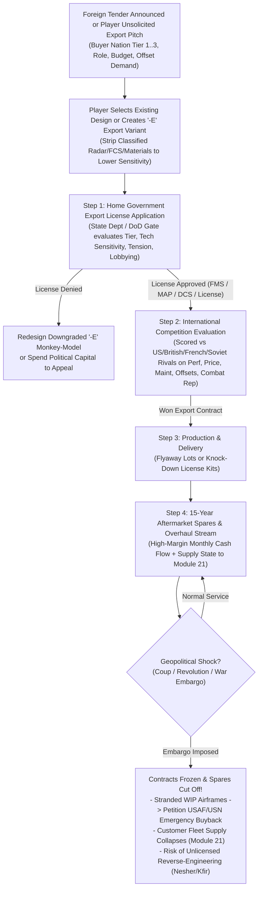

# 22 — Foreign Military Sales, Export Controls, Monkey-Models, and Spare-Parts Leverage

> **Status**: v1.0 (Phase 2 System-Design Specification — Forward-Compatible with MVP v1.0 Contracts)
> **Owner**: Module 22 (`mic.export` — Phase 2 expansion)
> **Conforms to**: [`docs/spec/00_conventions.md`](file:///Users/xtxsinan/.gemini/antigravity/scratch/military_industrial_complex_jet_age/docs/spec/00_conventions.md) (Locked Decisions D2, D5; §4 Shared Contracts), [`docs/spec/01_aero_physics.md`](file:///Users/xtxsinan/.gemini/antigravity/scratch/military_industrial_complex_jet_age/docs/spec/01_aero_physics.md) (`AircraftDesign`, `PerformanceReport`), [`docs/spec/04_economy.md`](file:///Users/xtxsinan/.gemini/antigravity/scratch/military_industrial_complex_jet_age/docs/spec/04_economy.md) (`CompanyState`, `reputation.export`, `active_delivered_fleet`), [`docs/spec/05_procurement.md`](file:///Users/xtxsinan/.gemini/antigravity/scratch/military_industrial_complex_jet_age/docs/spec/05_procurement.md) (`Requirement`, `usaf_gor127_n156_1956` MAP hook), and [`docs/spec/21_war_system.md`](file:///Users/xtxsinan/.gemini/antigravity/scratch/military_industrial_complex_jet_age/docs/spec/21_war_system.md) (regional balance of power & wartime spares supply).
> **Tunables**: `sim/data/tuning/export.json` (Phase 2)
> **Historical Data**: `sim/data/export/buyer_nations.json`, `sim/data/export/historical_tenders.json` (Phase 2)

---

## 1. Purpose & Player Fantasy

### 1.1 Core Philosophy (Locked Decision D5: Export Under Sovereign Gatekeeping)
For a combat aircraft manufacturer, the international export market is both a **financial lifeline** between domestic procurement cycles and a **geopolitical minefield**. Per Locked Decision **D5**, the player is strictly a manufacturer:
- **You cannot unilaterally sell weapons to whomever you please.** Every foreign demonstration, technical data transfer, or production contract must pass through your home government's **Export Control Gate** (in the US: State Department Office of Munitions Control / Pentagon DSAA / Congressional notification; in France: CIEEMG inter-ministerial committee; in the USSR: Politburo / GKES state export monopoly).
- **Different markets demand radically different airplanes.** Wealthy Tier 1 NATO allies (`West Germany`, `Japan`, `Canada`, `Belgium`, `Netherlands`) want bleeding-edge multimission performance (`F-104G`, `F-4E`, `F-16A`) and demand **local license co-production and industrial offsets**. Developing Tier 2/3 nations in Latin America, Asia, and the Middle East want rugged, low-cost, low-maintenance fighters (`maint_mh_per_fh` $\le 12$, short `takeoff_distance_m` for rough forward strips) and cannot obtain US export clearance for top-secret radars or engines.
- **The "Monkey-Model" & Export Derivative Strategy:** When the State Department blocks your frontline USAF interceptor from being exported to a Tier 2/3 buyer due to classified technologies (`techs_used`), you can engineer a dedicated **Downgraded Export Variant (`-E` / Monkey-Model)** or a private-venture light export fighter (like Northrop's `N-156F / F-5A` or Dassault's simplified `Mirage 5`, or the `F-16/79` J79-powered export fighter). Stripping classified radars, fire-control computers, and exotic materials lowers the export sensitivity score below the approval threshold while slashing `unit_flyaway_cost_usd`.
- **Aftermarket Spare Parts Are Both High-Margin Gold and a Geopolitical Leash:** Selling the airframe is only the beginning. Over a 15-year operational service life, a foreign fleet generates recurring, high-margin **spare parts, engine overhaul, and block-upgrade revenue**. However, if the buyer country suffers a coup, attacks a Western ally, or falls under a sudden **Arms Embargo** (e.g., France's 1967 embargo on Israel's paid-for `Mirage 5J`s, or the 1979 Iranian Revolution freezing `F-14A` support and stranding `F-16A`s on the Fort Worth ramp), your contracts are frozen overnight—forcing you to scramble for an emergency USAF/USN bailout buyback while watching your stranded aircraft get starved of spares or reverse-engineered into unauthorized clones (`IAI Nesher/Kfir`).

---

## 2. Scope

| Feature | MVP (Phase 1: US 1945–1960) | Phase 2 Export Expansion (`22_export_geopolitics.md`) | Later Phases (Phases 3–4) |
|---|---|---|---|
| **Export Representation** | `CompanyState.reputation["export"]` (`04_economy.md`), `usaf_gor127_n156_1956` MAP light fighter RFP (`05_procurement.md`), abstract `active_delivered_fleet` spares | Full buyer-nation database (24 customer nations across 4 alignment tiers), Export License Gate, Foreign Tenders, MAP/FMS/DCS/License deals | Multi-national consortium workshare politics (`23_nations_and_eras_1960_2030.md`), Soviet GKES state export directives |
| **Aircraft Derivatives** | Standard variant editing in Design Bureau (`01_aero_physics.md`) | Dedicated **Export Derivative (`-E` / Monkey-Model)** workflow with automatic Tech Sensitivity Score preview & cost delta | Software-locked export source-code tiers (Era IV–V `F-35` ALIS/ODIN export sovereignty tiers) |
| **Aftermarket & Risks** | Flat per-aircraft monthly sustainment revenue in `04_economy.md` | Per-customer `ExportFleetRecord` (15-year spares stream), Embargo/Coup events, Stranded Inventory USAF/USN Buyback, Tech Leakage / Reverse-Engineering | Grey-market sanctions busting, 1977 Foreign Corrupt Practices Act (FCPA) Senate investigation hearings |

---

## 3. Player-Facing Flow



### 3.1 Step-by-Step Experience
1. **International Market Map & Export Tenders:**
   - The player opens the **International Sales & Export Bureau** tab, displaying 24 buyer nations grouped by **Alignment Tier (`Tier 1` to `Tier 4`)**, their current air force aging pressure, defense budget, climate/runway constraints, and active **Foreign Fighter Tenders** (e.g., *1958 NATO Starfighter Replacement Consortium*, *1955 Royal Canadian Air Force Interceptor*, *1962 Israeli Mirage/Fighter Tender*, *1974 NATO "Sale of the Century" F-16 vs Mirage F1E vs Viggen*).
2. **Creating an Export Derivative ("Monkey-Model" Builder):**
   - Selecting any company aircraft opens the **Create Export Derivative (`-E`)** modal.
   - The UI highlights every component or technology in `AircraftDesign.techs_used[]` that contributes high **Export Tech Sensitivity ($S_{\text{sens}}$)**—such as a newly unlocked radar (`ma1`, `apq72`, `awg9`), fire-control computer, nuclear delivery wiring (`armament.nuclear_delivery`), or high titanium fraction.
   - With one click, the player swaps the classified radar for a simpler export-cleared radar (`apg30`) or optical sight, downgrades avionics level, or swaps the engine, immediately watching **Export Approval Probability jump from $12\%$ to $94\%$** and **`unit_flyaway_cost_usd` drop by $18\%$**.
3. **Export License Application & Financing Package:**
   - Before submitting a binding bid to the foreign buyer, the player files for a **Munitions Export License** (30-day review) and selects the commercial structure:
     - **US MAP/MDAP Grant Aid** (if eligible for this buyer/tender): The US Pentagon pays 100% of the contract in USD; guaranteed collection, capped $8\%$ profit margin.
     - **Foreign Military Sales (`FMS`) / Direct Commercial Sales (`DCS`)**: Buyer pays in USD; higher profit margin ($12\text{–}22\%$), subject to buyer credit/embargo risk.
     - **License Co-Production & Offset Package (`license_share` $\in [0\%, 70\%]$)**: Boosting local assembly share wins massive evaluation bonus points in Tier 1/2 industrialized tenders (`West Germany`, `Japan`, `Belgium/Netherlands`, `India`), trading away a portion of airframe manufacturing hours in exchange for a flat **Upfront Technical Data Package Fee** plus **$8\text{–}12\%$ per-unit license royalty** and captive engine/spares sales.
4. **Deliveries, Combat Proven Prestige & Aftermarket Spares:**
   - Once delivered, foreign squadrons enter the buyer nation's Order of Battle (`21_war_system.md`). Every flight hour generates recurring monthly **Spares & Depot Overhaul Revenue** at a $28\%$ gross margin for 15 years.
   - If the aircraft performs brilliantly in a regional war (e.g., `Mirage IIIC` in 1967 or `F-16A` in 1982), `reputation.export` surges and triggers unsolicited purchase inquiries from other Tier 2/3 nations.

---

## 4. Data Schemas & Forward-Compatibility Contracts

### 4.1 Forward Compatibility with MVP Contracts (`00_conventions.md` §4)

| MVP Contract & Field | Owner | How Module 22 (`mic.export`) Uses & Extends It |
|---|---|---|
| `CompanyState.reputation["export"]` | Module 04 | Already present in MVP (`0.0..100.0`, default `45.0`). Acts as the primary credibility and brand-prestige multiplier in all foreign tenders. |
| `CompanyState.active_delivered_fleet` | Module 04 | In MVP, a single integer tracking delivered aircraft for spares revenue. In Phase 2, remains synchronized as the sum of domestic active aircraft plus non-embargoed `ExportFleetRecord.active_airframes`. |
| `CompanyState.political_capital` | Module 04 | Spent to lobby the State Department / Congress to approve borderline export licenses or to secure an emergency USAF/USN buyback of embargo-stranded inventory. |
| `AircraftDesign.techs_used[]` | Modules 01, 03 | Used to compute the exact **Export Tech Sensitivity Index $S_{\text{sens}}$** based on the age and classification category of each tech node. |
| `Requirement` (`usaf_gor127_n156_1956`) | Module 05 | MVP already includes Northrop's `N-156F (F-5A)` MAP Light Fighter program; Module 22 seamlessly hooks into MAP-designated programs to distribute deliveries to Tier 1/2 MAP recipients (`ROKAF`, `ROCAF`, `Iran`, `Norway`, `Greece`, `Turkey`). |

### 4.2 `BuyerNationSpec` Schema (`sim/data/export/buyer_nations.json`)

```json
{
  "nation_id": "israel_iaf",
  "name_key": "nation.israel_iaf.name",
  "display_name": "Israel (Israeli Air Force)",
  "alignment_tier": 2,
  "alignment_history": [
    { "date": "1948-05-15", "tier": 3, "primary_supplier_bloc": "french_uk" },
    { "date": "1967-06-05", "tier": 2, "french_embargo": true },
    { "date": "1968-01-01", "tier": 1, "primary_supplier_bloc": "us" }
  ],
  "annual_procurement_budget_1950_usd": 45000000.0,
  "pilot_skill_base": 1.20,
  "industrial_capability": 0.70,
  "offset_preference_weight": 0.35,
  "maintenance_Infrastructure": 0.85,
  "rough_field_requirement": false,
  "climate_hot_high": true,
  "regime_instability_mtth_years": 999.0,
  "reverse_engineering_capability": 0.85
}
```

### 4.3 Buyer Alignment Tiers (`alignment_tier`)

| Tier | Classification | Historical Examples (1945–1990) | Max Allowed Tech Sensitivity ($T_{\text{tier}}$) | Eligible Financing Modes |
|---|---|---|---|---|
| **Tier 1** | **Close Treaty Ally / NATO Core / ANZUS** | `UK`, `Canada`, `West Germany` (post-1955), `Japan` (post-1954), `Australia`, `Belgium`, `Netherlands`, `Norway`, `Israel` (post-1968) | `0.85` (Allows frontline radars/missiles 2+ years after domestic IOC; excludes `nuclear_delivery` unless NATO nuclear-sharing dual-key) | `MAP`, `FMS`, `DCS`, `License Co-Production` |
| **Tier 2** | **Friendly Aligned / Regional Partner (SEATO/CENTO/RIO)** | `Taiwan (ROCAF)`, `South Korea (ROKAF)`, `Iran` (pre-1979), `Pakistan`, `Spain`, `Brazil`, `Venezuela`, `Saudi Arabia` | `0.50` (Requires mature tech $\ge 5$ years old or `-E` downgraded avionics/radar) | `MAP`, `FMS`, `DCS` |
| **Tier 3** | **Non-Aligned / Sensitive / Regional Conflict Zone** | `India`, `Egypt` (post-1976), `Yugoslavia`, `Argentina`, `Peru`, `Iraq` (1980s for French/Soviet) | `0.28` (Strictly simplified `-E` Monkey-Models or basic day fighters; high embargo sensitivity) | `FMS` (strict), `DCS` |
| **Tier 4** | **Embargoed / Adversary Bloc** | `USSR`, `Warsaw Pact`, `PRC` (except 1980s Peace Pearl window), `North Korea`, `North Vietnam`, `Iran` (post-1979), `Cuba` | `0.00` (**Hard Statutory Prohibition** — automatic rejection) | None |

### 4.4 `ExportVariantSpec`, `ExportContract`, and `ExportFleetRecord` Schemas

```python
ExportVariantSpec {
  variant_id: str                  # e.g. "f104g_export" or "f4e_monkey_export"
  parent_design_id: str            # base AircraftDesign.id
  modified_design: AircraftDesign  # full valid AircraftDesign with downgraded/swapped systems
  stripped_tech_ids: list[str]     # classified techs removed vs parent
  tech_sensitivity_score: float    # S_sens in [0.0, 1.0]
  unit_cost_reduction_frac: float  # cost savings vs parent
  mod_dev_cost_usd: float          # minor non-recurring engineering cost (typically 3%..8% of clean-sheet)
  mod_dev_days: int                # typically 60..150 days
}

ExportContract {
  contract_id: str
  buyer_nation_id: str
  design_id: str
  financing_mode: str              # "MAP_GRANT" | "FMS" | "DCS" | "LICENSE_COPROD"
  quantity_ordered: int
  quantity_delivered: int
  unit_price_usd: float
  local_workshare_frac: float      # [0.0, 0.70] fraction assembled by buyer's domestic industry
  license_upfront_fee_usd: float   # lump-sum tech transfer fee paid on signing
  license_royalty_frac: float      # [0.0, 0.15] royalty paid per locally built airframe
  offset_commitment_frac: float    # [0.0, 0.50] industrial offset discount
  status: str                      # "active" | "embargo_frozen" | "completed" | "cancelled"
  stranded_wip_units: int          # built/semi-built aircraft frozen on ramp by embargo
}

ExportFleetRecord {
  fleet_id: str
  buyer_nation_id: str
  design_id: str
  manufacturer_id: str
  active_airframes: int
  mean_fleet_age_years: float      # [0.0, 20.0]; retires after 15..20 years
  spares_contract_active: bool     # False if under embargo or cancelled
  supply_state: float              # [0.15, 1.00]; fed directly into Module 21 SquadronDeployment
  monthly_spares_revenue_usd: float
  monthly_spares_cost_usd: float
}
```

---

## 5. Algorithms & Mathematical Specification

All random draws use deterministic `PCG32` streams (`export.approval`, `export.tender`, `export.geopolitics`) from `RngStreamRegistry` (`00_conventions.md` §3). Constants in `UPPER_SNAKE` live in `sim/data/tuning/export.json` (§6).

### 5.1 State Department / Pentagon Export Approval Gate

#### 5.1.1 Aircraft Technology Sensitivity Score ($S_{\text{sens}} \in [0.0, 1.0]$)
For any `AircraftDesign` evaluated in calendar year $y_{\text{cur}}$, let $T_{\text{used}}$ be `design.techs_used[]`. Each technology $t \in T_{\text{used}}$ has a historical unlock year $y_{\text{hist}}(t)$ (`03_tech_tree.md`) and a category sensitivity weight $w_{\text{cat}}(t)$ (`1.5` for `radar`/`fire_control`/`stealth`/`electronic_warfare`, `1.2` for `propulsion`/`missiles`, `0.8` for `aero`/`structures`/`mfg`):
1. **Individual Tech Recency Sensitivity ($s_t \in [0, 1]$):**
   A technology is maximally sensitive when brand new ($\text{age} \le 0$) and decays linearly to zero export sensitivity over $\text{TECH\_EXPORT\_DECAY\_YEARS} = 10.0$ years:
   $$\text{age}_t = y_{\text{cur}} - y_{\text{hist}}(t), \qquad s_t = \text{clamp}\!\left(1.0 - \frac{\max(0.0,\, \text{age}_t)}{\text{TECH\_EXPORT\_DECAY\_YEARS}},\;\; 0.0,\;\; 1.0\right)$$
2. **Hard Restricted Feature Adders ($S_{\text{hard}}$):**
   Certain capabilities trigger heightened scrutiny by the State Department / Joint Chiefs:
   $$S_{\text{hard}} = 0.45 \cdot \mathbb{I}(\texttt{armament.nuclear\_delivery} \lor \texttt{armament.nuclear\_aam}) + 0.25 \cdot \mathbb{I}(\texttt{systems.avionics\_level} \ge 5) + 0.35 \cdot \mathbb{I}(\text{stealth\_generation} \ge 1)$$
3. **Composite Sensitivity Index ($S_{\text{sens}}$):**
   Let $s_{\max} = \max_{t \in T_{\text{used}}}(w_{\text{cat}}(t) \cdot s_t)$ and $\bar{s} = \frac{1}{\max(|T_{\text{used}}|, 1)}\sum_{t \in T_{\text{used}}} w_{\text{cat}}(t) \cdot s_t$:
   $$S_{\text{sens}} = \text{clamp}\!\left(0.65 \cdot s_{\max} + 0.35 \cdot \bar{s} + S_{\text{hard}},\;\; 0.0,\;\; 1.0\right)$$

#### 5.1.2 Export License Approval Probability ($p_{\text{approve}}$)
Given buyer alignment tier $\text{tier} \in \{1, 2, 3, 4\}$ with tier ceiling $T_{\text{tier}} \in \{0.85, 0.50, 0.28, 0.00\}$, global Cold War tension $\tau_{\text{ten}} = \texttt{macro.tension} \in [0, 1]$ (`09_core_loop.md`), and player lobbying spend $P_{\text{lobby}}$ [`political_capital`]:
- **Hard Statutory Prohibitions (`p_approve = 0.0`):**
  1. Buyer is `Tier 4` (Embargoed / Adversary Bloc) or under an active wartime arms embargo (`embargo_active == True`).
  2. Aircraft retains `armament.nuclear_delivery` or `nuclear_aam` and buyer is not a `Tier 1` NATO dual-key partner.
- **Approval Margin ($M_{\text{exp}}$):**
  Cold War tension has an asymmetric effect by tier: high tension **increases** willingness to arm `Tier 1/2` anti-communist frontline allies ($+\text{TENSION\_ALLY\_BONUS}$), while **tightening** technology security toward `Tier 3` non-aligned states ($-\text{TENSION\_TIER3\_PENALTY}$):
  $$\Delta_{\text{ten}} = \begin{cases} +0.12 \cdot (\tau_{\text{ten}} - 0.50) & \text{if } \text{tier} \in \{1, 2\} \\ -0.15 \cdot (\tau_{\text{ten}} - 0.50) & \text{if } \text{tier} = 3 \end{cases}$$
  $$\Delta_{\text{pc}} = \text{EXP\_LOBBY\_MAX} \cdot \left(1.0 - \exp\!\left(-\frac{P_{\text{lobby}}}{\text{EXP\_LOBBY\_SCALE}}\right)\right)$$
  $$M_{\text{exp}} = T_{\text{tier}} - S_{\text{sens}} + \Delta_{\text{ten}} + \Delta_{\text{pc}}$$
  $$p_{\text{approve}} = \sigma_{\text{logistic}}\!\left(\frac{M_{\text{exp}}}{\text{EXP\_GATE\_SLOPE}}\right) = \frac{1}{1 + \exp(-M_{\text{exp}} / 0.06)}$$
  *(Design consequence: If $S_{\text{sens}} = 0.62$ and the buyer is `Tier 2` ($T_2 = 0.50$), $M_{\text{exp}} = -0.12 \implies p_{\text{approve}} = 11.9\%$. Creating a `-E` Monkey-Model that swaps out the brand-new radar and fire-control system drops $S_{\text{sens}}$ to $0.34 \implies M_{\text{exp}} = +0.16 \implies p_{\text{approve}} = 93.5\%$!)*

---

### 5.2 Export Variants ("Monkey-Models" / Downgraded Export Blocks)

When creating an `ExportVariantSpec` from a parent `AircraftDesign`:
1. **Allowed Component & Subsystem Substitutions without Airframe Re-Tooling:**
   - Downgrade or remove `systems.radar_id`, `systems.fire_control_id`, and `systems.avionics_level` (e.g., stripping `MA-1` integrated FCS to basic `APG-30` radar-ranging sight, or removing radar entirely on `Mirage 5` to add internal fuel).
   - Remove restricted weapon clearances (`nuclear_delivery`, latest-gen SARH/ARH missiles) while retaining export-cleared guns, bombs, and Gen 1–2 IR missiles (`AIM-9B/E`).
   - Substitute a lower-tier or export-cleared engine of compatible diameter (`EngineSpec.diameter_m <= fuselage.max_diameter_m`, e.g., `F-16/79` substituting `J79-GE-119` for `F100-PW-100`).
2. **Engineering Cost, Schedule, and Tooling Inheritance:**
   - Because the primary wing/fuselage geometry and structural jigs are unchanged, non-recurring modification cost is only:
     $$C_{\text{dev,export}} = \left(0.03 + 0.05 \cdot \mathbb{I}(\text{engine\_changed})\right) \cdot \text{parent\_dev\_cost\_usd}$$
   - Development time is $60\text{ days}$ ($150\text{ days}$ if engine changed).
   - **Crucial Manufacturing Advantage:** The `-E` variant **shares the parent design's cumulative Wright learning curve counter `cumulative_units_built`** (`04_economy.md` §5.2.4) at $85\%$ commonality ($100\%$ if engine unchanged)! Thus foreign orders directly drive down domestic unit production cost along the learning curve.

---

### 5.3 International Tender Evaluation, Financing & Offsets

When an export-licensed bid competes in a foreign tender for buyer $B$, Module 22 scores all entrants (player bid + US/British/French/Soviet AI rival bids) using an international adaptation of Module 05's scoring kernel:

$$S_{\text{export}} = W_{\text{perf},B} \cdot S_{\text{perf}} + W_{\text{price},B} \cdot S_{\text{price,eff}} + W_{\text{maint},B} \cdot S_{\text{maint}} + \Delta_{\text{offset}} + \Delta_{\text{combat\_rep}} + \Delta_{\text{diplo}}$$

1. **Effective Buyer Price & Financing Multiplier ($S_{\text{price,eff}}$):**
   - If funded by **US MAP/MDAP Grant Aid** (`financing_mode == "MAP_GRANT"`), the buyer pays only $15\%$ of flyaway price out of its national budget (the US Pentagon funds the remaining $85\%$), granting a massive price score advantage.
   - If the player offers **Industrial Offsets** ($\phi_{\text{offset}} \in [0, 0.50]$) or **Local License Assembly** ($\phi_{\text{lic}} \in [0, 0.70]$), the effective price score is unchanged but the player receives the **Offset & Sovereign Workshare Bonus**:
     $$\Delta_{\text{offset}} = \text{OFFSET\_MAX\_PTS} \cdot w_{\text{offset},B} \cdot \left(0.60 \cdot \frac{\phi_{\text{lic}}}{0.50} + 0.40 \cdot \frac{\phi_{\text{offset}}}{0.40}\right)$$
     *(For `Tier 1` nations like West Germany or Japan with $w_{\text{offset},B} = 0.85$, offering $50\%$ license co-production adds up to $+14.0$ points—explaining how Lockheed's `F-104G` swept the European consortium over competitors refusing local production.)*
2. **Maintenance & Ruggedness Score ($S_{\text{maint}}$):**
    Tier 2/3 nations with lower `maintenance_infrastructure` heavily weight low `maint_mh_per_fh` ($M_{\text{mh}}$) and high `mtbf_h`:
   $$S_{\text{maint}} = 100.0 \cdot \text{clamp}\!\left(1.25 - 0.025 \cdot M_{\text{mh}},\;\; 0.0,\;\; 1.0\right)$$
3. **Combat-Proven Prestige Bonus ($\Delta_{\text{combat\_rep}} \in [-10, +15]$):**
   Derived from `CompanyState.reputation["export"]` and the specific aircraft design's cumulative wartime exchange ratio (`21_war_system.md` §5.4.1):
   $$\Delta_{\text{combat\_rep}} = 0.12 \cdot (\text{reputation.export} - 50.0) + 4.5 \cdot \ln(\text{ER}_{\text{design,career}}) \cdot \mathbb{I}(\text{combat\_sorties} \ge 50)$$
4. **License Co-Production Revenue Split (`financing_mode == "LICENSE_COPROD"`):**
   When $\phi_{\text{lic}} > 0$ across $Q$ ordered aircraft:
   - The player manufactures the first $Q_{\text{direct}} = \text{round}((1 - \phi_{\text{lic}}) \cdot Q)$ aircraft on their own factory floor at full `unit_price_usd`.
   - Upon contract signing, the buyer pays a lump-sum **Technical Data & Tooling Transfer Fee**:
     $$F_{\text{upfront}} = \text{LIC\_UPFRONT\_FRAC} \cdot C_{\text{dev,ref}} \cdot \phi_{\text{lic}}$$
   - For the remaining $Q_{\text{local}} = Q - Q_{\text{direct}}$ aircraft assembled abroad, the player collects a **License Royalty + Knock-Down Subassembly Fee** of $(\text{royalty\_frac} + 0.20) \cdot \text{unit\_price\_usd}$ per aircraft with zero domestic factory floor usage (`factory_floor_m2`), while still capturing $65\%$ of the 15-year aftermarket spare-parts stream!

---

### 5.4 Aftermarket Spare Parts, Embargoes, Stranded Inventory & Tech Leakage

#### 5.4.1 Recurring 15-Year Aftermarket Spares & Overhaul Revenue
Every delivered foreign fleet (`ExportFleetRecord`) with $N_{\text{active}}$ operational aircraft flies an average of $H_{\text{fh/mo}} = 18.0\text{ flight hours/month}$ in peacetime ($45.0\text{ fh/mo}$ in wartime).
So long as `spares_contract_active == True`, monthly aftermarket revenue and cost to the manufacturer are:
$$\text{Rev}_{\text{spares,mo}} = N_{\text{active}} \cdot H_{\text{fh/mo}} \cdot \left(\text{SPARES\_RATE\_PER\_FH} \cdot \text{unit\_flyaway\_cost\_usd}\right)$$
$$\text{Cost}_{\text{spares,mo}} = (1.0 - \text{SPARES\_GROSS\_MARGIN}) \cdot \text{Rev}_{\text{spares,mo}}$$
With $\text{SPARES\_RATE\_PER\_FH} = 0.00028$ and $\text{SPARES\_GROSS\_MARGIN} = 0.30$, a single aircraft flying $216\text{ fh/yr}$ generates $6.05\%\text{ of its flyaway price per year}$ in spares revenue—meaning **over a 15-year service life, aftermarket spares equal $\sim 91\%$ of the original flyaway contract value at a $30\%$ gross profit margin**!

#### 5.4.2 Coups, Sanctions & Sudden Arms Embargoes
An active export customer $B$ can fall under an **Arms Embargo** via two triggers:
1. **Historical / Geopolitical Coup or Revolution Event:** e.g., *1967 Six-Day War French Embargo*, *1979 Iranian Revolution*, *1990 Pressler Amendment Sanctions*.
2. **Wartime Aggression Trigger (`21_war_system.md`):** Buyer $B$ enters a war against a `Tier 1` ally of the player's home country.

When an embargo strikes buyer $B$, four consequences execute immediately:
1. **Contract Freeze & Stranded Ramp Inventory:**
   - All active `ExportContract`s with buyer $B$ transition to `status = "embargo_frozen"`. Progress payments stop immediately.
   - Any undelivered work-in-process aircraft (`stranded_wip_units`) sit unpainted on the player's factory ramp, tying up working capital.
   - **Emergency Domestic Buyback Petition (`export.request_domestic_buyback`):** The player may petition the USAF or USN (spending $5.0$ `political_capital`) to purchase the stranded aircraft as domestic attrition replacements or aggressor training squadrons (modeled on the USAF absorbing Iran's cancelled `F-16A`s in 1979 and the USN absorbing embargoed Pakistani `F-16`s as `F-16N`/adversary aircraft) at $\text{BUYBACK\_PRICE\_FRAC} = 0.82$ of contract unit price.
2. **Aftermarket Spares Cutoff & Fleet Readiness Collapse:**
   - `spares_contract_active` becomes `False`. The manufacturer loses the monthly spares cash flow.
   - In Module 21 (`21_war_system.md` §5.1.1), the embargoed customer's `supply_state` decays by $12\%$ per month down to a cannibalization floor of $S_{\text{sup}} = 0.15$ (unless the customer buys black-market spares or reverse-engineers domestic parts).
3. **Unlicensed Reverse-Engineering & Clone Risk (`Nesher` / `Kfir` / `J-7` Mechanic):**
   - If an embargoed (or former license-production) nation has `reverse_engineering_capability` $R_{\text{rev}} \ge 0.50$ and operates $\ge 24$ of the player's aircraft (or received a `LICENSE_COPROD` technical data package), each year of embargo rolls for an **Unlicensed Indigenous Clone**:
     $$p_{\text{clone,yr}} = \text{clamp}\!\left(0.15 + 0.45 \cdot R_{\text{rev}} + 0.25 \cdot \phi_{\text{lic}},\;\; 0.0,\;\; 0.85\right)$$
   - If triggered, the nation begins producing an unauthorized derivative (e.g., Israeli `IAI Nesher` / J79-powered `Kfir` from the embargoed `Mirage 5J`), restoring its own `supply_state` to $0.80$ and entering Tier 2/3 export tenders as a low-cost rival to the player!

#### 5.4.3 Sales Commissions vs. Foreign Corrupt Practices Scandal (1970s Lockheed Mechanic)
In `Tier 2` and `Tier 3` tenders (or `Tier 1` prior to 1977), the player may optionally authorize a covert **Foreign Sales Agent Commission (`agent_commission_frac` $\in \{0\%, 2\%, 5\%\}$ of contract value)**:
- Adds $+3.5$ (`2%`) or $+7.5$ (`5%`) political bonus points in the foreign tender evaluation.
- However, each active covert commission carries an annual investigative journalism / Senate Church Committee / FCPA exposure probability $p_{\text{scandal,yr}} = 0.06 \cdot (\text{agent\_commission\_frac} / 0.02) \cdot (1.0 + 1.5 \cdot \mathbb{I}(y_{\text{cur}} \ge 1975))$.
- If exposed, a **Foreign Bribery Scandal** fires: fine of $25\%$ of contract value, $-15.0$ domestic `political_capital`, $-10.0$ `reputation.export`, and mandatory executive resignation hearing.

---

## 6. Tunables Table (`sim/data/tuning/export.json`)

| Name | Default | Range | Effect | Rationale |
|---|---:|---|---|---|
| `TECH_EXPORT_DECAY_YEARS` | `10.0` | `[5.0, 15.0]` | Years after historical unlock for a tech's export sensitivity to decay to 0 | A 1953 technology is sensitive in 1954, routine by 1963 |
| `TIER_SENS_CEILINGS` | `[0.85, 0.50, 0.28, 0.0]` | — | Max baseline tech sensitivity $T_{\text{tier}}$ for Tiers 1..4 | Separates NATO allies from Tier 2/3 Monkey-Model buyers |
| `EXP_GATE_SLOPE` | `0.06` | `[0.03, 0.12]` | Logistic transition width for State Dept license approval | Sharp enough that stripping 1–2 classified systems flips rejection to approval |
| `EXP_LOBBY_MAX` / `SCALE` | `0.14` / `15.0` | `[0.05, 0.25]` | Max sensitivity waiver from spending `political_capital` on export lobbying | Lets lobbying rescue borderline Tier 1/2 sales without bypassing Tier 3/4 bans |
| `OFFSET_MAX_PTS` | `16.0` | `[8.0, 25.0]` | Max tender score bonus from license co-production + offsets | Reproduces `F-104G` and `F-16A` European consortium wins |
| `LIC_UPFRONT_FRAC` | `0.22` | `[0.10, 0.40]` | Upfront tech-transfer fee as fraction of reference RDT&E cost | Makes license deals immediately cash-positive |
| `SPARES_RATE_PER_FH` | `0.00028` | `[0.00015, 0.00045]` | Monthly spares revenue per flight hour as fraction of unit flyaway price | Yields $\sim 6\%/\text{yr}$ ($\sim 91\%$ over 15 yr), matching real life-cycle O&S ratios |
| `SPARES_GROSS_MARGIN` | `0.30` | `[0.18, 0.45]` | Manufacturer gross profit margin on aftermarket spares & depot kits | High-margin buffer that rewards keeping a large global fleet flying |
| `BUYBACK_PRICE_FRAC` | `0.82` | `[0.65, 0.95]` | Price paid by USAF/USN when absorbing embargo-stranded airframes | Avoids bankruptcy on sudden embargoes while still penalizing profit margin |

---

## 7. Edge Cases & Failure Modes

1. **Attempting to Export a Design with GFE-Bailed Prototype Hardware:**
   - GFE bailment (`04_economy.md` §3.3) applies only to US government prototypes. Export production lines always purchase engines and avionics at commercial/FMS vendor prices (`gfe_provided = False`).
2. **Buyer Nation Drops to `Tier 4` Mid-Production (1979 Iran Scenario):**
   - Handled deterministically by the embargo state machine (§5.4.2): the production line pauses without triggering Anderlohr forgetting for 90 days while the player decides whether to trigger `export.request_domestic_buyback` or divert the airframes (`stranded_wip_units`) to another open `Tier 1/2` customer operating the same design.
3. **Preventing Infinite "Monkey-Model" Variant Clutter:**
   - The UI groups `-E` derivatives as collapsible child rows under their parent `AircraftDesign` in the Design Bureau list, and limits each parent design to at most 3 active export sub-variants.

---

## 8. Golden Test Vectors (Phase 2 Target)

To be generated by `sim/mic/export/golden_gen.py` into `sim/golden/export_*.json`:
1. `sim/golden/export_gate_frontline_vs_monkey_model.json`:
   - **Input:** 1959 `F-106A` (with newly unlocked `ma1` integrated FCS and `aim26a_nuclear_falcon`, $S_{\text{sens}} = 0.88$) vs. downgraded `F-106E` (`apq72` radar, non-nuclear `aim4c_falcon` only, $S_{\text{sens}} = 0.44$) applied to `Tier 1` (`Canada`) and `Tier 2` (`Taiwan`).
   - **Expected Output:** `F-106A` is rejected for both (`nuclear_aam` hard block); `F-106E` passes `Tier 1` ($p_{\text{approve}} > 0.99$) and passes `Tier 2` ($p_{\text{approve}} = 0.73$, rising to $0.91$ with $10$ `political_capital`).
2. `sim/golden/export_f104g_nato_consortium_license.json`:
   - **Input:** 1958 NATO Consortium tender (`West Germany`, `Belgium`, `Netherlands`, `Italy`, $Q = 900$) comparing a pure direct-import bid ($\phi_{\text{lic}} = 0$) vs. a $65\%$ license co-production + offset bid (`F-104G`).
   - **Expected Output:** License co-production bid wins by $+11.4$ points; computes exact upfront technical transfer fee, royalty stream, and shared learning-curve progression.
3. `sim/golden/export_embargo_buyback_and_kfir_clone.json`:
   - **Input:** 50 aircraft delivered + 18 WIP units on line when a `Tier 2` buyer (`reverse_engineering_capability = 0.85`) is hit by a sudden embargo.
   - **Expected Output:** Spares revenue drops to `0`, customer `supply_state` decays by $12\%/\text{mo}$, USAF buyback recovers $82\%$ of unit price on the 18 stranded airframes, and 3-year cumulative clone probability reaches $p_{\text{clone}} > 0.70$.

---

## 9. Interactions with Other Modules

| Module | Direction | Contract / Data Exchanged |
|---|---|---|
| **01 Aero & Performance** (`mic.aero`, `mic.perf`) | `01 ↔ 22` | Evaluates `-E` export derivatives (`modified_design`) to produce updated `PerformanceReport` (`unit_flyaway_cost_usd`, mass, drag, turn rates). |
| **03 Tech Tree** (`mic.tech`) | `03 → 22` | Provides historical unlock years $y_{\text{hist}}(t)$ and category tags for `design.techs_used[]` to compute $S_{\text{sens}}$. |
| **04 Economy** (`mic.econ`) | `04 ↔ 22` | `22 → 04`: Export contract progress/delivery payments, license upfront fees & royalties, 15-year aftermarket spares P&L, Wright learning-curve shared unit counter, and bribery scandal fines. |
| **05 Procurement** (`mic.procurement`) | `05 ↔ 22` | Links US MAP/MDAP competitions (`usaf_gor127_n156_1956`) to foreign recipient allocations and handles emergency USAF/USN buybacks of embargoed WIP aircraft. |
| **09 Core Loop** (`mic.campaign`) | `09 ↔ 22` | Monthly tick processes license approvals, foreign tender evaluations, aftermarket spares settlements, and geopolitical regime/embargo events. |
| **21 War System** (`21_war_system.md`) | `21 ↔ 22` | Export deliveries populate foreign `SquadronDeployment` OOBs; spares contracts govern `supply_state`; combat AAR exchange ratios drive `reputation.export`. |
| **23 Nations & Eras** (`23_nations_and_eras_1960_2030.md`) | `23 ↔ 22` | Parameterizes national export gate rules (US State Dept vs. French CIEEMG vs. Soviet GKES monopoly). |

---

## 10. Validation & Calibration Targets (Phase 2)

1. **Historical Export Market Share Reproduction (1950–1985):**
   - In historical simulation replays, `F-86F` / `CL-13`, `MiG-15/17/21`, `Hawker Hunter`, `F-104G`, `Mirage III/5`, `F-5A/E`, `F-4E`, and `F-16A/B` capture their historical buyer blocs (`Tier 1` high-tech license vs. `Tier 2/3` cost-effective rugged fighters).
2. **Lifecycle Spares Ratio Verification:**
   - Across a 15-year peacetime/wartime mixed career, cumulative aftermarket revenue per exported fighter stays within $[0.80, 1.15] \times \text{unit\_flyaway\_cost\_usd}$.

---

## 11. Open Questions & Cross-Module Change Requests

### 11.1 Open Questions (Player Taste Decisions)
1. **Export Engine Sales for Airframe Primes:** Per `game_design.md` §18.2, if the player develops an in-house or custom-commissioned engine, should they be allowed to export standalone engines to foreign airframe programs (e.g., selling `J79`s to Israel for the `Kfir` or `RM12`/`F404`s to Sweden's `Gripen`), or keep exports strictly at the complete aircraft / knock-down kit level?

### 11.2 Cross-Module Change Requests
1. **[CR-22-01] Shared Learning Curve Group ID on `ProductionLine` (`04_economy.md` §4.3):** Add optional `learning_family_id: str | None = None` to `ProductionLine` in Phase 2 so `-E` export derivatives share cumulative Wright learning-curve progress with their domestic parent airframe.
