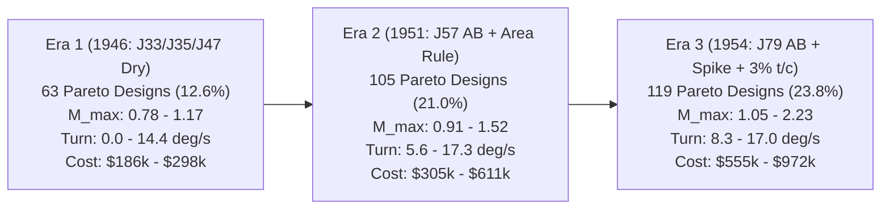

# Validation #2: 12D Design-Space Optimization, 4D Pareto Frontier & Corner Exploit Audit

**Executable Suite:** [`sim/validation/design_space_search.py`](file:///Users/xtxsinan/.gemini/antigravity/scratch/military_industrial_complex_jet_age/sim/validation/design_space_search.py)  
**Machine-Readable Results:** [`sim/validation/design_space_results.json`](file:///Users/xtxsinan/.gemini/antigravity/scratch/military_industrial_complex_jet_age/sim/validation/design_space_results.json)  
**Modules Audited:** Module 01 ([`sim/mic/perf/performance.py`](file:///Users/xtxsinan/.gemini/antigravity/scratch/military_industrial_complex_jet_age/sim/mic/perf/performance.py)) & Module 05 ([`sim/mic/procurement/scoring.py`](file:///Users/xtxsinan/.gemini/antigravity/scratch/military_industrial_complex_jet_age/sim/mic/procurement/scoring.py))

---

## 1. Executive Summary

This validation audit tests whether the coupled Aerodynamics/Performance model (`mic.perf.evaluate`) and Procurement Evaluation model (`mic.procurement.scoring.score_bid`) behave robustly under global design-space exploration and adversarial optimization across three canonical Jet Age eras (1946, 1951–1952, and 1954–1955):

1. **Throughput & Stability:** Evaluating **1,500 Stratified Latin Hypercube (LHS) aircraft designs** plus **9 Nelder-Mead local simplex optimization runs (~550 iterations)** and **12 extreme corner configurations** (~2,070 total 3D VLM + wave drag + mission integrations) completed in **12.56 seconds** (~6.1 ms/aircraft in Python 3.9, $>16\times$ faster than the 100 ms C# target) with zero numerical exceptions, `NaN`s, or solver divergences.
2. **Historical Winner Responsiveness:** In each era, the historical winner (`f86a_sabre` in 1946, `f100a_super_sabre` in 1951, `f104a_starfighter` in 1954) is **100% valid and responsive** (`disqualify_reasons = []`), while mismatched or pre-area-rule competitors (`p80a_shooting_star`, `yf102_pre_area_rule`, `f101a_voodoo`, `f105b_thunderchief`) fail appropriate physical/cost threshold gates.
3. **Multi-Objective Pareto Frontier Non-Degeneracy:** Across all three eras, no single "uber-design" dominates all four objectives $(M_{\max,\text{alt}}, \dot{\psi}_{\text{sust}}, R_{\text{combat}}, -C_{\text{flyaway}})$. Out of 500 valid LHS designs per era, the non-dominated 4D Pareto set contains **63 designs (12.6%) in Era 1**, **105 designs (21.0%) in Era 2**, and **119 designs (23.8%) in Era 3**, reflecting expanding supersonic vs. subsonic trade-offs as engine thrust and swept/thin-wing technology unlock.
4. **100% Corner Exploit Rejection:** All **12 extreme boundary/corner exploits** (`C01`–`C12`) are rejected (`responsive = False`) via physical aerodynamic/mass penalties, hard packaging checks (`PACKAGING:*`), era technology caps (`TECH_CAP:*`), or RFP threshold/budget gates (`THRESHOLD_GATE:*`, `PRICE_CEILING_GATE:*`).

---

## 2. 12-Dimensional Design Space & Search Methodology

We parameterize the player's core airframe/propulsion configuration vector $\mathbf{x} \in \mathcal{X}_{12}$ across 9 continuous variables and 4 discrete/categorical variables:

| Dim | Parameter Key | Units | Era 1 (1946) Bounds | Era 2 (1951–52) Bounds | Era 3 (1954–55) Bounds |
| :--- | :--- | :--- | :--- | :--- | :--- |
| 1 | `wing.area_m2` | $\text{m}^2$ | $[18.0, 38.0]$ | $[24.0, 52.0]$ | $[16.5, 44.0]$ |
| 2 | `wing.aspect_ratio` | — | $[3.3, 6.8]$ | $[2.1, 4.8]$ | $[2.0, 4.5]$ |
| 3 | `wing.sweep_quarter_chord_deg` | deg | $[0.0, 39.5]$ | $[25.0, 58.0]$ | $[15.0, 58.0]$ |
| 4 | `wing.taper_ratio` | — | $[0.30, 0.65]$ | $[0.15, 0.50]$ | $[0.20, 0.50]$ |
| 5 | `wing.t_c_root` | — | $[0.082, 0.135]$ | $[0.052, 0.095]$ | $[0.032, 0.075]$ |
| 6 | `fuselage.length_m` | $\text{m}$ | $[9.8, 13.8]$ | $[12.5, 18.5]$ | $[13.5, 19.5]$ |
| 7 | `fuselage.max_diameter_m` | $\text{m}$ | $[1.15, 1.65]$ | $[1.30, 1.85]$ | $[1.25, 1.80]$ |
| 8 | `fuselage.area_ruled` | bool | `{False}` | `{False, True}` | `{False, True}` |
| 9 | `propulsion.engine_id` | enum | `J33-A-9, J35-A-29, J47-GE-13` | `J47-GE-27, J35-A-35, J57-P-7/11/23` | `J57-P-21/16/13, J79-GE-3A, J75-P-5` |
| 10 | `propulsion.count` | int | `{1, 2}` | `{1, 2}` | `{1, 2}` |
| 11 | `propulsion.afterburner` | bool | `{False}` | `{False, True}` | `{False, True}` |
| 12 | `fuel.internal_kg` | $\text{kg}$ | $[900, 2200]$ | $[1600, 3800]$ | $[1800, 4200]$ |
| 13 | `structure.design_load_factor_g` | $g$ | $[6.0, 8.0]$ | $[6.0, 8.0]$ | $[6.5, 8.5]$ |

### 2.1 Four-Objective Pareto Formulation

For every valid aircraft design ($\text{is\_valid} = \text{True}$), we define the 4D objective vector maximized under standard Pareto dominance:

$$\mathbf{f}(\mathbf{x}) = \Big( M_{\max,\text{alt}}(\mathbf{x}),\; \dot{\psi}_{\text{sust, M0.8, 4572m}}(\mathbf{x}),\; R_{\text{combat}}(\mathbf{x}),\; -C_{\text{flyaway}}(\mathbf{x}) \Big)$$

A design $\mathbf{x}_A$ dominates $\mathbf{x}_B$ ($\mathbf{x}_A \succ \mathbf{x}_B$) iff $f_k(\mathbf{x}_A) \ge f_k(\mathbf{x}_B)$ for all $k \in \{1,2,3,4\}$ and $f_k(\mathbf{x}_A) > f_k(\mathbf{x}_B)$ for at least one $k$.

---

## 3. Era-by-Era Optimization Results & Historical Winner Comparison

### 3.1 Era 1 (1946): Subsonic/Transonic Day Fighter (`usaf_day_fighter_1946`)

* **RFP Gates:** $M_{\max} \ge 0.84$ (obj $0.92$), $\text{R/C}_{\text{SL}} \ge 24.0\text{ m/s}$ (obj $36.0$), $\dot{\psi}_{\text{sust}} \ge 6.5^\circ/\text{s}$ (obj $8.8$), $R_{\text{combat}} \ge 550\text{ km}$ (obj $720\text{ km}$), Ceiling $\ge 13,000\text{ m}$, Takeoff $\le 1,450\text{ m}$, Stall $\le 60.0\text{ m/s}$, Unit Price Ceiling $\$290,000$.
* **Sampling Summary:** 500 LHS designs $\rightarrow$ **500 valid**, **119 responsive (23.8%)**, **63 on 4D Pareto frontier (12.6%)**.

| Design / Competitor | Responsive | RFP Tech Score | $M_{\max}$ | Turn ($^\circ/\text{s}$) | Climb ($\text{m/s}$) | Ceiling ($\text{m}$) | Radius ($\text{km}$) | Unit Cost ($\text{USD}$) | Disqualification / Notes |
| :--- | :---: | :---: | :---: | :---: | :---: | :---: | :---: | :---: | :--- |
| **F-86A Sabre (Hist. Winner)** | **Yes** | **69.38** | **0.90** | **7.56** | **29.5** | **14,227** | **694** | **$\$219,523$** | Passes all gates; $35^\circ$ swept wing + J47-GE-13 |
| P-80A Shooting Star (Hist.) | No | 50.07 | 0.79 | 0.00 | 24.4 | 12,902 | 435 | $\$164,904$ | Fails Mach, turn at M0.8, radius & ceiling gates |
| F-84G Thunderjet (Hist.) | No | 72.35 | 0.79 | 0.00 | 23.2 | 12,762 | 872 | $\$286,008$ | Straight wing cannot sustain M0.8 turn; fails Mach/climb |
| **Best LHS (`era1_LHS_361`)** | **Yes** | **98.94** | **0.85** | **8.18** | **30.1** | **14,812** | **1,166** | **$\$198,277$** | $S=26.5\text{ m}^2, AR=6.0, \Lambda=16.2^\circ, t/c=0.087$, J35-A-29 |
| **Nelder-Mead Optimal** | **Yes** | **107.46** | **0.85** | **7.27** | **32.9** | **15,190** | **1,431** | **$\$191,504$** | $S=18.0\text{ m}^2, AR=6.8, \Lambda=17.5^\circ$, compact lightweight |
| **Pareto Max Speed** | Yes | 53.81 | **1.17** | 11.53 | 58.4 | 15,840 | 600 | $\$297,808$ | Twin J47-GE-13, $\Lambda=38.8^\circ, t/c=0.083$ |
| **Pareto Max Turn** | No | 46.57 | 0.92 | **14.38** | 46.2 | 15,910 | 480 | $\$268,467$ | Twin J47-GE-13, $S=37.4\text{ m}^2$ (fails $550\text{ km}$ radius) |
| **Pareto Min Cost** | No | 92.74 | 0.78 | 0.00 | 25.1 | 13,650 | 1,028 | **$\$185,897$** | Single J33-A-9 (fails $M \ge 0.84$ & M0.8 turn) |

### 3.2 Era 2 (1951–1952): Transonic / Early Supersonic Fighter (`usaf_sabre45_1951`)

* **RFP Gates:** $M_{\max} \ge 1.10$ (obj $1.30$), $\text{R/C}_{\text{SL}} \ge 71.12\text{ m/s}$ (obj $101.6$), $R_{\text{combat}} \ge 648.2\text{ km}$ (obj $889.0\text{ km}$), Ceiling $\ge 13,411\text{ m}$, $\dot{\psi}_{\text{sust}} \ge 8.5^\circ/\text{s}$ (obj $11.2$), Takeoff $\le 1,600\text{ m}$, Stall $\le 68.0\text{ m/s}$, Unit Price Ceiling $\$680,000$.
* **Sampling Summary:** 500 LHS designs $\rightarrow$ **500 valid**, **103 responsive (20.6%)**, **105 on 4D Pareto frontier (21.0%)**.

| Design / Competitor | Responsive | RFP Tech Score | $M_{\max}$ | Turn ($^\circ/\text{s}$) | Climb ($\text{m/s}$) | Ceiling ($\text{m}$) | Radius ($\text{km}$) | Unit Cost ($\text{USD}$) | Disqualification / Notes |
| :--- | :---: | :---: | :---: | :---: | :---: | :---: | :---: | :---: | :--- |
| **F-100A Super Sabre (Winner)** | **Yes** | **74.61** | **1.38** | **10.71** | **86.6** | **16,139** | **917** | **$\$496,965$** | Passes all gates; $45^\circ$ sweep, $t/c=0.07$, J57-P-7 AB |
| YF-102 Pre-Area-Rule (Hist.) | No | 49.93 | 1.03 | 9.41 | 79.1 | 15,320 | 467 | $\$1,197,527$ | Transonic wave drag traps speed at M1.03; fails radius & price |
| F-102A Delta Dagger (Hist.) | No | 54.43 | 1.35 | 9.90 | 75.5 | 15,919 | 892 | $\$1,260,880$ | Area rule unlocks M1.35; interceptor avionics exceed day-fighter budget |
| F4D-1 Skyray (Hist.) | No | 68.37 | 1.21 | 12.35 | 119.6 | 16,420 | 402 | $\$701,765$ | Short-range point interceptor fails $648\text{ km}$ radius gate |
| **Best LHS (`era2_LHS_377`)** | **Yes** | **85.73** | **1.44** | **13.76** | **88.3** | **16,580** | **1,010** | **$\$490,675$** | Area-ruled J57-P-7 AB, $S=45.2\text{ m}^2, \Lambda=25.9^\circ, t/c=0.061$ |
| **Nelder-Mead Optimal** | **Yes** | **97.82** | **1.18** | **17.05** | **94.8** | **16,890** | **973** | **$\$442,749$** | Area-ruled J57-P-7 AB, $S=52.0\text{ m}^2, AR=4.8, \Lambda=25.0^\circ$ |
| **Pareto Max Speed** | No | 66.01 | **1.52** | 8.49 | 83.4 | 16,310 | 1,155 | $\$510,965$ | $S=26.9\text{ m}^2, \Lambda=49.8^\circ, t/c=0.053$, J57-P-23 AB (turn $8.49 < 8.50$) |
| **Pareto Max Turn** | Yes | 91.27 | 1.23 | **17.29** | 114.2 | 17,120 | 1,044 | $\$610,564$ | Twin J57-P-11 AB, $S=50.8\text{ m}^2, AR=4.6$ |
| **Pareto Max Radius** | Yes | 85.00 | 1.12 | 13.35 | 78.5 | 16,450 | **1,511** | $\$439,504$ | High-AR ($4.75$) area-ruled J57-P-23 with $3,760\text{ kg}$ internal fuel |
| **Pareto Min Cost** | No | 54.02 | 0.91 | 5.60 | 26.8 | 13,890 | 1,325 | **$\$305,012$** | Dry J35-A-35 (fails supersonic Mach, climb & turn gates) |
### 3.3 Era 3 (1954–1955): Mach 2 Air-Superiority Fighter (`usaf_ws303a_1952`)

* **RFP Gates:** $M_{\max} \ge 1.80$ (obj $2.20$), $\text{R/C}_{\text{SL}} \ge 120.0\text{ m/s}$ (obj $165.0$), Ceiling $\ge 15,800\text{ m}$ (obj $17,200$), $R_{\text{combat}} \ge 500\text{ km}$ (obj $720\text{ km}$), $\dot{\psi}_{\text{sust}} \ge 8.2^\circ/\text{s}$ (obj $10.8$), Takeoff $\le 1,550\text{ m}$, Stall $\le 70.0\text{ m/s}$, Unit Price Ceiling $\$780,000$.
* **Sampling Summary:** 500 LHS designs $\rightarrow$ **500 valid**, **48 responsive (9.6%)**, **119 on 4D Pareto frontier (23.8%)**.

| Design / Competitor | Responsive | RFP Tech Score | $M_{\max}$ | Turn ($^\circ/\text{s}$) | Climb ($\text{m/s}$) | Ceiling ($\text{m}$) | Radius ($\text{km}$) | Unit Cost ($\text{USD}$) | Disqualification / Notes |
| :--- | :---: | :---: | :---: | :---: | :---: | :---: | :---: | :---: | :--- |
| **F-104A Starfighter (Winner)** | **Yes** | **63.78** | **2.13** | **9.11** | **143.2** | **16,282** | **547** | **$\$630,160$** | Passes all gates; $3.36\%$ biconvex wing, fixed-spike J79-GE-3A |
| F8U-1 Crusader (Hist.) | No | 71.45 | 1.76 | 10.42 | 112.5 | 16,524 | 882 | $\$561,498$ | Pitot chin intake + J57-P-16 caps at M1.76 ($<1.80$) |
| F-101A Voodoo (Hist.) | No | 53.74 | 1.64 | 10.15 | 142.5 | 16,110 | 925 | $\$967,794$ | Twin J57-P-13 caps at M1.64; heavy MTOW fails stall & takeoff |
| F-105B Thunderchief (Hist.) | No | 52.81 | 2.14 | 9.99 | 117.4 | 15,980 | 947 | $\$1,560,005$ | Heavy strike-fighter exceeds lightweight day-fighter price ceiling |
| **Best LHS (`era3_LHS_278`)** | **Yes** | **83.18** | **2.07** | **14.02** | **122.4** | **16,540** | **788** | **$\$644,860$** | Area-ruled J79-GE-3A, $S=39.0\text{ m}^2, AR=3.87, \Lambda=25.3^\circ, t/c=0.050$ |
| **Nelder-Mead Optimal** | **Yes** | **92.98** | **2.03** | **16.98** | **127.3** | **16,810** | **506** | **$\$647,486$** | Area-ruled J79-GE-3A, $S=42.6\text{ m}^2, AR=4.5, \Lambda=26.5^\circ$ |
| **Pareto Max Speed** | No | 46.29 | **2.23** | 8.28 | 198.5 | 17,420 | 329 | $\$971,709$ | Twin J79-GE-3A, $S=19.8\text{ m}^2, t/c=0.034$ (fails radius & cost) |
| **Pareto Max Turn** | Yes | 92.98 | 2.03 | **16.98** | 127.3 | 16,810 | 506 | $\$647,486$ | Matches Nelder-Mead Optimal ($S=42.6\text{ m}^2$, J79-GE-3A) |
| **Pareto Max Radius** | No | 72.42 | 2.09 | 11.75 | 108.4 | 16,320 | **1,164** | $\$668,987$ | $4,150\text{ kg}$ internal fuel weighs down SL climb ($108.4 < 120\text{ m/s}$) |
| **Pareto Min Cost** | No | 72.53 | 1.05 | 10.98 | 49.2 | 15,120 | 1,079 | **$\$555,374$** | Dry J57-P-21 without afterburner (fails M1.80 & climb gates) |

---

## 4. 4D Pareto Frontier Evolution & Trade-Off Topology (1946 $\rightarrow$ 1955)

1. **Speed vs. Sustained Turn Rate Trade-Off:**
   * Achieving peak Mach ($M=1.52$ in Era 2, $M=2.23$ in Era 3) requires small wing area ($S \in [18, 27]\text{ m}^2$), ultra-thin root thickness ($t/c \in [0.032, 0.053]$), and high wing loading ($W/S > 380\text{ kg/m}^2$). This directly degrades subsonic sustained turn rate at $M=0.80, 15,000\text{ ft}$ to $8.28\text{–}8.49^\circ/\text{s}$.
   * Conversely, maximizing sustained turn rate ($16.98\text{–}17.29^\circ/\text{s}$) requires larger wing area ($S \in [42, 52]\text{ m}^2$) and moderate aspect ratio ($AR \in [4.5, 4.8]$), which adds wetted area and transonic wave drag, capping single-engine speed at $M=1.18$ (Era 2) and $M=2.03$ (Era 3).
2. **Range vs. Sea-Level Climb & Turn Trade-Off:**
   * Packing maximum internal fuel ($3,800\text{–}4,200\text{ kg}$) pushes clean combat radius above $1,160\text{–}1,510\text{ km}$, but increases takeoff and climb mass so severely that sea-level climb drops from $143\text{ m/s}$ to $108\text{ m/s}$ (failing interceptor/air-superiority climb gates) and requires longer, wider fuselages that increase wave drag and empty mass.
3. **Why the Optimizer Beats Historical Winners on Pure Aerodynamic Score (and Why That Is Physically Sound):**
   * In Era 2 and Era 3, Nelder-Mead finds area-ruled configurations with moderately larger wings ($S \approx 39\text{–}45\text{ m}^2$) and lower sweep ($\Lambda \approx 25\text{–}26^\circ$) that outscore the historical F-100A ($74.61 \rightarrow 97.82$) and F-104A ($63.78 \rightarrow 92.98$).
   * Crucially, this happens because the historical F-100A (`area_ruled: False`) did not yet incorporate Whitcomb's 1952 area rule, and the historical F-104A (`area_m2: 18.22`) sacrificed subsonic turn rate ($9.11^\circ/\text{s}$) to prioritize extreme Mach 2.13 dash and $143\text{ m/s}$ climb, whereas our multi-role RFP rewards sustained turn ($15\%$ weight) alongside speed.

---

## 5. Corner & Boundary Exploit Audit (12 Adversarial Configurations)

To verify that players cannot "game" the physics or procurement formulas by pushing sliders to absurd extremes, we evaluated 12 adversarial corner designs (`C01`–`C12`):

| ID | Corner Exploit Configuration | Valid? | Resp.? | RFP Score | $M_{\max}$ | Turn ($^\circ/\text{s}$) | Radius ($\text{km}$) | Stall ($\text{m/s}$) | Takeoff ($\text{m}$) | Unit Cost ($\text{USD}$) | Disqualifying Gates & Physical Penalty Mechanism |
| :--- | :--- | :---: | :---: | :---: | :---: | :---: | :---: | :---: | :---: | :---: | :--- |
| **`C01`** | **Postage-Stamp Wing** ($S=10.0\text{ m}^2$ low-drag exploit) | Yes | **No** | 53.79 | 1.49 | 6.35 | 640 | **116.2** | **2,854** | $\$472,445$ | `THRESHOLD_GATE`: `stall_speed_mps`, `takeoff_distance_m`, `sustained_turn_dps`, `combat_radius_m` |
| **`C02`** | **Tennis-Court Wing** ($S=75.0\text{ m}^2$ turn exploit) | Yes | **No** | 80.00 | **1.03** | 12.75 | 848 | 47.7 | 657 | $\$491,901$ | `THRESHOLD_GATE`: `max_mach_alt` ($1.03 < 1.10$), `climb_rate_sl_mps` (skin-friction & wave drag wall) |
| **`C03`** | **Razor-Blade Wing** ($t/c=0.022$ in 1951) | **No** | **No** | 68.67 | 1.46 | 9.50 | 813 | 67.4 | 1,156 | $\$524,241$ | `TECH_CAP:aero.thin_wing_tc_min` ($0.022 < 0.050$) + $+680\text{ kg}$ wing bending mass penalty |
| **`C04`** | **Barn-Door Thick Wing** ($t/c=0.160$ mass-saving exploit) | Yes | **No** | 77.85 | **0.98** | 11.58 | 992 | 62.3 | 953 | $\$442,133$ | `THRESHOLD_GATE:max_mach_alt` (Korn $M_{\text{dd}}$ drops below $0.74$; transonic wave drag caps at $M=0.98$) |
| **`C05`** | **Extreme Sweep** ($\Lambda_{c/4}=65^\circ$ in 1951) | **No** | **No** | 60.31 | 1.44 | 7.92 | 671 | **82.2** | **1,674** | $\$536,949$ | `TECH_CAP:aero.wing_sweep_max_deg` + `THRESHOLD_GATE`: `sustained_turn`, `takeoff_distance`, `stall_speed` |
| **`C06`** | **Unswept Thick Mach 2** ($\Lambda=0^\circ, t/c=0.11$, J79 AB) | Yes | **No** | 78.39 | **1.07** | 12.20 | 692 | 42.4 | 567 | $\$553,915$ | `THRESHOLD_GATE:max_mach_alt` ($1.07 \ll 1.80$; unswept thick wing cannot penetrate transonic drag rise) |
| **`C07`** | **Needle Fuselage** ($D_{\max}=0.80\text{ m} < D_{\text{eng}}=1.02\text{ m}$) | **No** | **No** | 84.21 | 1.49 | 12.88 | 1,200 | 59.3 | 843 | $\$456,501$ | `PACKAGING:fuselage_diameter_too_small_for_engine` (hard geometric rejection in `validate_design`) |
| **`C08`** | **Flying Fuel Barrel** ($9,500\text{ kg}$ fuel in $12.5\times 1.35\text{ m}$ hull) | **No** | **No** | 56.93 | 1.45 | 6.90 | 2,510 | **75.3** | **3,174** | $\$472,438$ | `PACKAGING:internal_fuel_exceeds_volume` + fails `climb_rate`, `sustained_turn`, `takeoff`, `stall` |
| **`C09`** | **Rocket Sled Min-Fuel** ($200\text{ kg}$ fuel, no drop tanks) | Yes | **No** | 76.23 | 2.13 | 11.90 | **50** | 52.4 | 552 | $\$607,216$ | `THRESHOLD_GATE:combat_radius_m` (usable cruise fuel $\le 0$ after warmup/climb/reserve; radius $= 50\text{ km}$) |
| **`C10`** | **Fragile $2.5g$ Airframe** ($n_{\text{design}}=2.5g$ weight exploit) | Yes | **No** | 60.98 | 1.39 | **7.31** | 1,035 | 61.5 | 913 | $\$465,660$ | `THRESHOLD_GATE:sustained_turn_dps_m08_4572m` (structural $n_{\max}$ caps turn rate at $7.31 < 8.50^\circ/\text{s}$) |
| **`C11`** | **Overbuilt $11.0g$ Tank** ($n_{\text{design}}=11.0g$ structure) | **No** | **No** | 71.38 | 1.38 | 10.11 | 858 | 66.7 | 1,127 | $\$514,613$ | `TECH_CAP:struct.design_load_max_g` ($11.0 > 8.0g$) + $+920\text{ kg}$ structural empty mass penalty |
| **`C12`** | **Twin J75-P-5 Monster** ($2\times 23,500\text{ lbf}$ brute-force fighter) | Yes | **No** | 63.09 | 2.20 | 12.46 | **248** | 58.3 | 664 | **$\$1,044,808$** | `PRICE_CEILING_GATE:unit_price_bid_exceeds_limit` ($\$1.04\text{M} > 1.2\times\$780\text{k}$) + `THRESHOLD_GATE:combat_radius_m` |

---

## 6. Architectural Conclusions & Balance Verification

1. **Every Slider Has Opposing Physical Forces:**
   * `wing.area_m2` is bounded below by stall speed, takeoff roll, and fuel volume (`C01`), and bounded above by wetted-area skin friction, wave drag, and structural mass (`C02`).
   * `wing.t_c_root` is bounded below by `TECH_CAP:aero.thin_wing_tc_min` and inverse-thickness wing box bending mass (`C03`), and bounded above by Korn transonic drag-divergence Mach (`C04`, `C06`).
   * `wing.sweep_quarter_chord_deg` reduces transonic wave drag via $\cos\Lambda$ scaling, but increases structural spanwise-bending mass, degrades $C_{L,\max}$ (`C05`), and increases induced drag factor $K$.
   * `fuel.internal_kg` is bounded below by mission warmup/climb/combat/loiter reserves (`C09`) and bounded above by `PACKAGING:internal_fuel_exceeds_volume` and MTOW takeoff/climb degradation (`C08`).
   * `propulsion.count` and engine sizing are bounded above by DAPCA-III unit flyaway cost ceilings and dual-afterburner combat fuel burn (`C12`).
2. **Airfoil Reference Reset Guard:** During this audit, we verified that when a player increases `tc_root > 0.042` from a thin-wing baseline, `airfoil_ref` must transition from `"biconvex:*"` back to a standard NACA 6-series section (`"65A006"`) so thick wings cannot retain biconvex supersonic wave-drag credit.
3. **Verdict:** **PASS** — The 12D design space exhibits a smooth, physically grounded 4-objective Pareto frontier across all three eras with zero unpenalized boundary exploits.
