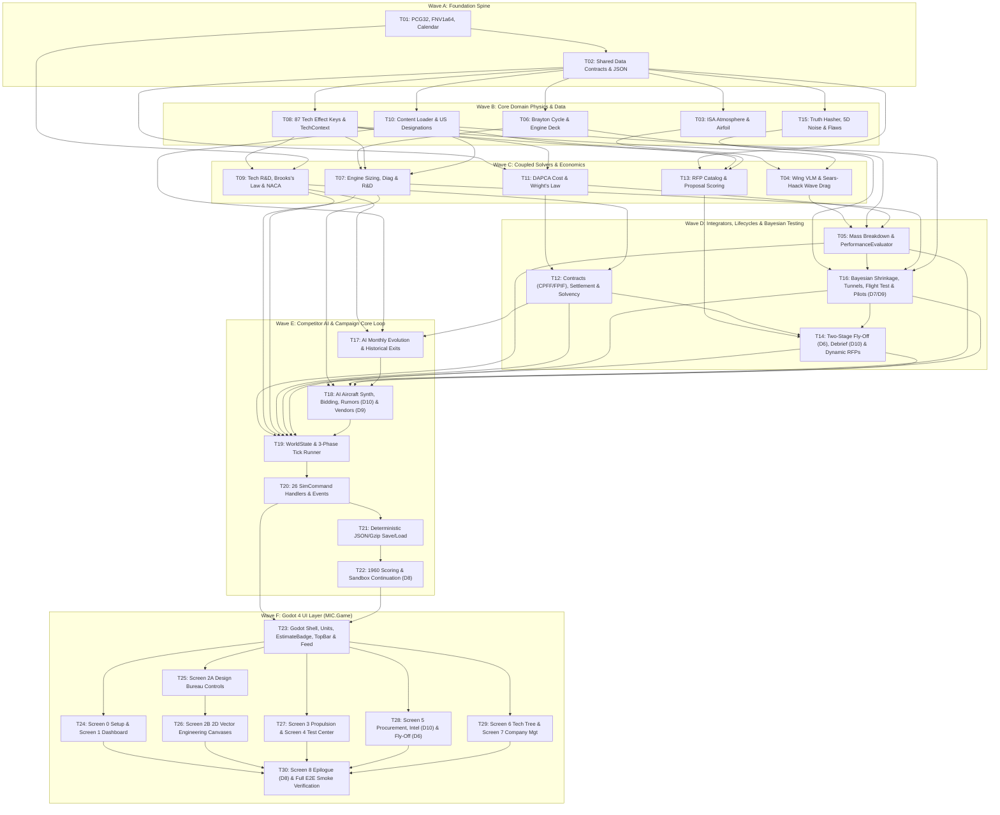

# 00 — Master Implementation Roadmap & Ticket Dependency DAG (T01–T30)

> **Status**: v1.0 (Wave 4 Ticket-Level Workplan Spine)
> **Target Stack**: .NET 8.0 (`net8.0`, C# 12) + Godot 4.3+ (.NET Edition) + xUnit 2.8+
> **Conforms to**: `docs/spec/00_conventions.md` v1.2 (Locked Decisions D1–D10) and Modules `01`–`10`
> **Oracle**: Python Reference Implementation (`sim/mic/`) & 19 Golden Test Vector Suites (`sim/golden/*.json`)

---

## 1. Purpose & Architectural Partition

Per Locked Decision **D1** (`docs/spec/00_conventions.md` §1), the production codebase is partitioned into three strictly isolated .NET 8 projects under a single root solution (`MilitaryIndustrialComplex.sln`):

1. **`src/MIC.Core/MIC.Core.csproj`**: Pure C# 12 simulation engine (`net8.0` class library). **Zero reference to `GodotSharp`**. Implements all deterministic math, data contracts, JSON loaders, and domain modules (`01` Aero/Perf, `02` Engines, `03` Tech Tree, `04` Economy, `05` Procurement, `06` Testing/Uncertainty, `07` Competitor AI, `09` Core Loop/RNG/Calendar/Save-Load, `10` Content/Designations).
2. **`tests/MIC.Core.Tests/MIC.Core.Tests.csproj`**: Headless xUnit test suite (`net8.0`). Mounts `sim/data/**/*.json` and `sim/golden/*.json` directly from the repository root and verifies that `MIC.Core` reproduces every Python golden vector within its specified relative/exact tolerance via `dotnet test`.
3. **`src/MIC.Game/MIC.Game.csproj`**: Godot 4.3+ C# UI & presentation assembly (`Godot.NET.Sdk/4.3.0`). References `MIC.Core`, reads simulation state exclusively through read-only interfaces (`IReadOnlyWorldState`), converts SI units to US Customary aviation units at render time (`Units.cs`), and mutates simulation state strictly by dispatching strongly-typed `SimCommand` (`PlayerAction`) records through `CampaignSessionNode`.

---

## 2. Target Repository & Solution Directory Layout

```text
military_industrial_complex_jet_age/
├── MilitaryIndustrialComplex.sln
├── docs/
│   ├── spec/                           # Authoritative Module Specifications (00..10)
│   ├── validation/                     # Calibration & Monte-Carlo Reports
│   └── workplan/                       # THIS FOLDER: Ticket-Level Implementation Plan (T01..T30)
│       ├── 00_master_roadmap.md
│       ├── T01_T05_foundation_and_aero.md
│       ├── T06_T10_engines_and_tech.md
│       ├── T11_T16_econ_procurement_testing.md
│       ├── T17_T22_ai_and_core_loop.md
│       └── T23_T30_godot_ui_screens.md
├── sim/                                # Python Reference Oracle (Read-Only Reference)
│   ├── data/                           # Canonical JSON Data (mounted by MIC.Core & MIC.Game)
│   └── golden/                         # 19 Golden Test Vector JSON Files (consumed by xUnit)
├── src/
│   ├── MIC.Core/                       # Pure C# Simulation Core (Tickets T01..T22)
│   │   ├── MIC.Core.csproj
│   │   ├── Random/                     # T01: Pcg32.cs, Fnv1a64.cs, RngStreamRegistry.cs, SplitMix64.cs
│   │   ├── Calendar/                   # T01: SimDate.cs, GameCalendar.cs, TickSchedule.cs
│   │   ├── Contracts/                  # T02: Estimate.cs, AircraftDesign.cs, EngineSpec.cs, PerformanceReport.cs,
│   │   │                               #      Requirement.cs, CompanyState.cs, HiddenFlaw.cs
│   │   ├── Data/                       # T02, T10: SimDataLocator.cs, JsonOptionsProvider.cs, UInt64HexConverter.cs
│   │   ├── Aero/                       # T03..T05: IsaAtmosphere.cs, AirfoilSolver.cs, WingVlmSolver.cs,
│   │   │                               #           WaveDragSolver.cs, DragBuildupSolver.cs, MassBreakdownSolver.cs,
│   │   │                               #           AeroDiagnosticsCalculator.cs, DesignValidator.cs
│   │   ├── Perf/                       # T05: PerformanceEvaluator.cs, MissionIntegrator.cs
│   │   ├── Engine/                     # T06..T07: BraytonCycleSolver.cs, InletRecoveryModel.cs, EngineDeck.cs,
│   │   │                               #           EngineSizingModel.cs, EngineDiagnosticsCalculator.cs,
│   │   │                               #           EngineRndEngine.cs, EngineCatalog.cs
│   │   ├── Tech/                       # T08..T09: TechEffectKey.cs, TechCatalog.cs, TechContext.cs,
│   │   │                               #           RequiredTechResolver.cs, TechResearchEngine.cs, CompanyTechState.cs
│   │   ├── Content/                    # T10: ContentCatalog.cs, DesignationGenerator.cs, LocalizationCatalog.cs
│   │   ├── Econ/                       # T11..T12: CostEstimator.cs, WrightLearningCurve.cs, ContractAccounting.cs,
│   │   │                               #           WorkforceModel.cs, ProductionLineModel.cs, CompanyMonthlySettlement.cs
│   │   ├── Procurement/                # T13..T14: ProgramCatalog.cs, ProposalEvaluator.cs, FlyOffLifecycleEngine.cs,
│   │   │                               #           DebriefGenerator.cs, DynamicRfpGenerator.cs, UnsolicitedProposalEngine.cs
│   │   ├── Testing/                    # T15..T16: TruthHasher.cs, ValueNoise5D.cs, FeatureExtractor.cs,
│   │   │                               #           FlawGenerator.cs, BayesianBeliefTracker.cs, TunnelCampaignRunner.cs,
│   │   │                               #           FlightTestRunner.cs, PilotRoster.cs, ServiceHazardRunner.cs
│   │   ├── AI/                         # T17..T18: AICompanyController.cs, AIDesignSynthesizer.cs, AIBiddingEngine.cs,
│   │   │                               #           PreBidRumorGenerator.cs, EngineVendorQuoter.cs
│   │   ├── Actions/                    # T20: SimCommand.cs, PlayerAction.cs, ActionCatalog.cs, ActionValidator.cs
│   │   └── Campaign/                   # T19..T22: WorldState.cs, CampaignRunner.cs, EventEngine.cs,
│   │                                   #           SaveLoadManager.cs, ScoringService.cs
│   └── MIC.Game/                       # Godot 4 C# UI Layer (Tickets T23..T30)
│       ├── project.godot
│       ├── MIC.Game.csproj
│       ├── Core/                       # T23: CampaignSessionNode.cs, IScreenPresenter.cs, LocalizationService.cs, AudioService.cs
│       ├── UI/                         # T23: Units.cs, Palette.cs, EstimateBadgeControl.cs, TopBarHudPresenter.cs,
│       │                               #      LeftNavDockPresenter.cs, RightEventFeedPresenter.cs
│       ├── Canvases/                   # T25..T26: EngineeringPlotCanvas.cs, Blueprint3ViewCanvas.cs,
│       │                               #           AirfoilSectionCanvas.cs, AreaRuleCanvas.cs, PsContourCanvas.cs,
│       │                               #           CashRunwayChartCanvas.cs, EngineCurveCanvas.cs, TechDagCanvas.cs, WrightsLawChartCanvas.cs
│       └── Screens/                    # T24..T30: Presenters & .tscn Scenes for Screens 0..8
└── tests/
    └── MIC.Core.Tests/                 # xUnit Golden Vector Test Suite (Tickets T01..T23)
        ├── MIC.Core.Tests.csproj
        ├── GoldenAssert.cs             # Helper for rel_tol / abs_tol recursive JSON & DTO assertions
        └── T01..T23_*Tests.cs
```

---

## 3. Exact `.csproj` Configurations

### 3.1 `src/MIC.Core/MIC.Core.csproj`
```xml
<Project Sdk="Microsoft.NET.Sdk">
  <PropertyGroup>
    <TargetFramework>net8.0</TargetFramework>
    <LangVersion>12.0</LangVersion>
    <Nullable>enable</Nullable>
    <ImplicitUsings>disable</ImplicitUsings>
    <Deterministic>true</Deterministic>
    <TreatWarningsAsErrors>true</TreatWarningsAsErrors>
    <RootNamespace>MIC.Core</RootNamespace>
  </PropertyGroup>
</Project>
```

### 3.2 `tests/MIC.Core.Tests/MIC.Core.Tests.csproj`
```xml
<Project Sdk="Microsoft.NET.Sdk">
  <PropertyGroup>
    <TargetFramework>net8.0</TargetFramework>
    <LangVersion>12.0</LangVersion>
    <Nullable>enable</Nullable>
    <IsPackable>false</IsPackable>
    <Deterministic>true</Deterministic>
  </PropertyGroup>
  <ItemGroup>
    <PackageReference Include="Microsoft.NET.Test.Sdk" Version="17.10.0" />
    <PackageReference Include="xunit" Version="2.8.1" />
    <PackageReference Include="xunit.runner.visualstudio" Version="2.8.1" />
  </ItemGroup>
  <ItemGroup>
    <ProjectReference Include="..\..\src\MIC.Core\MIC.Core.csproj" />
  </ItemGroup>
  <ItemGroup>
    <Content Include="..\..\sim\data\**\*.json" LinkBase="sim_data" CopyToOutputDirectory="PreserveNewest" />
    <Content Include="..\..\sim\golden\**\*.json" LinkBase="sim_golden" CopyToOutputDirectory="PreserveNewest" />
  </ItemGroup>
</Project>
```

### 3.3 `src/MIC.Game/MIC.Game.csproj`
```xml
<Project Sdk="Godot.NET.Sdk/4.3.0">
  <PropertyGroup>
    <TargetFramework>net8.0</TargetFramework>
    <LangVersion>12.0</LangVersion>
    <Nullable>enable</Nullable>
    <EnableDynamicLoading>true</EnableDynamicLoading>
    <RootNamespace>MIC.Game</RootNamespace>
  </PropertyGroup>
  <ItemGroup>
    <ProjectReference Include="..\MIC.Core\MIC.Core.csproj" />
  </ItemGroup>
</Project>
```

---

## 4. Ticket Dependency DAG (`T01`–`T30`)



---

## 5. Master Ticket Matrix (`T01`–`T30`)

| Ticket | Workplan File | Title & Scope | Depends On | Primary C# Namespace | Spec Ref | Golden Vector JSON (`sim/golden/`) | Tolerance |
|---|---|---|---|---|---|---|---|
| **T01** | `T01_T05_foundation_and_aero.md` | Deterministic `Pcg32`, `Fnv1a64`, `RngStreamRegistry`, `SimDate` & `GameCalendar` | — | `MIC.Core.Random`, `MIC.Core.Calendar` | `09` §§4.1–4.2, 5.1–5.2 | `core_rng_pcg32.json`, `core_calendar.json` | Int `0` (exact), Float `rel 1e-15` |
| **T02** | `T01_T05_foundation_and_aero.md` | Shared Data Contracts (`Estimate<T>`, `AircraftDesign`, `EngineSpec`, `PerformanceReport`, `Requirement`, `CompanyState`, `HiddenFlaw`) | `T01` | `MIC.Core.Contracts`, `MIC.Core.Data` | `00` §4.1–4.7 | Schema round-trip of `sim/data/**/*.json` | Exact |
| **T03** | `T01_T05_foundation_and_aero.md` | ISA 1976 Atmosphere & Parametric 2D Airfoil Solver (NACA 4/5/6, Biconvex, CST) | `T02` | `MIC.Core.Aero` | `01` §§5.1–5.2 | `aero_atmosphere_and_airfoil.json` | `rel 1e-6` |
| **T04** | `T01_T05_foundation_and_aero.md` | 16-Panel Weissinger VLM, Sears–Haack Wave Drag $A(x)$ & Transonic Drag Rise | `T03`, `T08` | `MIC.Core.Aero` | `01` §§5.3–5.4 | `perf_historical_reports.json` (aero sub-vectors) | `rel 1e-6` |
| **T05** | `T01_T05_foundation_and_aero.md` | Structural Mass Breakdown, Mission Integration, `AeroDiagnostics` & `PerformanceEvaluator.Evaluate` | `T04`, `T06`, `T11` | `MIC.Core.Aero`, `MIC.Core.Perf` | `01` §§5.5–5.6, 8 | `perf_historical_reports.json` | `rel 1e-6` |
| **T06** | `T06_T10_engines_and_tech.md` | Brayton 1D Thermodynamic Cycle Solver, Inlet Recovery & Off-Design Operating Deck | `T02` | `MIC.Core.Engine` | `02` §§5.1–5.5 | `engine_cycle_sls.json`, `engine_deck_queries.json` | `rel 1e-6` |
| **T07** | `T06_T10_engines_and_tech.md` | Engine Sizing, Duane MTBF, `EngineDiagnostics` & In-House/Custom R&D Engine | `T06`, `T08`, `T10` | `MIC.Core.Engine` | `02` §§5.6–5.7 | `engine_cycle_sls.json`, `engine_rnd_and_diagnostics.json` | `rel 1e-6` |
| **T08** | `T06_T10_engines_and_tech.md` | 87 Canonical Tech Effect Keys, `TechCatalog` DAG, `TechContext` & `RequiredTechResolver` | `T02` | `MIC.Core.Tech` | `03_keys` §§1–3, `03` §§4, 5.6 | `tech_context_start_1945.json`, `tech_aggregation_and_required.json` | `rel 1e-6` |
| **T09** | `T06_T10_engines_and_tech.md` | Daily/Monthly Tech R&D, Ahead-of-Time Penalty, Brooks's Law, NACA Diffusion & Maturity | `T01`, `T08` | `MIC.Core.Tech` | `03` §§5.1–5.5 | `tech_research_and_maturity.json` | `rel 1e-6` |
| **T10** | `T06_T10_engines_and_tech.md` | Historical Content Loader (`companies`, `designers`, `names`) & Pre-1962 US Designation Generator | `T02` | `MIC.Core.Content` | `10` §§4–5 | `sim/data/names/*.json`, `sim/data/companies/*.json` | Exact |
| **T11** | `T11_T16_econ_procurement_testing.md` | DAPCA-IV / RAND RDT&E & Flyaway Cost Estimator + Wright's Law & Anderlohr Setback | `T02`, `T08` | `MIC.Core.Econ` | `04` §§5.1–5.2, 5.4 | `econ_cost_historical.json`, `econ_contracts_and_settlement.json` | `rel 1e-6` |
| **T12** | `T11_T16_econ_procurement_testing.md` | Contract Accounting (`CPFF`, `FPIF`, `FFP`), Workforce Brooks's Law, Monthly Settlement & Solvency | `T09`, `T11` | `MIC.Core.Econ` | `04` §§5.3, 5.5 | `econ_contracts_and_settlement.json` | `rel 1e-6` |
| **T13** | `T11_T16_econ_procurement_testing.md` | Pentagon RFP Catalog, Threshold/Objective Utility, Skepticism Haircut & Credibility $C$ | `T02`, `T08`, `T10` | `MIC.Core.Procurement` | `05` §§4, 5.1–5.5 | `procurement_scoring_vectors.json` | `rel 1e-6` |
| **T14** | `T11_T16_econ_procurement_testing.md` | Two-Stage Fly-Off Lifecycle (D6), Debrief Report (D10), Promise Audit, Lot Reviews & Dynamic RFPs | `T12`, `T13`, `T16` | `MIC.Core.Procurement` | `05` §§5.6–5.11 | `procurement_lifecycle_vectors.json`, `procurement_dynamic_vectors.json` | `rel 1e-6` |
| **T15** | `T11_T16_econ_procurement_testing.md` | Counter-Based Truth Hashing, 5D Value Noise, 13-Feature Novelty & 34 Hidden Flaw Generator | `T01`, `T02` | `MIC.Core.Testing` | `06` §§4.2, 5.1–5.3 | `testing_hashing_vectors.json`, `testing_truth_and_flaws.json` | `rel 1e-6` |
| **T16** | `T11_T16_econ_procurement_testing.md` | Conjugate Bayesian `Estimate` Shrinkage, Wind Tunnels, 6-Item/4-Phase Flight Syllabus, Pilots (D9) & Fog-of-War (D7) | `T05`, `T07`, `T10`, `T15` | `MIC.Core.Testing` | `06` §§5.4–5.8 | `testing_bayesian_progression.json`, `testing_flight_programme_run.json` | `rel 1e-6` |
| **T17** | `T17_T22_ai_and_core_loop.md` | AI Airframer Monthly Evolution, Chief Designer Succession, Doctrine R&D & Historical Exits | `T09`, `T10`, `T12` | `MIC.Core.AI` | `07` §§4.1, 5.1 | `ai_competitor_behaviors.json` (part 1) | `rel 1e-6` |
| **T18** | `T17_T22_ai_and_core_loop.md` | AI Parametric Aircraft Synthesizer, Bidding/Fly-Off AI (D6), Pre-Bid Rumors (D10) & Engine Vendors (D9) | `T05`, `T07`, `T14`, `T16`, `T17` | `MIC.Core.AI` | `07` §§4.2–4.3, 5.2–5.5 | `ai_competitor_behaviors.json`, `ai_rumors_and_vendors.json` | `rel 1e-6` |
| **T19** | `T17_T22_ai_and_core_loop.md` | `WorldState`, `ISimModule` Adapter Registry & 3-Phase Canonical Tick Runner (Monthly, FY, Daily) | `T05`, `T07`, `T09`, `T12`, `T14`, `T16`, `T18` | `MIC.Core.Campaign` | `09` §§4.4, 5.3 | `core_campaign_smoke.json` | Exact SHA-256 / `rel 1e-6` |
| **T20** | `T17_T22_ai_and_core_loop.md` | 26 `SimCommand` / `PlayerAction` Schema & Domain Validators + Scripted/MTTH `EventEngine` | `T19` | `MIC.Core.Actions`, `MIC.Core.Campaign` | `09` §§4.3, 4.5, 4.7 | `core_campaign_smoke.json` | Exact |
| **T21** | `T17_T22_ai_and_core_loop.md` | Deterministic Versioned JSON / Gzip `SaveLoadManager`, NaN Guard & Rotating Autosaves | `T20` | `MIC.Core.Campaign` | `09` §§4.6, 7 | `core_campaign_smoke.json` (`save_load_split_1945_seed_777`) | Exact SHA-256 match |
| **T22** | `T17_T22_ai_and_core_loop.md` | Insolvency / 24-Month Takeover Checks, `1960-12-31` Victory `ScoringService` & Sandbox Continuation (D8) | `T21` | `MIC.Core.Campaign` | `09` §§3.1, 5.4 | `core_campaign_smoke.json` (`full_mvp_1945_1960_seed_1945`) | `rel 1e-6` |
| **T23** | `T23_T30_godot_ui_screens.md` | Godot 4 Project Shell, `Units` Helper, `EstimateBadgeControl`, `TopBarHUD`, `LeftNavDock` & `RightEventFeed` | `T20`, `T22` | `MIC.Game.Core`, `MIC.Game.UI` | `08` §§1–3 | `UnitsTests.cs` (25 unit key conversions) | `rel 1e-6` |
| **T24** | `T23_T30_godot_ui_screens.md` | Screen 0 (`NewCampaignScreen` + D4/D6/D7 Toggles) & Screen 1 (`ExecutiveDashboardScreen` + Cash Runway Chart) | `T23` | `MIC.Game.Screens` | `08` §§4.0–4.1 | Headless presenter binding tests | Exact |
| **T25** | `T23_T30_godot_ui_screens.md` | Screen 2 Part A: `DesignBureauScreen` Parametric Controls, Tech-Cap Clamping & `<2ms` Live Preview | `T23` | `MIC.Game.Screens` | `08` §4.2 | Headless draft-buffer & command dispatch tests | Exact |
| **T26** | `T23_T30_godot_ui_screens.md` | Screen 2 Part B: 2D Vector Canvases (`Blueprint3ViewCanvas`, `AirfoilSectionCanvas`, `AreaRuleCanvas`, `PsContourCanvas`) | `T25` | `MIC.Game.Canvases` | `08` §4.3 | Polyline/contour vertex generation tests | `rel 1e-5` |
| **T27** | `T23_T30_godot_ui_screens.md` | Screen 3 (`PropulsionScreen` + D9 Vendor Modal) & Screen 4 (`TestCenterScreen` + D7 Fog-of-War + D9 Pilots) | `T23` | `MIC.Game.Screens` | `08` §§4.4–4.5 | Presenter & command payload tests | Exact |
| **T28** | `T23_T30_godot_ui_screens.md` | Screen 5 (`ProcurementScreen` + D10 Pre-Bid Rumor Cards + D6 Fly-Off Tracker + D10 Debrief Modal) | `T23` | `MIC.Game.Screens` | `08` §4.6 | Presenter & command payload tests | Exact |
| **T29** | `T23_T30_godot_ui_screens.md` | Screen 6 (`TechTreeScreen` 82-Node Full-Visibility DAG, D7) & Screen 7 (`CompanyManagementScreen` + Wright's Law) | `T23` | `MIC.Game.Screens` | `08` §§4.7–4.8 | Presenter & command payload tests | Exact |
| **T30** | `T23_T30_godot_ui_screens.md` | Screen 8 (`CampaignEpilogueModal` + D8 Sandbox Continuation) & Full 26-Command E2E Integration Verification | `T24`..`T29` | `MIC.Game.Screens` | `08` §§4.9, 5 | Full 1945–1960 + Post-1960 Sandbox E2E test | 100% Pass |

---

## 6. Non-Negotiable Engineering Laws & Definition of Done

1. **Double-Precision IEEE-754 Only**: Use `double` (`System.Math`) for all simulation arithmetic in `MIC.Core`. Never use `float` or `MathF` in `MIC.Core`.
2. **Deterministic Collection Ordering**: Whenever iterating over a `Dictionary<string, T>` or `HashSet<string>` in `MIC.Core`, sort keys explicitly via `.OrderBy(k => k, StringComparer.Ordinal)` so RNG consumption and floating-point summation orders match Python's `sorted(...)` bit-for-bit.
3. **64-Bit RNG Hex Serialization**: All `ulong` states in `Pcg32` and `RngStreamRegistry` must serialize as `"0x"` + 16 lowercase hex digits (`$"0x{val:x16}"`) to prevent JSON `double` 53-bit truncation.
4. **Zero Hard-Coded Display Names (Decision D4)**: `MIC.Core` stores only canonical IDs and localization keys (`company.lockheed.name`, `tech.aero_1952_whitcomb_area_rule.name`). `MIC.Game` resolves all display text via `LocalizationService.TrKey(key)` backed by `sim/data/names/*.json`.
5. **Definition of Done**:
   - `dotnet build MilitaryIndustrialComplex.sln -c Release -warnaserror` succeeds with **0 warnings, 0 errors**.
   - `dotnet test tests/MIC.Core.Tests/MIC.Core.Tests.csproj -c Release` passes **100% of unit and golden-vector tests across all 19 `sim/golden/*.json` files**.
   - All 10 Locked Decisions (**D1–D10**) are verified by dedicated automated tests.
